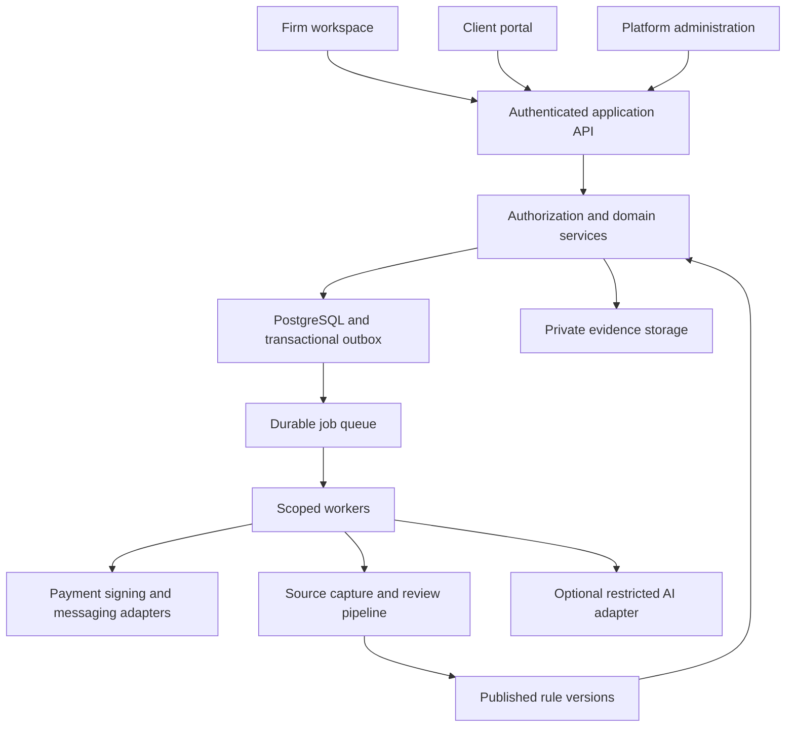

# Casevoya Architecture

Version 1.1 · 14 October 2026 · Proposed implementation blueprint, not a deployed system.

Read [RULES.md](RULES.md) for grounding and professional boundaries, [PRD.md](PRD.md) for behavior, and [DESIGN.md](DESIGN.md) for interface contracts. This file defines technical defaults and the source-governance extension required by the owner.

## 1 Architecture decisions

| Decision | Proposed default | Reason and revisit condition |
| --- | --- | --- |
| Delivery | Responsive web, three authenticated surfaces | Supports firms, clients and platform operations without native-app dependency |
| Codebase | TypeScript modular monolith | Strong domain boundaries with simpler deployment; split only after measured need |
| Web | Next.js and React with shared accessible components | One application stack; verify current official framework guidance at implementation |
| Server | Route handlers calling domain services, plus dedicated workers | Business rules stay outside UI and transport layers |
| Database | Managed PostgreSQL in an approved Canadian region | Transactions, constraints and tenant isolation |
| Files | Private object storage in approved region | Versioned evidence, quarantine and signed retrieval |
| Queues | Managed durable queue and dead-letter queue | Reliable reminders, scan jobs, exports and callbacks |
| Payments | Firm-connected earned-fee checkout plus manual advance workflow | Preserve separate funds flows; automated advances gated by approval |
| Sources | Versioned official-source registry and reviewed rule packs | Enforce evidence-backed immigration behavior |
| AI | Optional adapter behind policy and review gates | Core work remains usable without AI |

Use supported stable library versions pinned in a lockfile after checking official documentation. No framework version or vendor contract has been procured by this documentation task. Retain PostgreSQL portability. Neon is not a default Canada-resident deployment; the initial PRD records the region limitation observed during research.

## 2 Logical system topology



The public marketing site reads approved public content only. It has no connection to client document stores through frontend credentials. Do not expose database or provider credentials in any browser bundle.

## 3 Repository layout

- `apps/web`: marketing routes, firm routes, client routes, admin routes, and API transport handlers.
- `apps/worker`: queue consumers, source monitoring, file processing, reconciliation, reminders and exports.
- `packages/domain`: application services, state transitions, finance rules, source gates and permission policies.
- `packages/db`: schema, migrations, transactions, tenant context and repositories.
- `packages/ui`: tokens, accessible primitives and product components based on DESIGN.md.
- `packages/contracts`: request/response schemas, events, validation and shared types.
- `packages/integrations`: provider adapters and sandbox clients.
- `packages/rule-packs`: schemas and synthetic fixtures; reviewed production packs are controlled releases.
- `packages/testing`: synthetic tenants, family relationships, financial fixtures and authorization tests.
- `infra`: deployment manifests, region policy, monitoring, backup and recovery configuration.
- `docs`: the six documents in this package.

These are target paths, not a claim that application code exists. Keep one source of truth for each domain rule. Browser validation improves usability; server validation controls correctness.

## 4 Domain ownership

| Module | Owns | Must not own |
| --- | --- | --- |
| Identity and tenancy | Sessions, memberships, roles, grants | Professional licence decisions without evidence |
| Practice | Firm settings, credentials, onboarding, succession | Government outcomes |
| CRM and scheduling | Leads, consent, consultation bookings | Full legal eligibility conclusions |
| Matters | Parties, workflow, assignments, deadlines, closure | Bank settlement state |
| Evidence | Facts, documents, versions, reviews, custody | Silent overwriting of submitted evidence |
| Content governance | Sources, rule versions, effective dates, professional review | Autonomous legal interpretation |
| Agreements | Templates, parties, executed documents, signature events | Assuming government signature validity |
| Preparation | Form mappings, package manifests, approvals | Direct submission without authorized integration |
| Finance | Invoices, allocations, client subledgers, reconciliation | Pooling protected money in platform accounts |
| Communications | Audience-scoped messages and notification delivery | Inferring recipient access from shared email alone |
| Integrations | Provider event validation and transport | Inventing successful external actions |
| Administration | Subscription, health, support grants, incidents | Default access to client content |

## 5 Identity and tenant isolation

A global User authenticates; Membership binds that identity to an Organization. Client Person records are tenant-local and may exist without login. A person connects to a user only through verified invitation or reviewed identity linkage. Sharing an email does not merge people. Cross-firm access requires separate membership and explicit workspace selection.

Evaluate authorization using actor, organization, role, assigned matter, party relationship, data category, document audience, purpose, and time-limited grants. A sponsor, payer, employer, guardian, and adult dependant are separate relationship types. A firm owner is not automatically a licensed consultant.

Use server authorization plus PostgreSQL RLS as defense in depth. Set tenant context with transaction-local settings on non-owner connections. Do not trust a request-supplied organization ID. Background jobs set context from authenticated stored job records. Test pooled-connection reuse, search, exports, storage links, metrics and vector retrieval for cross-tenant leakage.

Conceptual database policy:

```sql
ALTER TABLE matter ENABLE ROW LEVEL SECURITY;
ALTER TABLE matter FORCE ROW LEVEL SECURITY;
CREATE POLICY matter_tenant_policy ON matter
  USING (organization_id =
    NULLIF(current_setting('app.organization_id', true), '')::uuid)
  WITH CHECK (organization_id =
    NULLIF(current_setting('app.organization_id', true), '')::uuid);
```

This illustrates tenant filtering only. Matter assignment and person-level permissions require additional policy enforcement. Set context inside an explicit transaction and reset it by transaction completion. Migration and maintenance credentials are separate and audited. Do not give the application role BYPASSRLS.

## 6 Data model

The complete core entity inventory is in PRD section 18. Use UUID keys, UTC instants, explicit local calendar dates, date precision, integer minor units for money, ISO currency, record versions, and tenant-scoped foreign keys. Maintain append-only histories for facts, approvals, posted journal lines, published templates, and government-event verification.

Core relationships:

- Organization has many Memberships, Offices, Persons, Matters, subscriptions and integration connections.
- Matter has many MatterParties; each party refers to a tenant-local Person and a role.
- Document has immutable DocumentVersions; MatterDocument references allow reuse with explicit grants.
- FactVersion records source evidence or an intake answer; Package pins the exact fact and document versions used.
- Invoice has InvoiceLines and PaymentAllocations; posted JournalEntries link to underlying financial events.
- GovernmentEvent references evidence, verified status and deadlines; Decision records consultant-confirmed official outcome.
- RetentionPolicy and LegalHold control disposition of all related records and derivatives.

### Source governance tables

| Entity | Important fields |
| --- | --- |
| OfficialSource | id, publisher, canonical URL, allowed host, jurisdiction, content type, discovery status |
| SourceSnapshot | source_id, final URL, retrieved_at, published_at, modified_at, current_to, content hash, evidence storage reference, retrieval result |
| SourceDependency | parent snapshot, linked form or page, purpose, expected type, observed version |
| RuleDefinition | stable key, category, jurisdiction, program, owner, required facts |
| RuleVersion | definition_id, version, structured condition, output, exceptions, applicability, effective range, publication status |
| RuleEvidence | rule_version_id, snapshot_id, source section, limited excerpt or locator, interpretation notes |
| ProfessionalReview | rule_version_id, reviewer membership, reviewer credential snapshot, decision, time, rationale |
| RulePackVersion | jurisdiction, program, version, included rule versions, form mappings, signature policy, release manifest |
| MatterRuleBinding | matter_id, pack version, chosen context, reviewed_by, checked_at, recheck requirement |
| RuleImpact | changed source or version, affected matter, reason, owner, disposition |
| SourceCheckAttempt | source_id, attempted_at, result, HTTP metadata, change signal, error, next retry |

Official public source records may be global. They must not contain client data or firm-private interpretation. Firm overrides, internal notes, matter bindings, review assignments, and impact records remain tenant-scoped. A firm's private interpretation cannot leak into another firm's AI retrieval.

Only a published, applicable, reviewed RuleVersion can drive regulated automation. Null effective dates or incomplete applicability produce a review-required state, unless a reviewer explicitly documents how applicability is established without a published effective date. Never substitute retrieved_at for a legal effective date.

## 7 Core state machines

Matter work stages, government status, engagement status, financial status, and outcome remain independent. Follow PRD section 7. A mutation specifies expected_version; stale writes fail with a conflict. Backward transitions require a reason and preserve history. An uploaded decision is not confirmed until verified.

Source state is Draft → Evidence captured → Professional review → Approved → Published, with Review due, Suspended, Superseded and Rejected branches. Published versions are immutable; edits create successors. A content author and professional approver are distinct responsibilities, even where one qualified individual holds both roles and that fact is recorded.

Signature state is Draft → Sent → Partially signed → Completed, with Declined, Expired, and Voided branches. Payment and refund states follow verified provider events plus reconciliation. Do not invent provider statuses; adapters map documented vendor states to domain states and preserve the original payload reference securely.

## 8 Source ingestion and rule execution

### Capture pipeline

Fetch only approved public URLs over HTTPS using an egress-controlled service. Resolve and validate IP addresses and redirects at every hop; block private, link-local, loopback and metadata endpoints. Set size, content-type, redirect, concurrency, and timeout limits. Follow permitted access and source licensing; do not automate login or scrape restricted government accounts.

Store retrieval result and content fingerprint separately from review status. Parse into inert text or a safe document representation. Malware-scan downloadable content. Never execute embedded scripts or instructions. Track linked forms separately. A page fetch with changed navigation is not necessarily a changed legal rule.

Monitoring produces a change candidate and review task. It cannot publish guidance, change active eligibility decisions, or update fees automatically. Capture both old and new evidence and identify affected rule bindings. Human review determines significance and effective applicability.

### Deterministic rules

Represent conditions as a constrained, schema-validated expression tree; never evaluate arbitrary JavaScript from database content. Inputs are approved facts with explicit unknown states. Outputs include checklist items, review flags, fee categories or guidance references, together with rule IDs and source versions. Avoid definitive eligibility decisions unless the supported scope and professional review explicitly permit the function.

Example evaluation contract:

```json
{
  "matterId": "synthetic-matter-id",
  "rulePackVersionId": "synthetic-pack-version",
  "asOf": "2026-10-14",
  "result": "needs_review",
  "reasonCodes": ["NO_PUBLISHED_APPLICABLE_RULE"],
  "sourceReferences": [],
  "proposedActions": [],
  "requiresConsultant": true
}
```

This is a synthetic failure contract, not a real immigration decision. Test unknown facts, effective-date boundaries, version changes, exceptions, and conflicting sources. Every material output retains its evidence chain.

## 9 Documents and submission packages

1. Authenticate upload intent and confirm matter/person permission, file type, size and quota.
2. Issue a short-lived upload authorization to a quarantine prefix with an unguessable key.
3. Verify completion, server-side size and checksum; never trust client declarations alone.
4. Scan, classify, generate inert previews, and optionally extract candidate fields in a worker.
5. Preserve originals and transformations with hashes. Failed or suspicious files remain quarantined.
6. Reviewers accept or request changes; accepted facts reference exact evidence versions.
7. Preparation builds a manifest of form, fact, document, source-rule and approval versions.
8. Release validates active reviewer scope, client confirmations, current applicable rule checks and manifest integrity.
9. An authorized representative completes the official-channel handoff; the platform records receipt evidence.

Downloads reauthorize the user before issuing a short-lived URL. Deleting a shared document reference cannot erase evidence needed by another retained matter. An edited document invalidates only dependent approvals but preserves historical releases.

## 10 Financial integrity

Use separate payment configurations for the platform's SaaS invoices and each firm's client fees. Hosted checkout avoids card storage. Client advances use approved bank instructions with manual recording until an automated funds flow has been approved. A connected processor account is not automatically an approved client account.

Record provider event identity, account, amount, currency, signature verification, processing state, and secure raw-event reference. Deduplicate by provider plus connected account plus event ID. Use a transactional inbox and reconciliation to handle delayed or reordered delivery.

A database transaction posts balanced journals and the corresponding domain event. Posted journals are immutable; corrections reverse and replace. Lock the relevant client balance during allocation or transfer approval. Cross-currency allocation is rejected in the initial product. Do not count pending manual deposits as available funds.

For client funds, maintain bank control, per-client subledger and reconciliation records. Earned-fee transfer requires delivered-service evidence, a permissible invoice, funds availability, approval, and bank movement evidence. Three-way reconciliation compares adjusted statement balance, control ledger and total client subledgers. Validate account treatment with the practice's accountant.

## 11 API contracts

Core endpoints are listed in PRD section 20. Use /api/v1, authenticated workspace context, schema validation, request IDs, cursor pagination, rate limits and optimistic versioning. Financial and externally visible mutations require idempotency keys scoped by tenant, actor, endpoint and semantic payload hash. Reusing a key with a different payload must fail.

Add these source-governance endpoints:

| Endpoint | Permission and behavior |
| --- | --- |
| GET /official-sources | Read reviewed metadata; no secret URLs or client evidence |
| POST /source-checks | Content operator queues an allowed source fetch |
| GET /rule-versions/{id}/evidence | Authorized source reviewer sees provenance and interpretation |
| POST /rule-versions | Content author creates a draft with expected scope |
| POST /rule-versions/{id}/reviews | Qualified reviewer records a decision against exact version |
| POST /rule-packs/{id}/publish | Publisher validates evidence, reviewer scope, tests and effective date |
| GET /matters/{id}/rule-impact | Assigned staff see changes affecting the matter |
| POST /matters/{id}/rule-bindings | Consultant adopts a reviewed version with rationale |
| POST /packages/{id}/readiness | Evaluate current source and evidence gates without submission |

Readiness response contains ready, blockingIssues, warnings, checkedRuleVersionIds, packageHash, and evaluatedAt. A later mutation changing dependencies invalidates readiness. Final approval repeats the checks inside its transaction; the UI cannot reuse an old ready=true response as authority.

## 12 Events queues and race conditions

Persist domain updates and outbox entries in one transaction. Workers publish and process at least once; consumers deduplicate. Events contain IDs and minimum metadata rather than complete case documents. Source events include source.changed, source.check_failed, rule.review_due, rule.published, and matter.rule_impact_detected.

Before a delayed job sends a reminder, recheck task status, recipient permission, current deadline, timezone, notification preferences, and delivery history. Before an export completes, recheck the requester's access. If a grant was revoked, stop delivery and delete the transient export according to policy.

Use retry backoff, a bounded attempt count, dead-letter queues, alerts and human replay controls. A successful replay must not double-send a message or repost a financial entry. Reconcile provider records independently of callbacks. Record cancellations for obsolete jobs instead of silently dropping operational evidence.

## 13 AI architecture

Use an application gateway to enforce allowed model operations, data minimization, tenant permissions, source freshness, output schemas and cost budgets. Retrieve only authorized evidence and published applicable rules. Generation is draft-only. Returned citations must resolve to retrieved versions and support the claim; a model-generated URL is not accepted automatically.

AI has no direct financial, role-management, signature, or government-submission capabilities. Human review converts an accepted draft into a new domain action using ordinary permissions. Store disposition and provenance, not an unrestricted cross-tenant chat log. Disable providers that cannot meet the firm's processing and retention requirements.

## 14 Hosting security and operations

Proposed core deployment uses Canadian-region compute, PostgreSQL, object storage, queues and backups. Confirm availability, contract and residency for each provider before selecting it. Identity, messaging, signing, payments, telemetry and AI may have different processing locations; disclose and review them separately. Do not advertise Canada-only processing unless the full data path supports it.

Use separate environments, private database networking, managed secrets, key rotation, restricted service identities, encrypted storage and transport, WAF/rate limits, redacted telemetry and dependency scanning. Audit sensitive access and all material mutations. Support access requires a scoped expiring grant with visible reason and firm oversight.

Retention applies to originals, previews, OCR, extracted facts, AI outputs, exports, caches, logs and backups. Holds prevent destruction. Maintain deletion tombstones and reapply them after restore. Configure different retention purposes rather than applying one duration to every data type.

Targets remain those in the PRD: 99.9 percent core availability, tested RPO within 15 minutes and RTO within 4 hours, plus meaningful queue and export targets. These are proposed objectives to demonstrate, not achieved results. Monitor authentication failures, authorization denials, queue delay, dead letters, source staleness, pending refunds, reconciliation variance and failed backups.

## 15 Testing and release

Use unit tests for deterministic rules and money, integration tests for transactions/RLS/provider signatures, contract tests for adapters, and end-to-end tests for core journeys. Include cross-tenant, family privacy, source-provenance, stale-rule, unknown-fact, daylight-saving, duplicate-event, package-integrity, and restore scenarios.

Release flow: validate → migrate safely → deploy behind feature flag → synthetic smoke checks → controlled tenant rollout → monitor → expand. Preserve backward compatibility during schema changes. A rollback of code must not erase financial or audit history. Template and rule rollback publishes a reviewed successor or restores a version only when still applicable; it does not change legal reality.

Before production: approved source and program packs, demonstrated backups/restoration, independent security review, accountant-reviewed finance, verified contracts and funds flow, tested continuity/export, and pilot acceptance. No third-party government API, named vendor contract, production account, or compliance certification is assumed.
