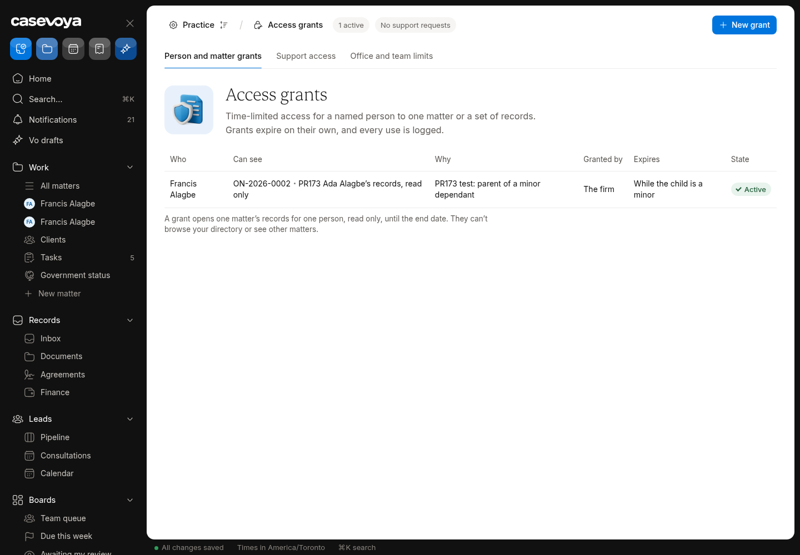
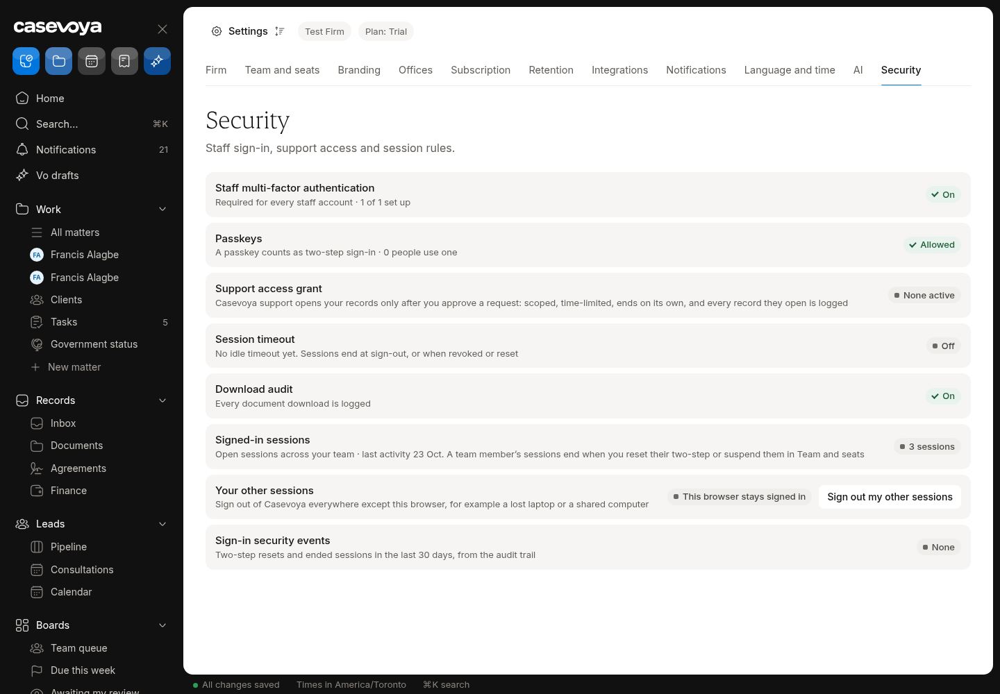

# ADM (Platform admin): partly built requirements

Requirements: ADM-04. Source: `docs/spec/PRD.md`, status from the PRD status review of main 6d5e54f (rechecked against aac7804, which adds only #173). UI checked on https://app.casevoya.ca on 2026-10-23.

Rules for whoever builds this: test mode only for Stripe (never live keys); new migrations go in `supabase/migrations/` and are applied by Francis, not by the builder; immigration content (rules, fees, forms, document lists, dates) is built from official IRCC / Government of Canada sources, with the source URL and retrieval date stored with each value (see **Official sources** below); wording follows `docs/spec/DECISIONS.md` and the design system.

## Official sources (applies to everything in this file)

Francis's direction: build the real content using accurate, current information from IRCC. Don't build placeholder, sample or example rules, fees, dates, forms or sources.

- Use only official IRCC / Government of Canada sources:
  - IRCC home: https://www.canada.ca/en/immigration-refugees-citizenship.html
  - Application forms and guides (form numbers and "date modified"): https://www.canada.ca/en/immigration-refugees-citizenship/services/application/application-forms-guides.html
  - IRCC fee list: https://ircc.canada.ca/english/information/fees/fees.asp
  - Processing times: https://www.canada.ca/en/immigration-refugees-citizenship/services/application/check-processing-times.html. IRCC says these times are "not a maximum or a guarantee", so show them as IRCC's estimate with the date checked.
  - Program pages and instruction guides on canada.ca for each program.
  - Where relevant, Justice Laws: IRPA https://laws-lois.justice.gc.ca/eng/acts/I-2.5/ and IRPR https://laws-lois.justice.gc.ca/eng/regulations/SOR-2002-227/. Record the "current to" date shown on the page.
- **Store the source with every value.** Every rule, fee, form, document list, deadline or date stores:
  - its official source URL, with the section or anchor;
  - the form number and the form's "date modified" where it applies;
  - the date it was retrieved, plus a snapshot hash;
  - the effective or "current to" date when the page states one.

  Store these with the rule or claim (SRC-01/02). Show them in the UI next to the value.
- **No invented values.** If something can't be found on an official page, leave it out, show it as Unknown where the UI needs a slot, and list it in your `## Handoff` comment. Don't guess.
- **Review before live.** Content goes live only through the licensed-reviewer approval (SRC-03). Matters pin the version they used (SRC-05). Vo cites these sources or abstains (SRC-09, AI-01).
- Spot check (retrieved 2026-10-23 from the fee list above):
  - "Study permit (including extensions) – per person" is $150.00.
  - "Right of permanent residence fee" is $600.00.

  Use the live page at build time, not these numbers.

## ADM-04: Onboarding, incidents, SLA

> **PRD ADM-04:** Support onboarding tasks, permissioned troubleshooting, tenant incident notices, and service-level reporting. Aggregate product analytics use operational metadata and exclude immigration narratives, identity numbers, uploaded documents, and message bodies.

**UI check:** partly present (route: /sheet/settings?tab=security, platform admin)

- What's there: Onboarding checklist for new firms; permissioned support access (grant/revoke, audited).
- What's missing on screen: No tenant incident / service notices shown to firms; no service-level (uptime/response) reporting; analytics exclusion not documented on screen.

**Built today**

- Firm onboarding (`src/modules/firm-onboarding/`)
- Support access grants

**Missing (acceptance criteria)**

- [ ] **Service notices**: platform staff post a notice (maintenance/incident) targeted to all or some firms; firms see a banner and a history page.
- [ ] **Service level report**: monthly uptime and support response times per firm (from real monitoring data or marked unavailable).
- [ ] Product analytics uses metadata only (documented in code and settings copy).

**Likely migration:** Yes: `service_notices` (+ reads).

**UI test steps**

1. Post a test notice to Test Firm only: banner appears for Test Firm staff, not other firms.

**Open PRs:** Not covered by any open PR.

