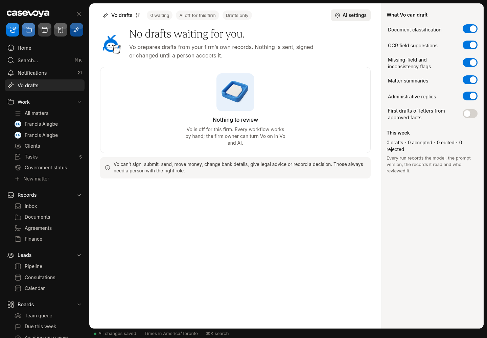
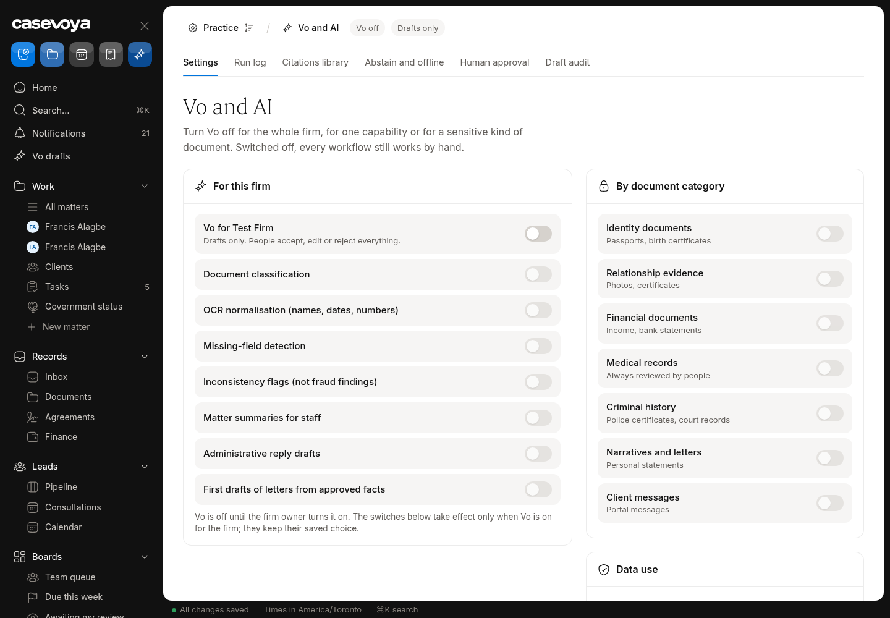

# AI (AI (Vo)): partly built requirements

Requirements: AI-01, AI-06. Source: `docs/spec/PRD.md`, status from the PRD status review of main 6d5e54f (rechecked against aac7804, which adds only #173). UI checked on https://app.casevoya.ca on 2026-10-23.

Rules for whoever builds this: test mode only for Stripe (never live keys); new migrations go in `supabase/migrations/` and are applied by Francis, not by the builder; immigration content (rules, fees, forms, document lists, dates) is built from official IRCC / Government of Canada sources, with the source URL and retrieval date stored with each value (see **Official sources** below); wording follows `docs/spec/DECISIONS.md` and the design system.

## Official sources (applies to everything in this file)

Francis's direction: build the real content using accurate, current information from IRCC. Don't build placeholder, sample or example rules, fees, dates, forms or sources.

- Use only official IRCC / Government of Canada sources:
  - IRCC home: https://www.canada.ca/en/immigration-refugees-citizenship.html
  - Application forms and guides (form numbers and "date modified"): https://www.canada.ca/en/immigration-refugees-citizenship/services/application/application-forms-guides.html
  - IRCC fee list: https://ircc.canada.ca/english/information/fees/fees.asp
  - Processing times: https://www.canada.ca/en/immigration-refugees-citizenship/services/application/check-processing-times.html. IRCC says these times are "not a maximum or a guarantee", so show them as IRCC's estimate with the date checked.
  - Program pages and instruction guides on canada.ca for each program.
  - Where relevant, Justice Laws: IRPA https://laws-lois.justice.gc.ca/eng/acts/I-2.5/ and IRPR https://laws-lois.justice.gc.ca/eng/regulations/SOR-2002-227/. Record the "current to" date shown on the page.
- **Store the source with every value.** Every rule, fee, form, document list, deadline or date stores:
  - its official source URL, with the section or anchor;
  - the form number and the form's "date modified" where it applies;
  - the date it was retrieved, plus a snapshot hash;
  - the effective or "current to" date when the page states one.

  Store these with the rule or claim (SRC-01/02). Show them in the UI next to the value.
- **No invented values.** If something can't be found on an official page, leave it out, show it as Unknown where the UI needs a slot, and list it in your `## Handoff` comment. Don't guess.
- **Review before live.** Content goes live only through the licensed-reviewer approval (SRC-03). Matters pin the version they used (SRC-05). Vo cites these sources or abstains (SRC-09, AI-01).
- Spot check (retrieved 2026-10-23 from the fee list above):
  - "Study permit (including extensions) – per person" is $150.00.
  - "Right of permanent residence fee" is $600.00.

  Use the live page at build time, not these numbers.

## AI-01: Optional AI capabilities

> **PRD AI-01:** Optional capabilities are document classification, OCR normalization, missing-field detection, inconsistency flags, matter summaries, administrative reply drafts, and first drafts of letters from approved facts. The firm can disable AI while using core functionality.

**UI check:** partly present (route: /sheet/settings (Vo), /sheet/matters/<matter id> (Vo panel))

- What's there: Vo: document classification and reading, missing-field and inconsistency flags, matter summary, reply drafts; firm switch to turn Vo off (core works without it).
- What's missing on screen: Not built: first drafts of **letters** from approved facts (e.g. submission/cover letter), **lead follow-up** drafts, **call notes** summaries.

**Built today**

- `src/modules/vo/` (#106, #118)

**Missing (acceptance criteria)**

- [ ] **Draft letter with Vo** on the matter (Drafts): uses only approved facts, cites each fact, labelled draft, licensed review required before release.
- [ ] **Lead follow-up draft** on a Lead page (respects marketing consent).
- [ ] **Call notes**: after a Casevoya video call, staff can paste/upload notes and get a summary draft (no recording unless CRM-03 recording exists).
- [ ] All respect the firm AI switch and category switches (AI-06).
- [ ] Letter drafts that mention program requirements, fees or dates cite the approved source version (official IRCC/Justice Laws URL + retrieved date) for each one; if there's no approved source, Vo leaves it out and says so.

**Likely migration:** Maybe: drafts table additions for source citations.

**UI test steps**

1. In a Vo-on test firm, Draft letter on a matter: draft lists cited facts; can't be released without licensed review. Turn Vo off: the buttons disappear; manual drafting works.

**Open PRs:** Not covered by any open PR.

## AI-06: AI vendor terms and switches

> **PRD AI-06:** Contractually evaluate vendor data use, retention, processing region, subprocessors, and deletion. Do not train on client records by default. AI must be independently switchable by firm and sensitive document category. A non-AI workflow remains available.

**UI check:** partly present (route: /sheet/settings (Vo / Integrations))

- What's there: Firm AI switch and sensitive-category switches; non-AI workflow remains; no training by default.
- What's missing on screen: No vendor-terms panel showing the AI vendor's data use, retention, processing region, subprocessors and deletion terms.

**Built today**

- Vo switches in `src/modules/vo/`

**Missing (acceptance criteria)**

- [ ] Settings > Vo: **AI vendor terms** panel (read from a reviewed config, not invented): vendor, data use (no training), retention, processing region, subprocessors, deletion; last reviewed date; link to the full terms.
- [ ] Owner must acknowledge the panel before first turning Vo on (audited).
- [ ] The vendor terms panel takes its content from the vendor's published terms/DPA (URL + retrieved date stored), not from invented text.

**Likely migration:** Maybe: acknowledgement column.

**UI test steps**

1. Settings > Vo shows the panel; turning Vo on asks for acknowledgement once; audit row.

**Open PRs:** Not covered by any open PR.

