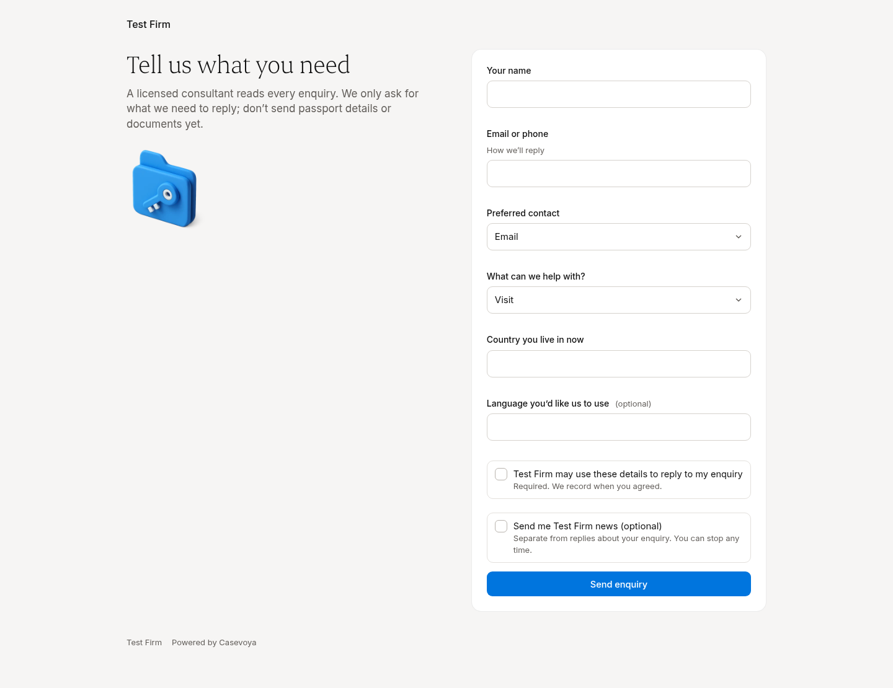
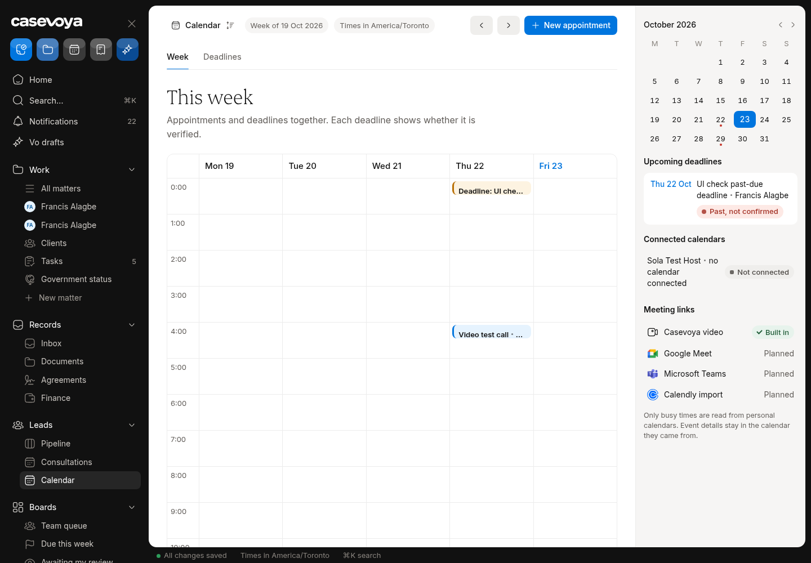
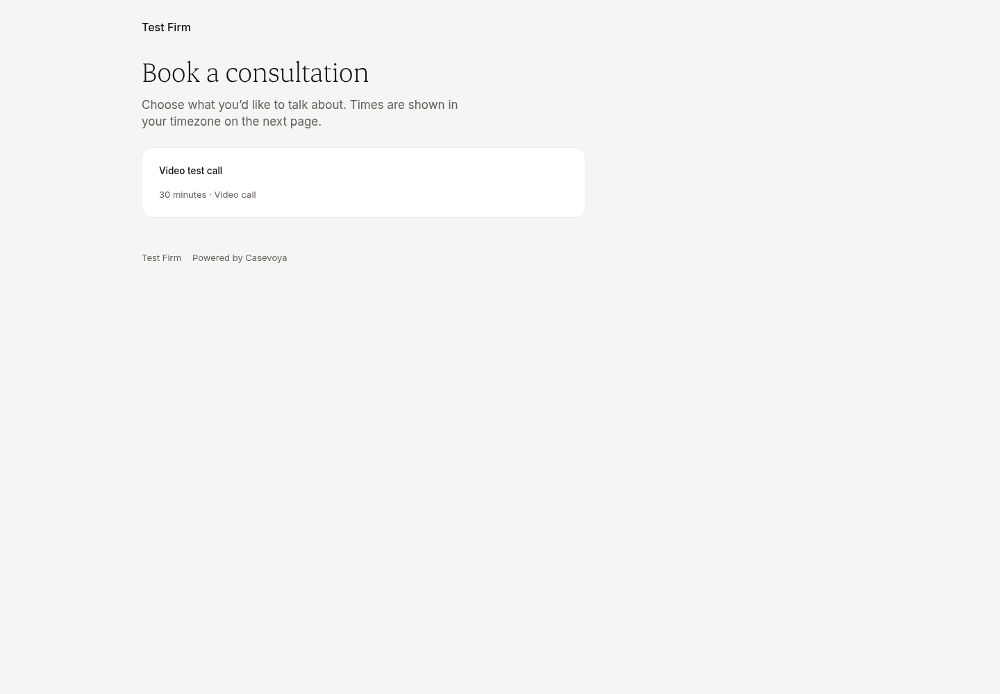

# CRM (Leads and consultations): partly built requirements

Requirements: CRM-01, CRM-03. Source: `docs/spec/PRD.md`, status from the PRD status review of main 6d5e54f (rechecked against aac7804, which adds only #173). UI checked on https://app.casevoya.ca on 2026-10-23.

Rules for whoever builds this: test mode only for Stripe (never live keys); new migrations go in `supabase/migrations/` and are applied by Francis, not by the builder; no invented immigration rules, fees or dates; wording follows `docs/spec/DECISIONS.md` and the design system.

## CRM-01: Enquiry forms and hosted page

> **PRD CRM-01:** Provide embeddable enquiry forms and a hosted firm-branded page. Collect name, preferred contact, broad service interest, current country, language, consent records, and source attribution. Defer passports and detailed sensitive histories until needed.

**UI check:** partly present (route: /enquiry/<firm slug>, /embed/enquiry/<firm slug>)

- What's there: Hosted page with name, email/phone, preferred contact, service interest, current country, language, required consent and optional marketing consent, honeypot; embed route.
- What's missing on screen: No link to the firm's privacy notice on the page; no Settings switch to turn the firm's enquiry page off; staff get no email when a new enquiry arrives (only the Pipeline shows it); no source-attribution field visible (UTM / referrer).

**Built today**

- `src/app/enquiry/[firm]/page.tsx`, `src/app/embed/enquiry/[firm]/page.tsx`, `src/app/api/enquiry/`
- `src/modules/leads/enquiry.ts`, `enquiry-page.ts`, `enquiry-present.ts`
- `supabase/migrations/20261020190000_enquiry_public_page.sql` (`submit_enquiry`, rate limit)

**Missing (acceptance criteria)**

- [ ] Enquiry page shows a "Privacy notice" link to a **public** read-only URL of the firm's published privacy notice (e.g. `/privacy/<firm slug>`); the same link is reused on `/book/<firm>` (DECISIONS open item).
- [ ] Settings (Integrations or a new "Enquiry page" card) has an on/off switch; when off, `/enquiry/<slug>` and the embed show a polite "not taking enquiries online" state and `submit_enquiry` refuses.
- [ ] A new enquiry sends a minimal-content staff email ("New enquiry for <firm>", link to Pipeline, no enquiry details) to the firm owner / lead owners; uses the outbox.
- [ ] Source attribution: capture `utm_*`, referrer and embed host into the lead's source fields; shown on the Lead page.

**Likely migration:** Yes: an `enquiry_page_enabled` flag on organizations (or a settings row) and source-attribution columns if absent; a public read function for the published privacy notice.

**UI test steps**

1. Open /enquiry/swe-video-test-firm-tk2aad signed out: Privacy notice link opens the firm's published notice.
2. Settings: turn the enquiry page off; reload the page: closed state; POST is refused. Turn back on.
3. Submit an enquiry with ?utm_source=test: lead appears in Pipeline with source; owner email logged (no details in body).

**Open PRs:** Not covered by any open PR.

## CRM-03: Appointments, availability, rescheduling

> **PRD CRM-03:** Provide appointments with staff availability, duration, buffer, timezone, rescheduling, cancellation, capacity, meeting link, and no-show status. Calendar connection is scoped to selected calendars. Concurrent booking must not allocate the same capacity twice.

**UI check:** partly present (route: /sheet/calendar, /sheet/consultations, /book/<firm slug>)

- What's there: Calendar week view with appointments and deadlines, connected-calendars panel, meeting links (Casevoya video built in; Google Meet / Teams / Calendly "Planned"). Public booking page lists booking types. Staff reschedule/cancel/no-show exist; LiveKit video (#141–#143).
- What's missing on screen: No tokenized "Manage your booking" page for a public booker without a portal (reschedule/cancel); a booker without a portal can't join the video call from the email link without signing in; no recording (BUILD-SPEC slice 8); Google Meet / Teams links still "Planned".

**Built today**

- `src/modules/scheduling/` (availability, slots, public-api, staff-actions, portal-actions, ics)
- `src/app/book/[firm]/[event]/page.tsx`, `src/app/call/[ref]/page.tsx`, `src/modules/video/`
- `supabase/migrations/20261019180100_scheduling_core.sql` (capacity, no double booking)
- `docs/calendar/BUILD-SPEC.md` slices 1–7

**Missing (acceptance criteria)**

- [ ] Booking confirmation email has a **Manage your booking** link (`/booking/<ref>?t=<token>`, hashed single-purpose token, expires after the appointment) letting the booker reschedule within the booking type's rules or cancel with a reason; no portal login required (BUILD-SPEC slice 5).
- [ ] The video call link works for a booker without a portal: `/call/<ref>` accepts the same booking token, shows a lobby with name check, and admits them only inside the join window.
- [ ] Recording (slice 8): off by default; only when the booking type allows it and both sides consent on screen; recording stored privately with retention; or, if Francis defers it, the Calendar shows "Recording: not available" (honest state).
- [ ] Staff Consultations record shows when the booker used Manage (rescheduled / cancelled by booker).

**Likely migration:** Yes: booking manage-token hash + expiry columns (and recording tables if slice 8 is built).

**UI test steps**

1. Book the "Video test call" on /book/swe-video-test-firm-tk2aad with a +alias email; open the email's Manage link in a signed-out browser: reschedule to another slot; staff Calendar shows the new time.
2. Cancel through Manage: slot frees up; staff record says cancelled by booker.
3. Open /call/<ref> from the email link signed out inside the join window: lobby admits; outside window: honest message.

**Open PRs:** #163 (draft) re-reads the Consultations page on tab return (polish only). #166 / #162 cover the consultation agreement and booking confirmation design. The Manage link, portal-less join and recording are not in any open PR.

