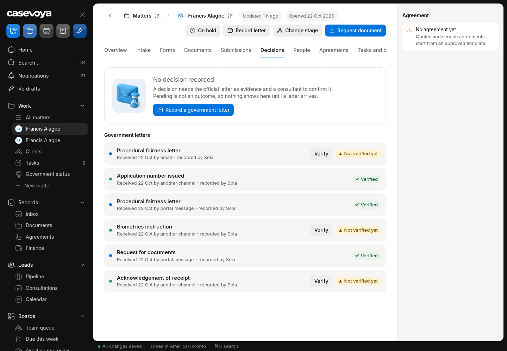

# DEC (Decisions): partly built requirements

Requirements: DEC-02. Source: `docs/spec/PRD.md`, status from the PRD status review of main 6d5e54f (rechecked against aac7804, which adds only #173). UI checked on https://app.casevoya.ca on 2026-10-23.

Rules for whoever builds this: test mode only for Stripe (never live keys); new migrations go in `supabase/migrations/` and are applied by Francis, not by the builder; no invented immigration rules, fees or dates; wording follows `docs/spec/DECISIONS.md` and the design system.

## DEC-02: Approval follow-up

> **PRD DEC-02:** Approved matters receive a program-specific follow-up checklist, document-delivery record, conditions summary approved by the consultant, relevant expiry reminders, and closure tasks. Renewal reminders require valid contact preferences and clearly defined scope for any new service.

**UI check:** partly present (route: /sheet/matters/<matter id>?tab=decisions, /sheet/matters/<matter id>?tab=closure)

- What's there: Decisions tab records outcomes; Closure tab has closure tasks; expiry reminders exist for documents.
- What's missing on screen: On approval, no program follow-up checklist, no **conditions summary** approved by the consultant, no **document delivery record** (what was sent to the client and when), no successor (renewal) control respecting contact preferences.

**Built today**

- `src/modules/decisions/`, `src/modules/closure/`

**Missing (acceptance criteria)**

- [ ] Recording an approval adds a follow-up checklist to the matter.
- [ ] **Conditions summary**: staff drafts, licensed consultant approves; the client sees the approved text in the portal.
- [ ] **Delivery record**: which decision documents went to the client, how and when (with acknowledgement).
- [ ] **Renewal reminder / successor matter**: only if the client's contact preferences allow; scope of any new service stated; creates a lead or draft matter, never auto-bills.

**Likely migration:** Yes: conditions summary + delivery record tables.

**UI test steps**

1. Record an approval on ON-2026-0008: follow-up checklist appears; draft and approve a conditions summary; client sees it; record delivery of the decision letter; set a renewal reminder (client opted in).

**Open PRs:** Not covered by any open PR.

