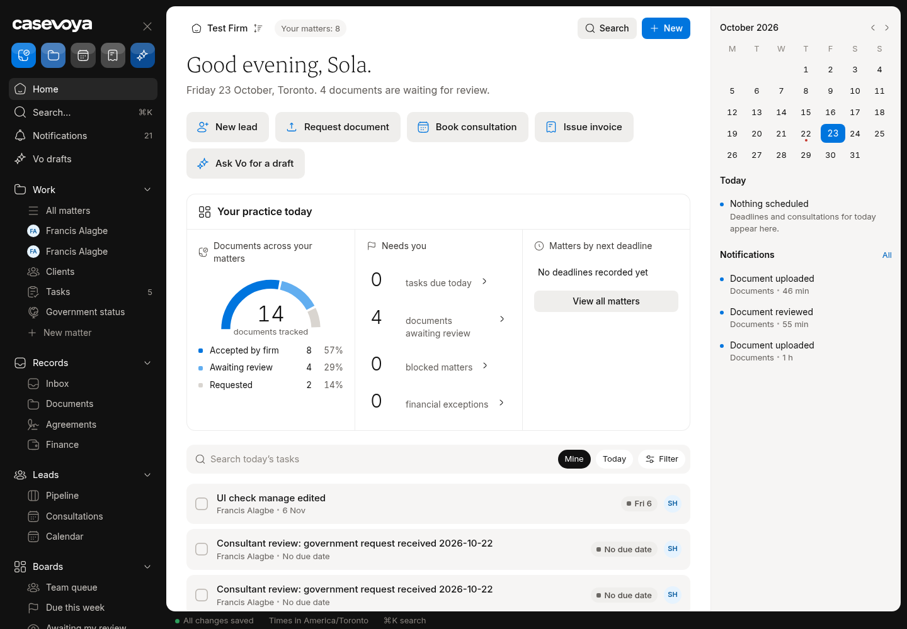

# DES (Design states): partly built requirements

Requirements: DES-04. Source: `docs/spec/PRD.md`, status from the PRD status review of main 6d5e54f (rechecked against aac7804, which adds only #173). UI checked on https://app.casevoya.ca on 2026-10-23.

Rules for whoever builds this: test mode only for Stripe (never live keys); new migrations go in `supabase/migrations/` and are applied by Francis, not by the builder; no invented immigration rules, fees or dates; wording follows `docs/spec/DECISIONS.md` and the design system.

## DES-04: Incomplete and failed states

> **PRD DES-04:** Represent incomplete and failed states. Provide useful loading, empty, partial, permission-denied, stale-source, failed-payment, and failed-upload states. Never fill missing real data with invented results.

**UI check:** partly present (route: All sheet pages and portal)

- What's there: Many pages have empty/loading states; portal loading/empty states from #173 (merged).
- What's missing on screen: No audit across the state matrix (loading, empty, partial, permission-denied, stale-source, failed-payment, failed-upload) on every page; some pages show blank tables.

**Built today**

- Existing empty states across `src/components/sheet/`

**Missing (acceptance criteria)**

- [ ] A state-matrix doc (`docs/spec/gaps/DES-04-matrix.md`) listing each staff and portal page × state, with status.
- [ ] Fill the gaps: permission-denied page, stale-source banner, failed-payment and failed-upload messages with next step; never invented data.

**Likely migration:** None.

**UI test steps**

1. Visit a page without permission: permission-denied view. Fail an upload (wrong type): clear message with retry. Stripe test declined card: failed-payment state.

**Open PRs:** #173 (merged to main as aac7804 on 2026-10-23) adds portal loading/empty states (portal side only).

