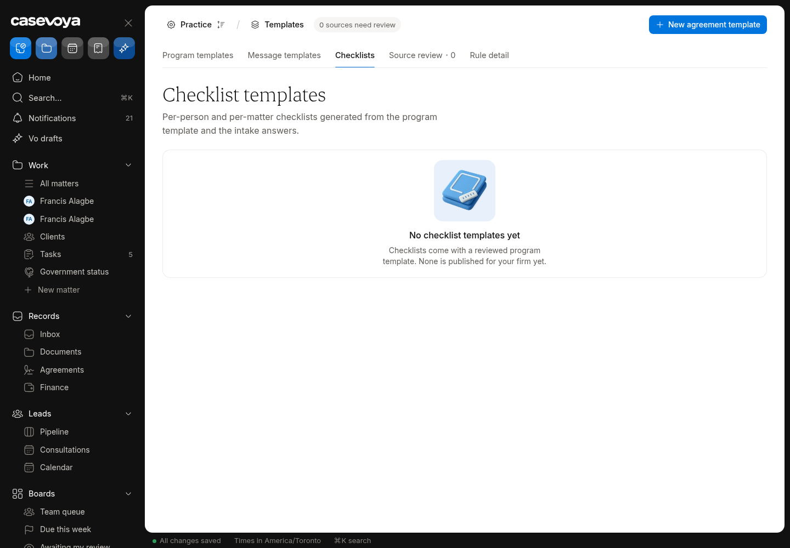
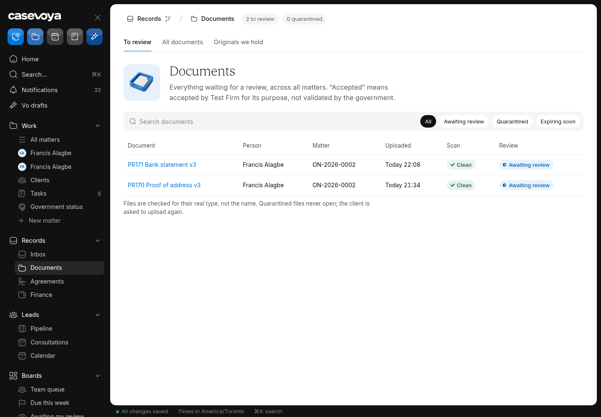
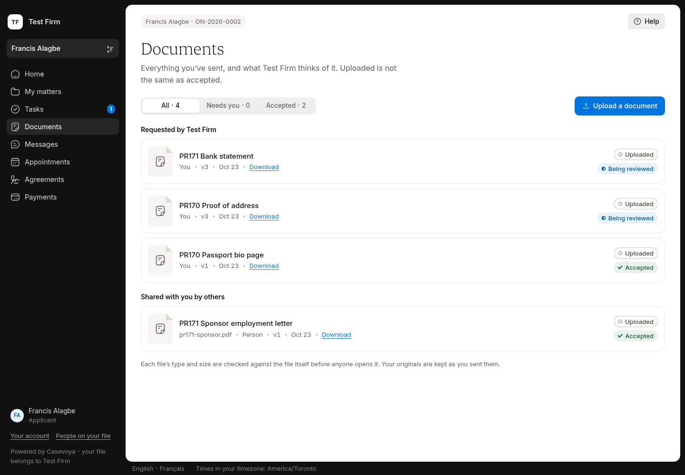
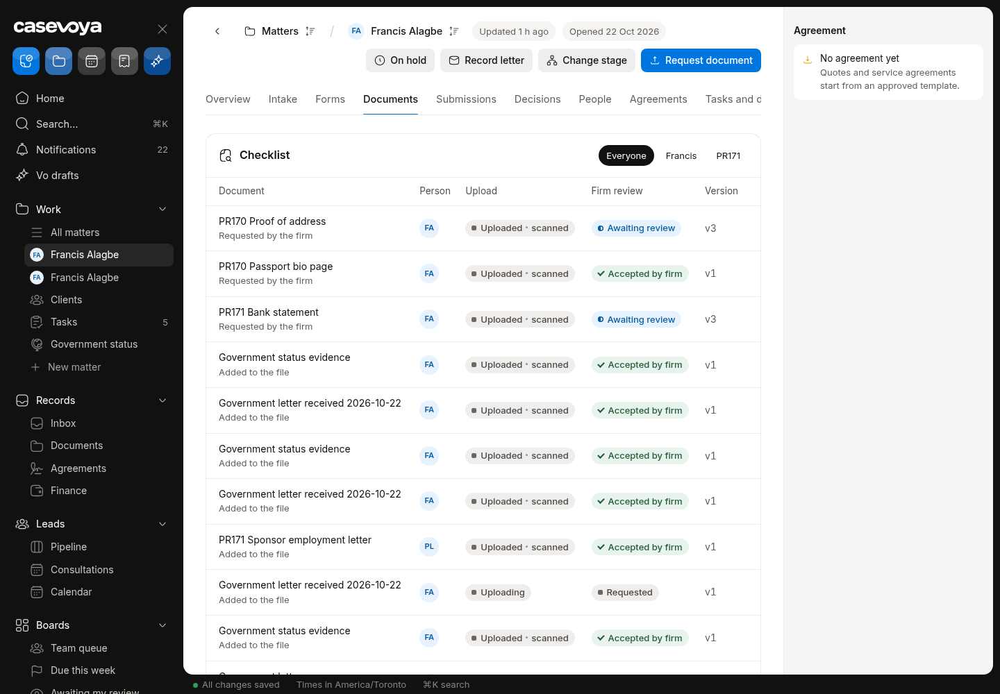
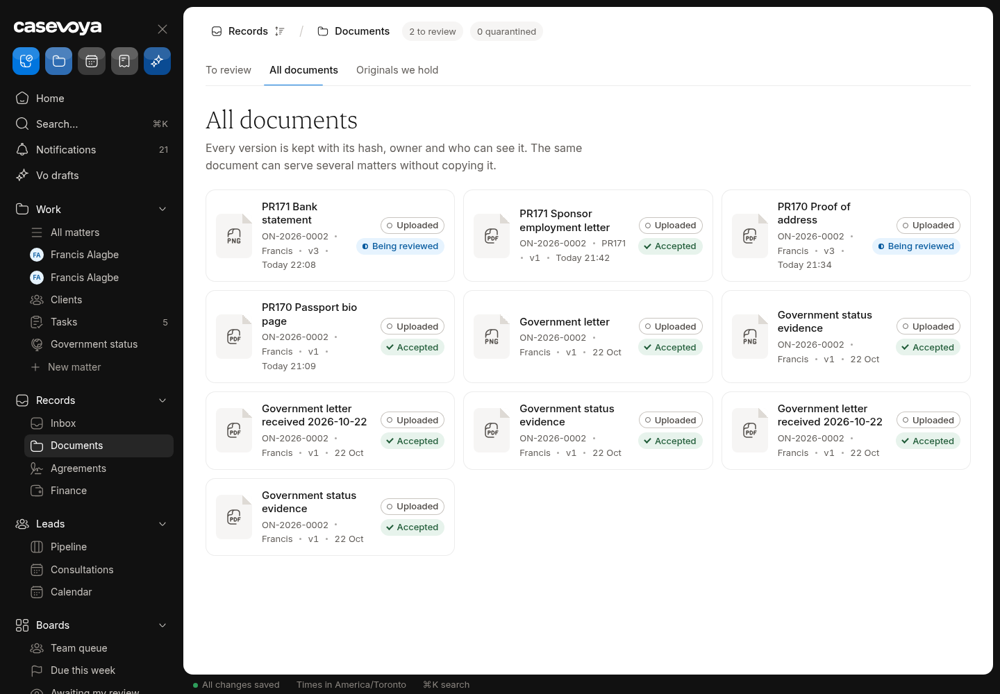
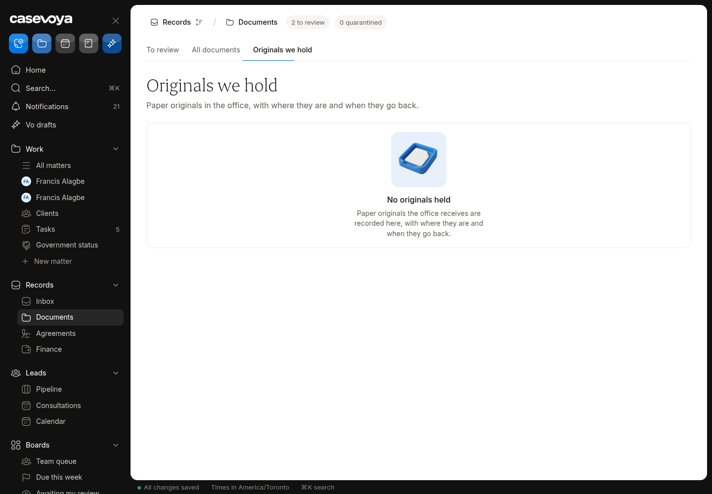

# DOC (Documents): partly built requirements

Requirements: DOC-01, DOC-02, DOC-05, DOC-06, DOC-07. Source: `docs/spec/PRD.md`, status from the PRD status review of main 6d5e54f (rechecked against aac7804, which adds only #173). UI checked on https://app.casevoya.ca on 2026-10-23.

Rules for whoever builds this: test mode only for Stripe (never live keys); new migrations go in `supabase/migrations/` and are applied by Francis, not by the builder; no invented immigration rules, fees or dates; wording follows `docs/spec/DECISIONS.md` and the design system.

## DOC-01: Rule-derived checklists

> **PRD DOC-01:** Generate per-person and per-matter checklists from program templates and conditional intake rules. Each item has type, explanation, owner, due date, acceptable formats, review criteria, optional expiry, and audience.

**UI check:** partly present (route: /sheet/matters/<matter id>?tab=documents, /sheet/templates (Checklists tab))

- What's there: Matter Documents tab has a Checklist (per person filter) built from staff document requests. Templates > Checklists tab exists but says "No checklist templates yet".
- What's missing on screen: No checklist template editor; checklists aren't generated from a program template or conditional intake rules; items lack explanation, acceptable formats, review criteria, expiry and audience fields on screen.

**Built today**

- `src/modules/documents/actions.ts` (document requests), `supabase/migrations/20261017180100_document_requests.sql` (#12, #112)
- Templates Checklists tab shell (`src/modules/sheet/templates-load.ts`)

**Missing (acceptance criteria)**

- [ ] Templates > Checklists: create a firm checklist template (draft → approved by a licensed consultant) with items: type, explanation, owner (client/staff), due offset, acceptable formats, review criteria, optional expiry, audience (person role), and an optional condition on an intake answer.
- [ ] On a matter, **Apply checklist** creates document requests per person from the template and the current intake answers; re-applying after answers change proposes additions/removals for staff to confirm.
- [ ] Each generated item shows its template version; centrally reviewed packs (INT-02/T014) can plug in later.

**Likely migration:** Yes: `checklist_templates`, `checklist_template_items` (versioned) and a link from document requests to the template item.

**UI test steps**

1. Templates > Checklists: create "Test checklist" with 3 items (one conditional on marital status), approve it.
2. ON-2026-0002 Documents: Apply checklist: requests appear per person; the client sees them on /portal/documents with explanation and formats.

**Open PRs:** Not covered by any open PR.

## DOC-02: File types, limits, malware quarantine

> **PRD DOC-02:** Accept PDF, JPEG, PNG, HEIC, and DOCX where appropriate. Default upload limit is 25 MB per file; administrators can configure up to 100 MB after infrastructure validation. Verify actual file type, quarantine for malware scanning, and retain originals. Convert previews separately. Do not execute macros or trust filename extensions.

**UI check:** partly present (route: /sheet/documents, /portal/documents (upload))

- What's there: Documents page: Scan column ("Clean"), Quarantined filter and count, "Files are checked for their real type, not the name"; portal upload checks type and size.
- What's missing on screen: "Clean" only means structural checks passed: no malware scanner is connected (`structural_only`). No admin setting for the per-file limit (25 MB default, up to 100 MB). DOCX upload/preview handling not confirmed.

**Built today**

- `supabase/migrations/20261017180000_document_storage.sql`, `20261018010500_verified_document_upload.sql` (magic-byte type check, `structural_only` engine)
- `src/modules/documents/verify.ts`, `files.ts`; `organizations.document_max_bytes`

**Missing (acceptance criteria)**

- [ ] A real malware scan step: new uploads stay **Quarantined / Scanning** until a scanner result arrives (e.g. a scanning API or ClamAV service behind the outbox); infected files never open and the client is asked to re-upload; the Scan column shows the engine name.
- [ ] If no scanner is configured, the Scan column says "Type checked, not virus-scanned" instead of "Clean" (honest state).
- [ ] Settings > Security (or Documents) has a per-file limit control (25 MB default, max 100 MB, owner + step-up), enforced server-side.
- [ ] DOCX accepted where the request allows it; macros never executed; preview is a converted PDF/image, original retained.

**Likely migration:** Possibly: scan-result columns/status values if new engines need them; none if only the label changes.

**UI test steps**

1. Upload a PDF on /portal/documents as the Test Firm client: shows Scanning then Clean (scanner) or "Type checked" (no scanner).
2. Upload the EICAR test string renamed .pdf: rejected or quarantined; never downloadable.
3. Set the limit to 30 MB; upload a 28 MB file: accepted; 31 MB: refused with the limit in the message.

**Open PRs:** Not covered by any open PR.

## DOC-05: OCR extraction with staff confirmation

> **PRD DOC-05:** Support OCR extraction with confidence and source-page anchors. Staff confirm identity numbers, names, and dates before they become approved facts. Unreadable fields remain unknown. AI or OCR never silently replaces source data.

**UI check:** partly present (route: /sheet/matters/<matter id>?tab=documents (Read with Vo), /sheet/drafts)

- What's there: "Read with Vo" on a document proposes fields, flags and deadlines that staff accept or reject (#106). Test Firm has Vo off, so the control is inactive there.
- What's missing on screen: Extraction only runs when staff click Read with Vo, not on upload; no confidence or source-page anchor shown per field; HEIC and DOCX not read.

**Built today**

- `src/modules/vo/vo-doc.ts`, `vo-doc-actions.ts`, `vo-doc-prompt.ts`, `src/modules/sheet/vo-doc-load.ts`
- `supabase/migrations/20261019218100_vo_doc_review.sql`

**Missing (acceptance criteria)**

- [ ] Optional per-firm setting "Read documents on upload" (off by default, respects AI and category switches): new uploads get proposals automatically, still pending staff confirmation.
- [ ] Each proposed field shows confidence and page number; clicking it opens the preview at that page.
- [ ] Identity numbers, names and dates must be confirmed by staff before they become approved facts; unreadable fields stay Unknown.
- [ ] HEIC converted to JPEG and DOCX to text/PDF before reading.

**Likely migration:** Maybe: confidence/page columns on Vo proposal rows and a firm setting.

**UI test steps**

1. In a Vo-on test firm, upload a sample passport image: proposals appear with confidence and page; accept one: becomes an approved fact with provenance.
2. Test Firm (Vo off): no automatic reading; Read with Vo explains Vo is off.

**Open PRs:** Not covered by any open PR.

## DOC-06: Versions, hashes, multi-matter evidence

> **PRD DOC-06:** Store document versions, hashes, classifications, translation relationship, person ownership, visibility, expiry, and retention link. The same verified evidence can be referenced in several matters with explicit access checks. Deleting one reference must not remove evidence still required by another matter.

**UI check:** partly present (route: /sheet/documents (All documents))

- What's there: All documents tab: versions (v1–v3), owner, visibility; page says "The same document can serve several matters without copying it". Versions and SHA-256 hashes stored (#12).
- What's missing on screen: No control to mark a document as a translation of another (DB has `translation_of_version_id`); no way to reference the same evidence in another matter; deleting a reference vs evidence still needed elsewhere isn't handled on screen; expiry/classification not editable.

**Built today**

- `supabase/migrations/20261017180000_document_storage.sql` (versions, sha256, `translation_of_version_id`, `language_tag`)
- `src/modules/documents/actions.ts`, `src/modules/sheet/documents-load.ts`

**Missing (acceptance criteria)**

- [ ] Document detail: **Translation of…** picker (choose the original version + language) and the original shows its translations.
- [ ] **Use in another matter**: link a verified document to another matter of the same person (access checked); the document lists all matters that reference it.
- [ ] Removing a reference from one matter keeps the file when another matter still references it; deletion is blocked with a clear message until no reference or retention requirement remains.
- [ ] Classification and expiry date editable by staff (audited).

**Likely migration:** Yes: a `matter_document_links` (reference) table if documents are matter-owned today.

**UI test steps**

1. Mark a test upload as the English translation of PR170 Passport bio page: both show the link.
2. Use PR171 Bank statement in ON-2026-0008: appears there; remove it from ON-2026-0008: still on ON-2026-0002.

**Open PRs:** Not covered by any open PR.

## DOC-07: Secure preview, short links, custody

> **PRD DOC-07:** Support secure preview, authorized download, short-lived retrieval links, download audit, redacted copies, and original-document custody tracking. Custody records include received date, location, purpose, recipient, return date, and acknowledgement.

**UI check:** partly present (route: /sheet/documents (Originals we hold))

- What's there: Short-lived download grants and a download audit (Settings > Security: Download audit On). "Originals we hold" tab lists custody records (read-only, empty).
- What's missing on screen: No control to record an original's custody (received, location, purpose, recipient, return date, acknowledgement); no redacted copies; no in-browser secure preview (download only).

**Built today**

- `document_download_grants`, download audit; `document_custody_events` (append-only) in `supabase/migrations/20261017180000_document_storage.sql`
- `src/modules/sheet/documents-load.ts`, `documents-present.ts`

**Missing (acceptance criteria)**

- [ ] Originals we hold: **Record an original** (matter, person, document, received date, location, purpose) and per-row actions **Move**, **Return** (recipient, date) and **Acknowledgement** (upload or e-sign) – each appends a custody event.
- [ ] **Redacted copy**: staff create a redacted version (rectangles on the preview) stored as a new derived version linked to the original; clients/third parties can be given the redacted copy only.
- [ ] Secure preview in the browser (PDF/image rendered from a short-lived link, no-cache headers, watermark with viewer name), logged like downloads.

**Likely migration:** Probably none for custody (table exists; may need write functions); yes for redaction-derivative links if not present.

**UI test steps**

1. Record an original passport for ON-2026-0002, then Return it: two events with times; client portal shows nothing private.
2. Preview a PDF: opens in browser; audit row written. Create a redacted copy: new version linked, original unchanged.

**Open PRs:** Not covered by any open PR.

