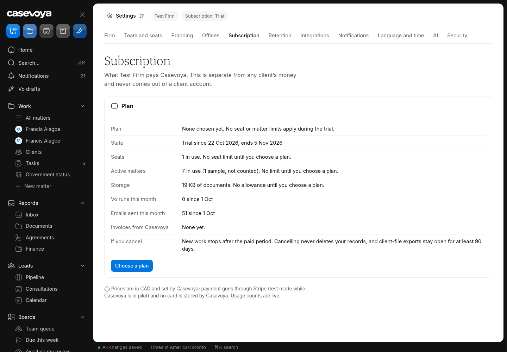
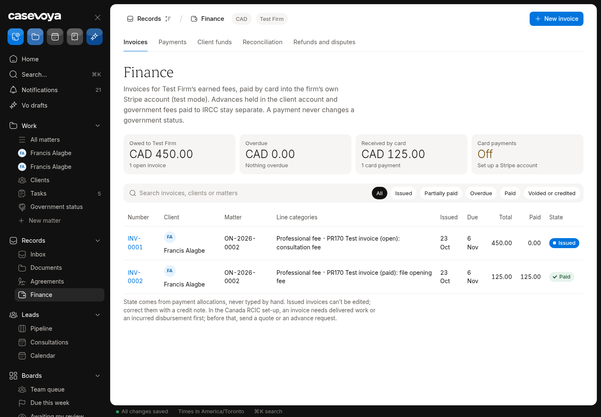
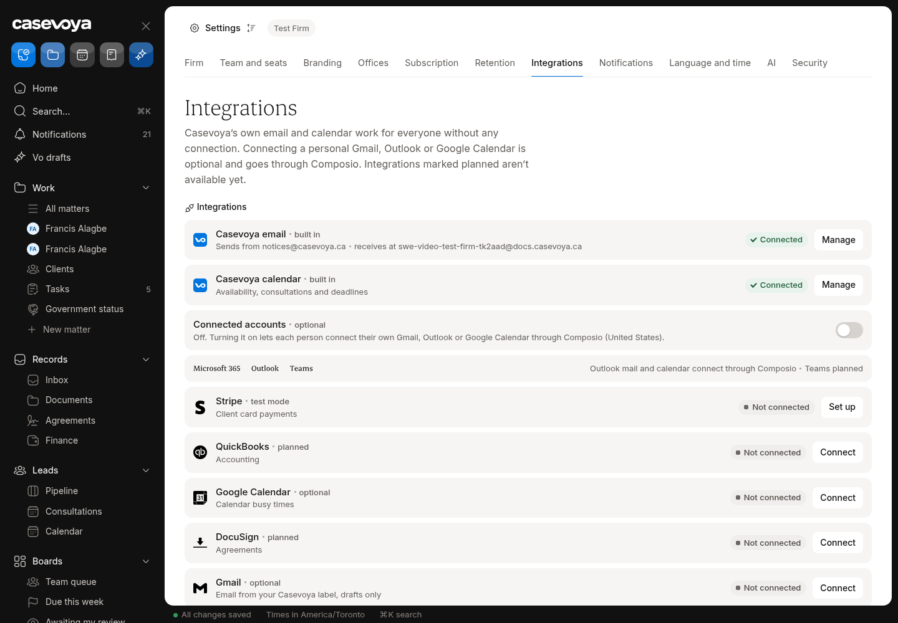
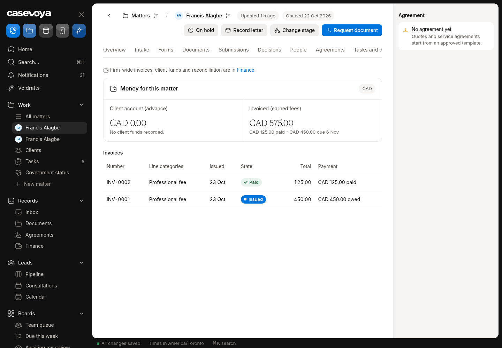
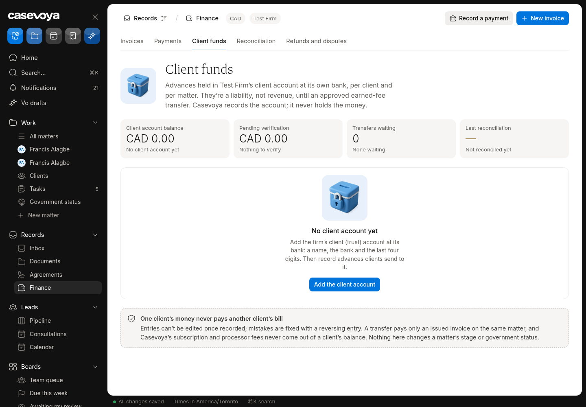
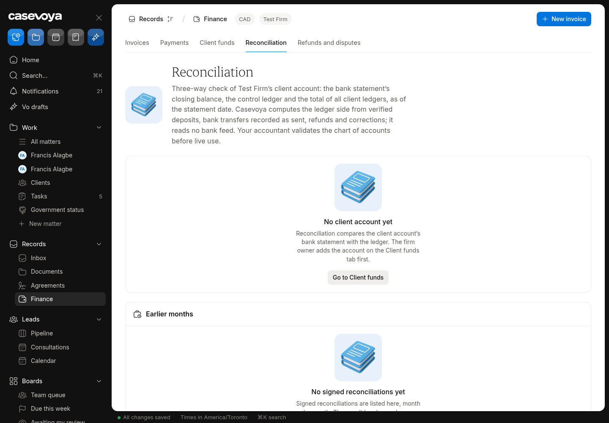
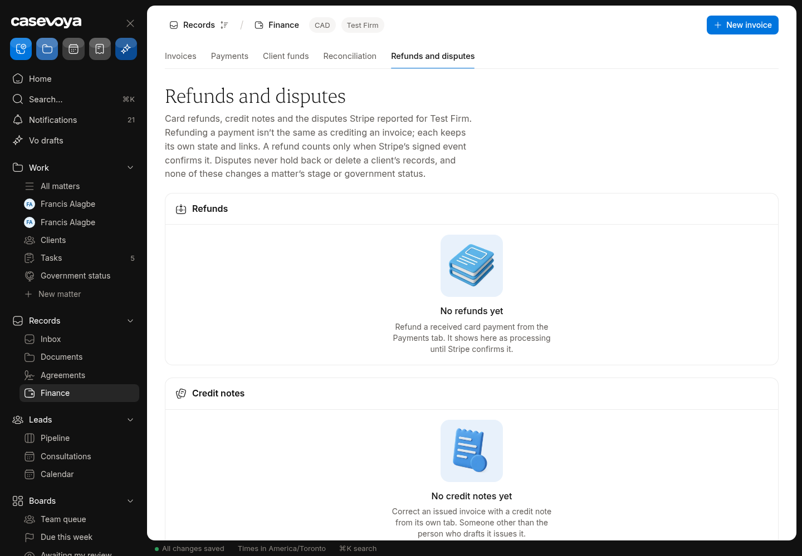
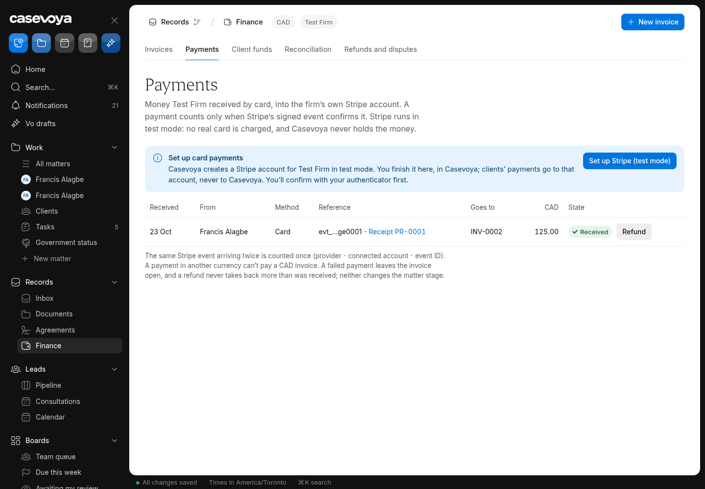

# FIN (Finance): partly built requirements

Requirements: FIN-02, FIN-06, FIN-09, FIN-12, FIN-13. Source: `docs/spec/PRD.md`, status from the PRD status review of main 6d5e54f (rechecked against aac7804, which adds only #173). UI checked on https://app.casevoya.ca on 2026-10-23.

Rules for whoever builds this: test mode only for Stripe (never live keys); new migrations go in `supabase/migrations/` and are applied by Francis, not by the builder; no invented immigration rules, fees or dates; wording follows `docs/spec/DECISIONS.md` and the design system.

## FIN-02: Stripe Connect earned-fee checkout

> **PRD FIN-02:** Use each firm's approved processor account for earned-fee checkout, initially considering Stripe Connect direct charges. Stripe describes direct charges as charges on the connected account. Refund liability and loss handling depend on the selected Connect configuration and must be confirmed before contracting. [S13]

**UI check:** partly present (route: /sheet/settings?tab=billing, /sheet/finance, /sheet/settings?tab=integrations)

- What's there: Settings > Billing and money shows Stripe card payments as not connected for Test Firm; Finance shows invoices and payments; Connect onboarding and direct-charge checkout code exist (#96).
- What's missing on screen: Test Firm has never completed Connect onboarding in test mode, so no checkout has been proven end to end on the live app; no screen showing the connected account's status (charges/payouts enabled, requirements due); refund liability configuration not shown.

**Built today**

- `src/modules/payments/` (Connect onboarding, checkout, webhooks)
- `src/app/api/stripe/`
- Earned-fee invoices (`src/modules/billing/`)

**Missing (acceptance criteria)**

- [ ] Settings > Billing and money: **Connect status card** for the firm's Stripe account: not connected / onboarding incomplete (with the list of requirements Stripe reports) / charges enabled / payouts enabled, with a Continue onboarding button (owner + step-up).
- [ ] Client pays an earned-fee invoice from the portal via a direct charge on the connected account (test mode only); payment and receipt appear on Finance and the client's Billing page.
- [ ] Trust/advance invoices can never use this checkout (server-side refusal, explained on screen).
- [ ] Card shows the refund/loss liability setting chosen for the platform (text from a config, not invented).

**Likely migration:** Probably none; maybe a cached Connect account status table.

**UI test steps**

1. **Test mode only (sk_test / Connect test accounts; never live keys).** Settings > Billing: Connect onboarding with Stripe test data; status card turns "Charges enabled".
2. Create an earned-fee invoice on ON-2026-0002; as the client pay with card 4242…: invoice Paid; receipt visible both sides.
3. Try paying an advance invoice: refused with explanation.

**Open PRs:** Old #19 (stale, unmerged) touched Connect; not covered by any open PR.

## FIN-06: Billing types, time, expenses, write-offs

> **PRD FIN-06:** Support flat, hourly, milestone, and instalment billing, time entries, expenses, quotes, deposits recorded as advances, earned-fee invoices, credit notes, refunds, receipts, write-offs, disputes, and ageing reports. Tax rates and treatment are effective-dated and approved by the firm or its accountant.

**UI check:** partly present (route: /sheet/matters/<matter id>?tab=billing, /sheet/finance)

- What's there: Matter Billing tab: fee schedule, invoices, payments, credit notes, receipts; flat and milestone fees; expenses and deposits as advances.
- What's missing on screen: No time entries (hourly billing) or timer; no write-offs; no quotes; no instalment plans visible; no ageing report; tax rates not effective-dated on screen.

**Built today**

- `src/modules/billing/`, `src/modules/sheet/matter-billing-*`
- Invoices, credit notes, receipts (#18, #96)

**Missing (acceptance criteria)**

- [ ] **Time entries**: staff log time against a matter (date, minutes, rate, description, billable flag) or start/stop a timer; unbilled time can be pulled into an earned-fee invoice.
- [ ] **Write-off**: reduce an invoice balance with a reason (permission + audit); separate from a credit note.
- [ ] **Quote**: draft a fee quote from the fee schedule, send to the client to accept in the portal, convert to invoices.
- [ ] **Instalment plan**: split a fee into dated instalments with reminders.
- [ ] **Ageing report** on Finance (current / 30 / 60 / 90+).
- [ ] Tax rates effective-dated, chosen by the firm (no rates invented).

**Likely migration:** Yes: `time_entries`, `write_offs`, `quotes` (+ lines), `instalment_schedules`, effective-dated `tax_rates` if absent.

**UI test steps**

1. Log 90 minutes at $150/h on ON-2026-0002; create an invoice from unbilled time: $225 line.
2. Write off $25 with a reason: balance drops; audit row.
3. Finance > Ageing shows the invoice in Current.

**Open PRs:** Old #19 (stale, unmerged) had time entries; not covered by any open PR.

## FIN-09: Manual payments pending verification

> **PRD FIN-09:** Manual payment entry requires method, external reference, received date, bank destination, evidence, amount, and reviewer. It remains pending verification until reconciled. Failed or reversed transfers reopen the relevant balance and create a task without silently changing the case stage.

**UI check:** partly present (route: /sheet/finance (Client funds), /sheet/matters/<matter id>?tab=billing)

- What's there: Manual entry exists only for client-funds advances (method, reference, date, amount).
- What's missing on screen: No manual entry for earned-fee invoice payments (e-transfer, cheque); no evidence upload, bank destination or reviewer; entries aren't held as Pending verification until reconciled; a failed/reversed transfer doesn't reopen the balance or create a task.

**Built today**

- Client-funds manual advance entry (`src/modules/trust/`)
- Billing payments (`src/modules/billing/`)

**Missing (acceptance criteria)**

- [ ] **Record manual payment** on an invoice: method, external reference, received date, bank destination (firm account), evidence upload, amount, reviewer. Status **Pending verification**; invoice shows as Pending, not Paid.
- [ ] A reviewer (different person where the firm has more than one) verifies it, or it's matched in reconciliation; only then does it count as paid.
- [ ] **Mark reversed/failed**: reopens the balance, creates a task for the matter owner, never changes the matter stage.
- [ ] Same fields for client-funds advances.

**Likely migration:** Yes: columns/status on payments (pending_verification, evidence doc, reviewer, bank destination) and a reversal event.

**UI test steps**

1. Record a $100 e-transfer on an invoice in ON-2026-0002 with a PDF as evidence: invoice Pending verification; client sees Pending.
2. Verify as a second staff user: invoice Paid. Mark it reversed: balance reopens, task created, stage unchanged.

**Open PRs:** Not covered by any open PR.

## FIN-12: Three-way reconciliation

> **PRD FIN-12:** Provide a monthly three-way reconciliation workspace comparing adjusted bank balance, control ledger, and total client subledgers, with outstanding items and signed review. The accountant and practice reviewer must validate the chart of accounts and reports before financial production use.

**UI check:** partly present (route: /sheet/finance (Reconciliation))

- What's there: Reconciliation tab exists and says "No client account yet" for Test Firm; trust ledger and client subledgers exist.
- What's missing on screen: No way to set up the firm's client (trust) bank account record; no monthly workspace comparing adjusted bank balance vs control ledger vs total client subledgers; no outstanding items or signed review.

**Built today**

- `src/modules/trust/` (ledger, subledgers)
- Reconciliation tab shell (`src/modules/sheet/finance-load.ts`)

**Missing (acceptance criteria)**

- [ ] Set up a **client account** (bank name, last 4 digits, currency) on Settings > Billing and money (owner + step-up).
- [ ] Monthly reconciliation: enter/import statement closing balance; list outstanding deposits and cheques; show adjusted bank balance, control ledger and sum of client subledgers side by side; differences highlighted.
- [ ] Reviewer signs off (name, time, step-up); a signed month is locked; a PDF report can be exported.
- [ ] Clear banner that the accountant and practice reviewer must validate before production financial use.

**Likely migration:** Yes: `client_bank_accounts`, `reconciliations` (+ items, sign-off).

**UI test steps**

1. Create a test client account; start October 2026: three totals shown; add an outstanding deposit to make them agree; sign off; month locked.

**Open PRs:** Not covered by any open PR.

## FIN-13: Refunds, chargebacks, overpayments

> **PRD FIN-13:** Support partial refunds, processor failures, chargebacks, overpayments, and cancelled instalment schedules. Refunding a payment is not the same as crediting an invoice. Preserve allocation links and avoid duplicating a bank refund when a processor refund is pending.

**UI check:** partly present (route: /sheet/finance (Refunds, Payments))

- What's there: Refunds tab and Payments list; full and partial refunds of card payments via processor (test mode), with refund ≠ credit note.
- What's missing on screen: No dispute/chargeback screens (evidence, status, deadline); no overpayment handling (credit balance, refund or apply); cancelling an instalment schedule not available; processor-failed refunds not shown as such.

**Built today**

- `src/modules/payments/` refunds and webhooks
- Finance Refunds tab

**Missing (acceptance criteria)**

- [ ] **Disputes**: Stripe dispute webhooks create a dispute record on Finance (amount, reason, evidence due date, status); a task for the owner; evidence upload and submit (test mode).
- [ ] **Overpayment**: payment above balance creates a client credit; staff choose Refund or Apply to another invoice; allocation links kept.
- [ ] Refund pending at processor blocks a duplicate manual bank refund (server-side).
- [ ] Failed refunds show Failed with reason and create a task.

**Likely migration:** Yes: `payment_disputes`, client credit balances/allocations if absent.

**UI test steps**

1. Test mode: pay with Stripe's dispute test card; dispute appears with due date and a task.
2. Record an overpayment of $50: credit shown; apply it to another invoice: links visible.

**Open PRs:** Not covered by any open PR.

