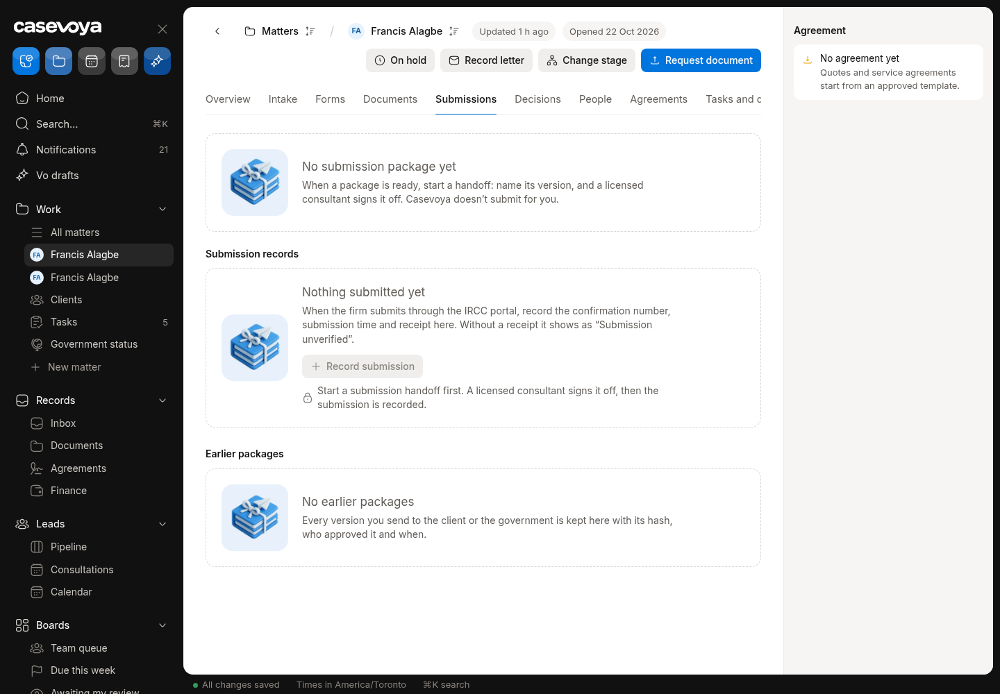
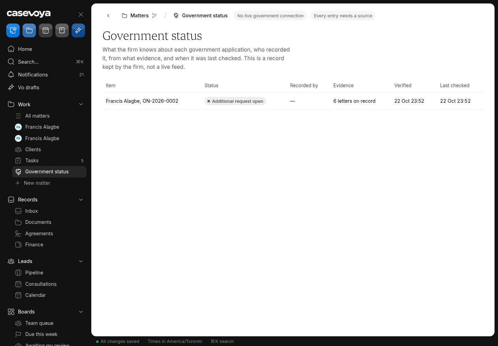

# GOV (Government submissions): partly built requirements

Requirements: GOV-01, GOV-03, GOV-04, GOV-05. Source: `docs/spec/PRD.md`, status from the PRD status review of main 6d5e54f (rechecked against aac7804, which adds only #173). UI checked on https://app.casevoya.ca on 2026-10-23.

Rules for whoever builds this: test mode only for Stripe (never live keys); new migrations go in `supabase/migrations/` and are applied by Francis, not by the builder; immigration content (rules, fees, forms, document lists, dates) is built from official IRCC / Government of Canada sources, with the source URL and retrieval date stored with each value (see **Official sources** below); wording follows `docs/spec/DECISIONS.md` and the design system.

## Official sources (applies to everything in this file)

Francis's direction: build the real content using accurate, current information from IRCC. Don't build placeholder, sample or example rules, fees, dates, forms or sources.

- Use only official IRCC / Government of Canada sources:
  - IRCC home: https://www.canada.ca/en/immigration-refugees-citizenship.html
  - Application forms and guides (form numbers and "date modified"): https://www.canada.ca/en/immigration-refugees-citizenship/services/application/application-forms-guides.html
  - IRCC fee list: https://ircc.canada.ca/english/information/fees/fees.asp
  - Processing times: https://www.canada.ca/en/immigration-refugees-citizenship/services/application/check-processing-times.html. IRCC says these times are "not a maximum or a guarantee", so show them as IRCC's estimate with the date checked.
  - Program pages and instruction guides on canada.ca for each program.
  - Where relevant, Justice Laws: IRPA https://laws-lois.justice.gc.ca/eng/acts/I-2.5/ and IRPR https://laws-lois.justice.gc.ca/eng/regulations/SOR-2002-227/. Record the "current to" date shown on the page.
- **Store the source with every value.** Every rule, fee, form, document list, deadline or date stores:
  - its official source URL, with the section or anchor;
  - the form number and the form's "date modified" where it applies;
  - the date it was retrieved, plus a snapshot hash;
  - the effective or "current to" date when the page states one.

  Store these with the rule or claim (SRC-01/02). Show them in the UI next to the value.
- **No invented values.** If something can't be found on an official page, leave it out, show it as Unknown where the UI needs a slot, and list it in your `## Handoff` comment. Don't guess.
- **Review before live.** Content goes live only through the licensed-reviewer approval (SRC-03). Matters pin the version they used (SRC-05). Vo cites these sources or abstains (SRC-09, AI-01).
- Spot check (retrieved 2026-10-23 from the fee list above):
  - "Study permit (including extensions) – per person" is $150.00.
  - "Right of permanent residence fee" is $600.00.

  Use the live page at build time, not these numbers.

## GOV-01: Submission checklist

> **PRD GOV-01:** Create a submission checklist tailored to program and channel. Require current representation evidence, released package version, reviewed deadlines, required signatures, and confirmed fee handling. Show which actions occur outside Casevoya.

**UI check:** partly present (route: /sheet/matters/<matter id>?tab=submissions)

- What's there: Submissions tab records submissions (channel, reference, date) and shows "Submission unverified" until confirmed; package release exists (#16).
- What's missing on screen: No submission checklist (representation evidence current, released package version, reviewed deadlines, signatures, fee handling confirmed) and no list of steps that happen outside Casevoya before recording a submission.

**Built today**

- `src/modules/submissions/`, `src/modules/sheet/matter-submissions-*`
- Package release (#16)

**Missing (acceptance criteria)**

- [ ] Before **Record submission**, a **Submission checklist** card shows each gate with live status and a link: representation (Use of a Representative) current; package version released; deadlines reviewed; required signatures complete; fees handled/confirmed.
- [ ] A blocking gate prevents recording (owner can override with a reason, audited).
- [ ] "Done outside Casevoya" list for the channel (e.g. pay government fee in IRCC portal, upload in the portal), each tickable.
- [ ] Gates and "done outside Casevoya" steps per program and channel come from the official IRCC application guide / instructions for that program (URL + retrieved date shown next to each step), e.g. paying the government fee per the IRCC fee list, giving biometrics where IRCC requires them, and submitting the Use of a Representative form (IMM 5476, current version from the forms page).

**Likely migration:** Probably none (checks derive from existing data); maybe a checklist-state table.

**UI test steps**

1. ON-2026-0002 Submissions: checklist shows representation and package gates; with no released package, Record submission is blocked; release a package: gate turns green.

**Open PRs:** Not covered by any open PR.

## GOV-03: Submission record, manifest, receipt

> **PRD GOV-03:** Record channel, application reference, submission timestamp, submitting representative, package manifest, receipt, and supporting evidence. Submission date and acknowledgment date are separate. If confirmation is missing, display Submission unverified rather than Submitted to government.

**UI check:** partly present (route: /sheet/matters/<matter id>?tab=submissions)

- What's there: Submission record: channel, application reference, submitted at, representative; "Submission unverified" vs confirmed; acknowledgment separate.
- What's missing on screen: No package manifest (list of files and hashes actually submitted) on the record; no receipt/evidence upload control shown.

**Built today**

- `src/modules/submissions/`

**Missing (acceptance criteria)**

- [ ] Recording a submission pins the **package manifest** (released package version, file list, SHA-256 per file) to the record, shown on screen and in the audit.
- [ ] **Add receipt / evidence**: upload the government confirmation; acknowledgment date entered separately; only then does it read Submitted to government.
- [ ] Without evidence it stays "Submission unverified".
- [ ] Channel names (e.g. IRCC Portal, Permanent Residence Portal, paper) use IRCC's official names with the source page linked.

**Likely migration:** Maybe: manifest snapshot column / table.

**UI test steps**

1. Record a submission on ON-2026-0002: manifest shows files and hashes; status Submission unverified; upload a receipt PDF + acknowledgment date: status Submitted to government.

**Open PRs:** Not covered by any open PR.

## GOV-04: Government correspondence

> **PRD GOV-04:** Staff record government correspondence through upload or reviewed email import. Store issuer, document date, received date, action requested, confirmed due date, evidence, and audience. One letter may create several tasks for different people.

**UI check:** partly present (route: /sheet/matters/<matter id>?tab=decisions (Record letter))

- What's there: Record a government letter dialog: upload, received date, action requested, due date, audience; letter can create a task.
- What's missing on screen: Dialog lacks **issuer** and **letter (document) date** even though the DB columns exist; one letter creates only one task (not several for different people); no reviewed email-import path.

**Built today**

- `government_correspondence` table with issuer / document_date columns
- `src/modules/decisions/` or correspondence actions

**Missing (acceptance criteria)**

- [ ] Letter dialog adds **Issuer** (e.g. IRCC, CBSA, a visa office) and **Letter date**, separate from received date.
- [ ] **Tasks from this letter**: add several tasks, each with owner (staff or client), due date and description.
- [ ] Optional: a letter from Triage/inbound email can be filed here after staff review (links to OPS-06).
- [ ] The issuer list uses official names (IRCC, CBSA, IRB, a named visa office) taken from official Government of Canada pages.

**Likely migration:** Probably none (columns exist); maybe a letter→tasks link.

**UI test steps**

1. Record a letter on ON-2026-0002 with issuer IRCC, letter date 2026-10-20, received 2026-10-22, two tasks (one for the client): both tasks appear; the client sees theirs.

**Open PRs:** Not covered by any open PR.

## GOV-05: Government status provenance

> **PRD GOV-05:** Every government status has source, recorder, evidence, verified time, and last checked time. Client views clearly identify updates recorded by the firm. Do not display real-time tracking or automatic government synchronization unless an actual supported integration provides it.

**UI check:** partly present (route: /sheet/matters/<matter id>?tab=submissions, /portal (home))

- What's there: Staff record government status updates with source and recorder; portal shows status recorded by the firm; no real-time tracking claimed.
- What's missing on screen: No "verified at" / "last checked" times on screen; no evidence link per status; `share_government_record` (share with client) has no UI.

**Built today**

- Government status records and `share_government_record` function (DB)
- Portal home status

**Missing (acceptance criteria)**

- [ ] Each status shows source, recorder, evidence link, verified time and **last checked** time; **Mark checked** updates last checked.
- [ ] **Share with client** button (calls `share_government_record`) with preview of what the client will see; portal says "Recorded by <firm> on <date>".
- [ ] No wording implying automatic sync.
- [ ] Any IRCC processing-time estimate shown next to a status comes from the official processing-times page with the date checked, labelled as IRCC's estimate ("not a maximum or a guarantee", per IRCC).

**Likely migration:** Probably none (function exists); maybe last_checked_at column.

**UI test steps**

1. Add a status on ON-2026-0002, Mark checked: last checked updates. Share with client: /portal shows "Recorded by Test Firm".

**Open PRs:** Not covered by any open PR.

