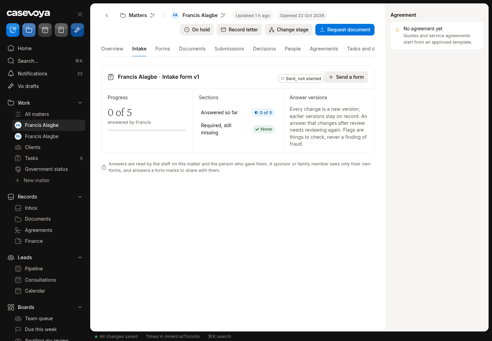

# INT (Intake and facts): partly built requirements

Requirements: INT-04, INT-05. Source: `docs/spec/PRD.md`, status from the PRD status review of main 6d5e54f (rechecked against aac7804, which adds only #173). UI checked on https://app.casevoya.ca on 2026-10-23.

Rules for whoever builds this: test mode only for Stripe (never live keys); new migrations go in `supabase/migrations/` and are applied by Francis, not by the builder; no invented immigration rules, fees or dates; wording follows `docs/spec/DECISIONS.md` and the design system.

## INT-04: Fact provenance and reuse

> **PRD INT-04:** Record provenance for every material fact: person, field, raw value, normalized value, source document or answer, submitting actor, timestamp, review state, and superseded value. Reuse approved facts in later matters only after client reconfirmation and staff review where required.

**UI check:** partly present (route: /sheet/matters/<matter id>?tab=intake)

- What's there: Intake tab: form, progress, sections, answer versions ("Every change is a new version"), review state and flags.
- What's missing on screen: No way to see an approved fact's full provenance (raw vs normalised value, source document/answer, actor, time, superseded value) in one place; no reuse of approved facts in a later matter (with client reconfirmation and staff review).

**Built today**

- `src/modules/intake/actions.ts`, `present.ts`, `src/modules/sheet/matter-intake-present.ts`, `matter-load.ts`
- Answer versions and review state (#137, #140)

**Missing (acceptance criteria)**

- [ ] On the Intake tab, each answer has a **Provenance** popover: raw value, normalised value, source (answer or document version link), who submitted, when, review state, and superseded values.
- [ ] When a client starts a new matter (or staff opens one for an existing person), staff can choose **Reuse approved facts** from the person's earlier matter: the facts are pre-filled as *Needs client reconfirmation*; the client confirms in the portal; staff review where the field requires it. Nothing is copied silently; each reused fact links to its origin.
- [ ] Reuse respects access: only facts of the same person, same firm.

**Likely migration:** Likely yes: a `fact_reuse` link (origin answer id → new answer) and a reconfirmation state.

**UI test steps**

1. ON-2026-0002 Intake tab: open an answer's provenance; values match the portal submission.
2. Open a second matter for Francis Alagbe (e.g. ON-2026-0008), choose Reuse approved facts: answers arrive as Needs reconfirmation; as the client, confirm one; staff sees it confirmed.

**Open PRs:** Not covered by any open PR.

## INT-05: Inconsistency flags, aliases

> **PRD INT-05:** Flag overlapping or missing history periods, conflicting birth dates, inconsistent names, and expired evidence as review items. An inconsistency flag is not a fraud finding. Include aliases, transliterations, multiple passports, and changing addresses without overwriting history.

**UI check:** partly present (route: /sheet/matters/<matter id>?tab=intake, /sheet/matters/<matter id>?tab=people)

- What's there: Review flags on the Intake tab ("Flags are things to check, never a finding of fraud"); Vo inconsistency flags (#106) when Vo is on.
- What's missing on screen: No place to record aliases / other names, transliterations, more than one passport, or an address history for a person; no automatic flags for overlapping or missing history periods, conflicting birth dates, inconsistent names or expired evidence.

**Built today**

- Intake review flags (#137) in `src/modules/intake/`
- Vo flags `src/modules/vo/vo-doc.ts` (#106)

**Missing (acceptance criteria)**

- [ ] People tab > person: **Other names** (alias, maiden name, transliteration with script), **Passports** (several, each with country, number masked, issue/expiry, current flag) and **Addresses** (history with from/to), all append-only with history.
- [ ] Deterministic checks create review items (not fraud findings): gaps/overlaps in address or employment history periods, birth date differing between intake and an accepted document, name mismatch not covered by a recorded alias, expired passport/evidence.
- [ ] Each flag shows its evidence and can be resolved with a note; wording never says fraud.

**Likely migration:** Yes: `person_names`, `person_passports`, `person_addresses` (or similar) and a flags table/view.

**UI test steps**

1. People tab on ON-2026-0002: add an alias and two passports (one expired); expired one raises a flag.
2. Enter overlapping address periods: flag appears; resolve it with a note; flag closed and audited.

**Open PRs:** Not covered by any open PR.

