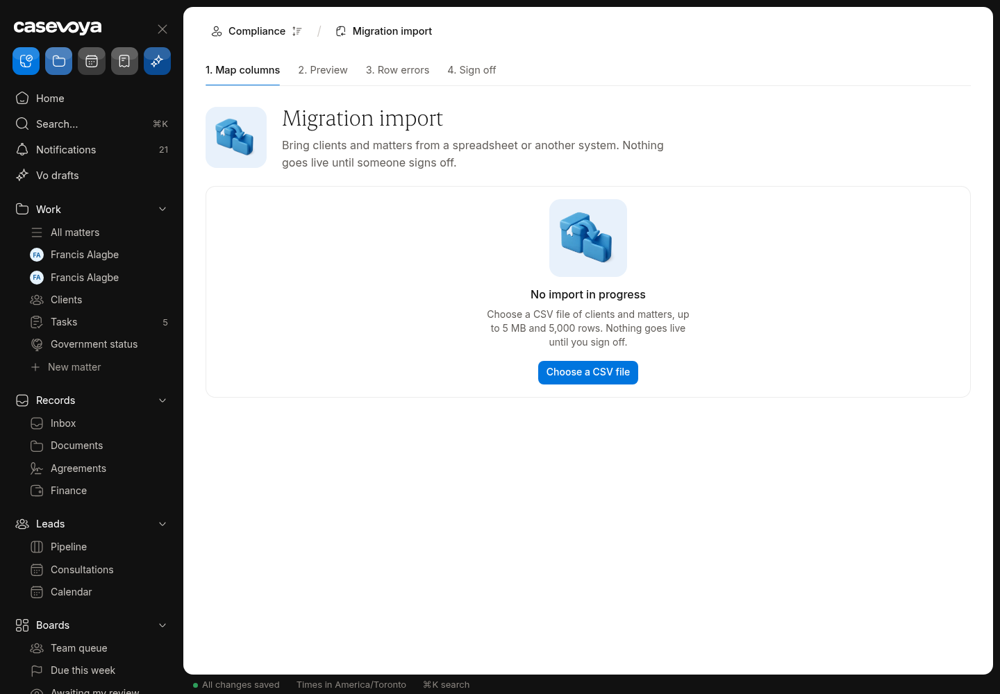

# MIG (Migration): partly built requirements

Requirements: MIG-01, MIG-02. Source: `docs/spec/PRD.md`, status from the PRD status review of main 6d5e54f (rechecked against aac7804, which adds only #173). UI checked on https://app.casevoya.ca on 2026-10-23.

Rules for whoever builds this: test mode only for Stripe (never live keys); new migrations go in `supabase/migrations/` and are applied by Francis, not by the builder; immigration content (rules, fees, forms, document lists, dates) is built from official IRCC / Government of Canada sources, with the source URL and retrieval date stored with each value (see **Official sources** below); wording follows `docs/spec/DECISIONS.md` and the design system.

## Official sources (applies to everything in this file)

Francis's direction: build the real content using accurate, current information from IRCC. Don't build placeholder, sample or example rules, fees, dates, forms or sources.

- Use only official IRCC / Government of Canada sources:
  - IRCC home: https://www.canada.ca/en/immigration-refugees-citizenship.html
  - Application forms and guides (form numbers and "date modified"): https://www.canada.ca/en/immigration-refugees-citizenship/services/application/application-forms-guides.html
  - IRCC fee list: https://ircc.canada.ca/english/information/fees/fees.asp
  - Processing times: https://www.canada.ca/en/immigration-refugees-citizenship/services/application/check-processing-times.html. IRCC says these times are "not a maximum or a guarantee", so show them as IRCC's estimate with the date checked.
  - Program pages and instruction guides on canada.ca for each program.
  - Where relevant, Justice Laws: IRPA https://laws-lois.justice.gc.ca/eng/acts/I-2.5/ and IRPR https://laws-lois.justice.gc.ca/eng/regulations/SOR-2002-227/. Record the "current to" date shown on the page.
- **Store the source with every value.** Every rule, fee, form, document list, deadline or date stores:
  - its official source URL, with the section or anchor;
  - the form number and the form's "date modified" where it applies;
  - the date it was retrieved, plus a snapshot hash;
  - the effective or "current to" date when the page states one.

  Store these with the rule or claim (SRC-01/02). Show them in the UI next to the value.
- **No invented values.** If something can't be found on an official page, leave it out, show it as Unknown where the UI needs a slot, and list it in your `## Handoff` comment. Don't guess.
- **Review before live.** Content goes live only through the licensed-reviewer approval (SRC-03). Matters pin the version they used (SRC-05). Vo cites these sources or abstains (SRC-09, AI-01).
- Spot check (retrieved 2026-10-23 from the fee list above):
  - "Study permit (including extensions) – per person" is $150.00.
  - "Right of permanent residence fee" is $600.00.

  Use the live page at build time, not these numbers.

## MIG-01: Staged import

> **PRD MIG-01:** Import clients, matters, people relationships, documents, notes, tasks, dates, and financial opening balances through a staged mapping process. Validate formats, classify sensitivity, detect duplicates, and provide a preview with row-level errors. Never merge records silently.

**UI check:** partly present (route: /sheet/settings (Import / migration))

- What's there: CSV import of clients and matters with mapping, preview and row-level errors; duplicates detected, never merged silently.
- What's missing on screen: Only clients and matters: no people relationships, documents, notes, tasks, dates or financial opening balances; no sensitivity classification step.

**Built today**

- `src/modules/migration/` (clients, matters import)

**Missing (acceptance criteria)**

- [ ] Add import types: people relationships, documents (zip + manifest), notes, tasks, key dates, financial opening balances (as advances/receivables, reviewer required).
- [ ] Mapping step classifies sensitive columns; preview shows row-level errors per type; duplicates proposed for staff decision.

**Likely migration:** Maybe: staging tables per type.

**UI test steps**

1. Import a 5-row test CSV of tasks for Test Firm: preview shows one row error; commit: 4 tasks created with imported_at/source_system.

**Open PRs:** Not covered by any open PR.

## MIG-02: Pilot and controlled migration

> **PRD MIG-02:** Pilot a small sample, obtain firm sign-off, then run a controlled migration with source counts, checksums, record totals, and exception reports. Imported historical events retain their original date plus imported_at and source_system; do not present imported history as a native audit event.

**UI check:** partly present (route: /sheet/settings (Import / migration))

- What's there: Import runs record counts; imported records keep source.
- What's missing on screen: No **pilot mode** (small sample + firm sign-off), no checksums or exception report, imported history not consistently marked (original date + imported_at + source_system).

**Built today**

- `src/modules/migration/`

**Missing (acceptance criteria)**

- [ ] **Pilot run**: import a sample (e.g. 10 rows) into a pilot batch; firm owner signs off before the full run is allowed.
- [ ] Full run report: source counts, checksums, record totals, exceptions (downloadable).
- [ ] Imported events show "Imported from <system> on <date>" and never appear as native audit events.

**Likely migration:** Yes: batch/pilot/sign-off columns.

**UI test steps**

1. Run a pilot of 3 clients; full run is blocked until sign-off; sign off; full run report shows counts and checksum.

**Open PRs:** Not covered by any open PR.

