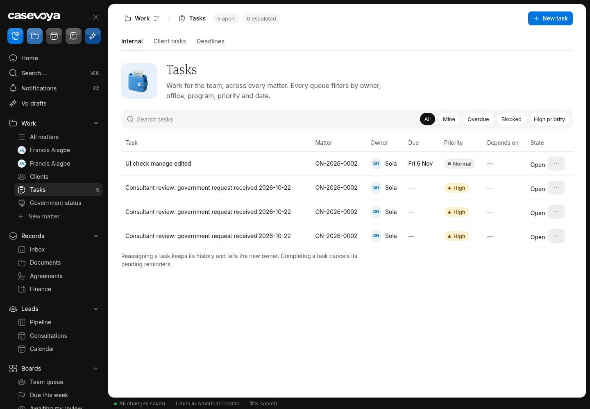
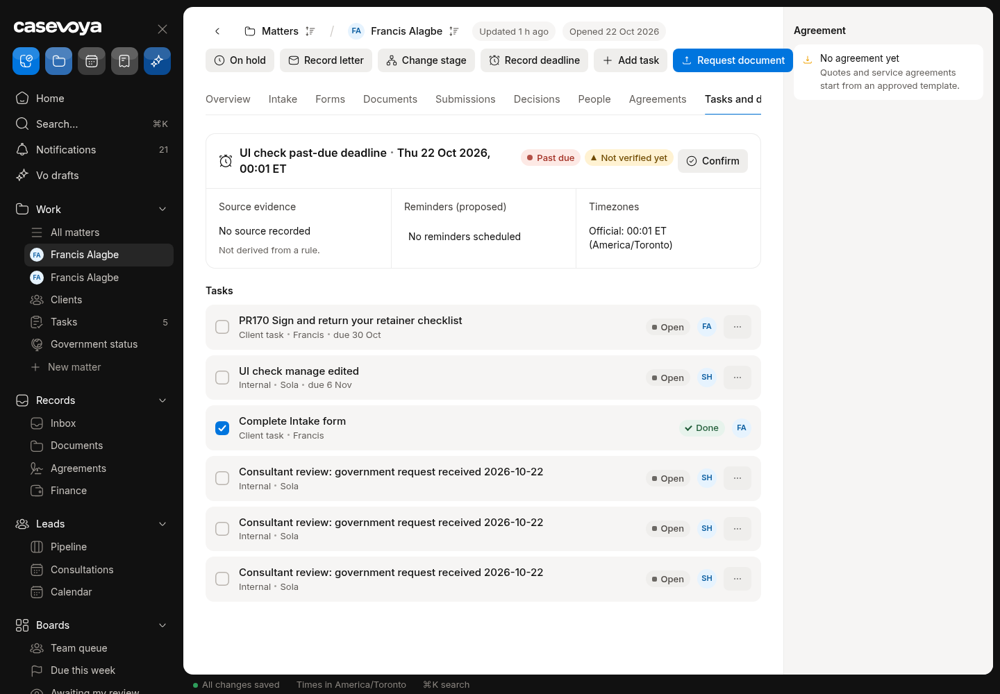
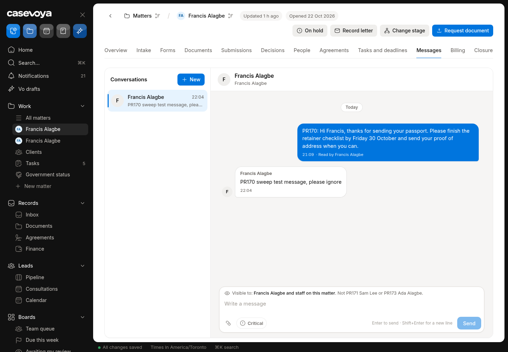
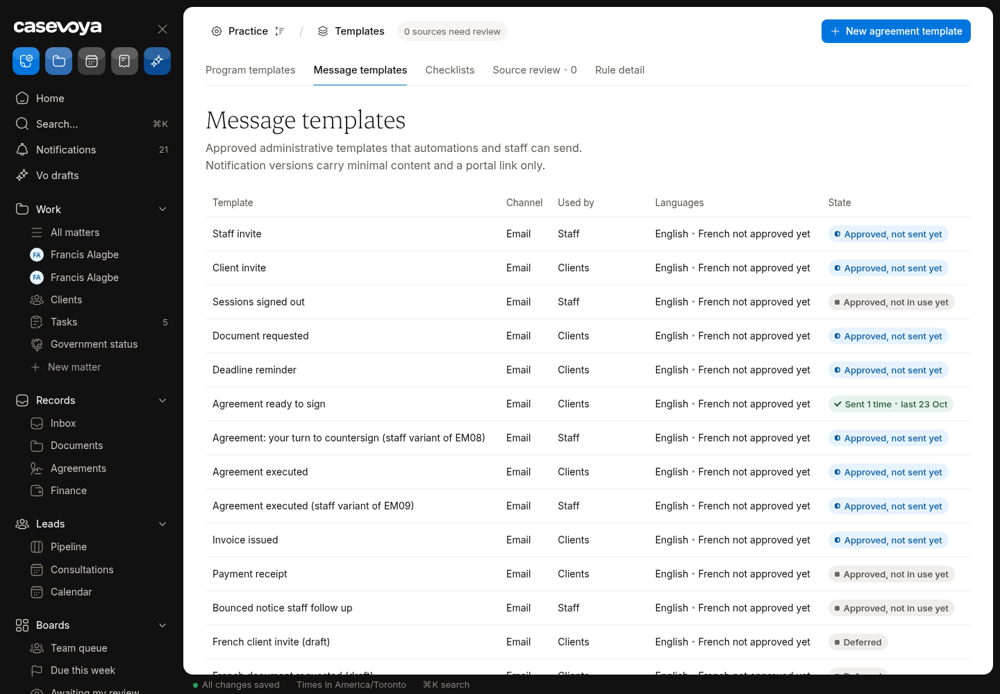
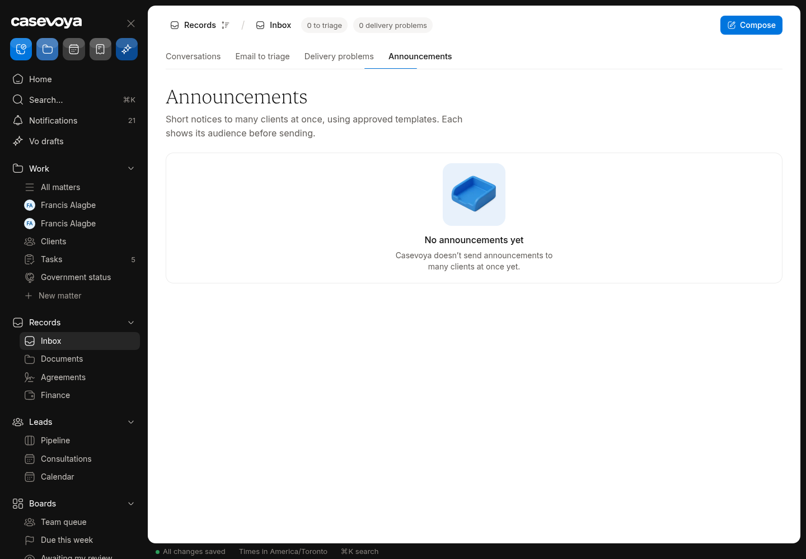
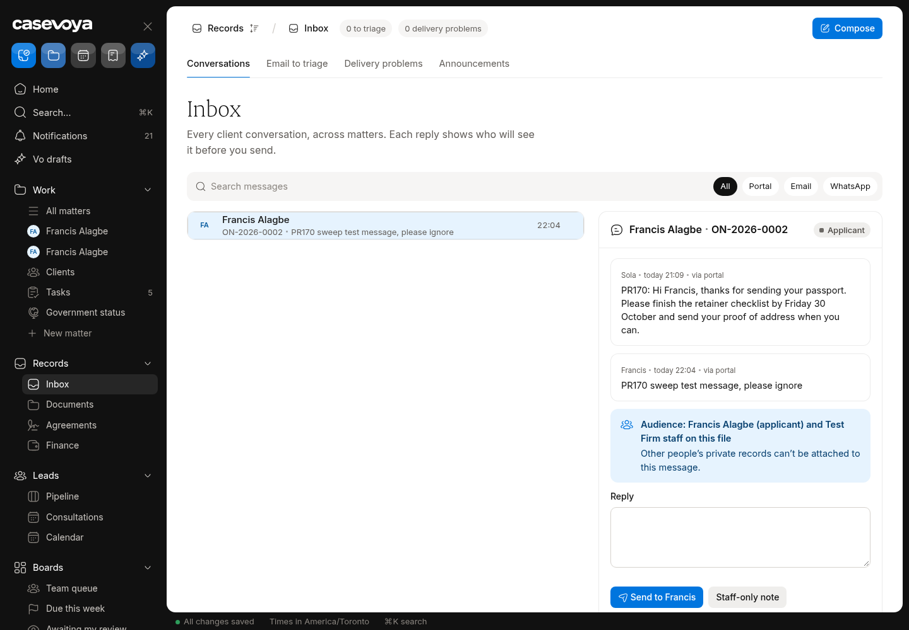
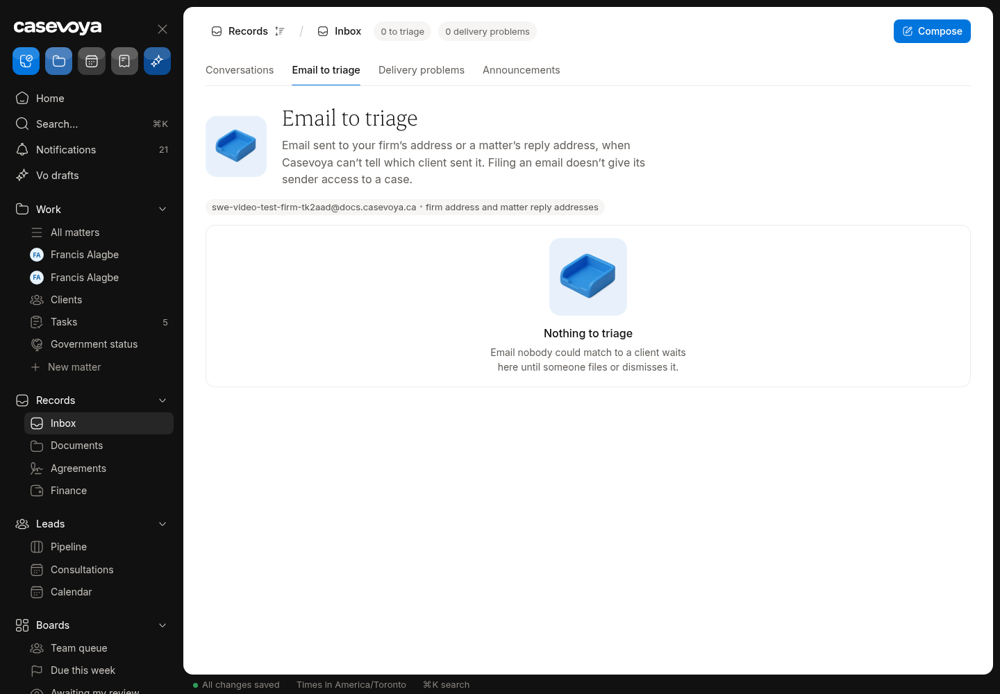
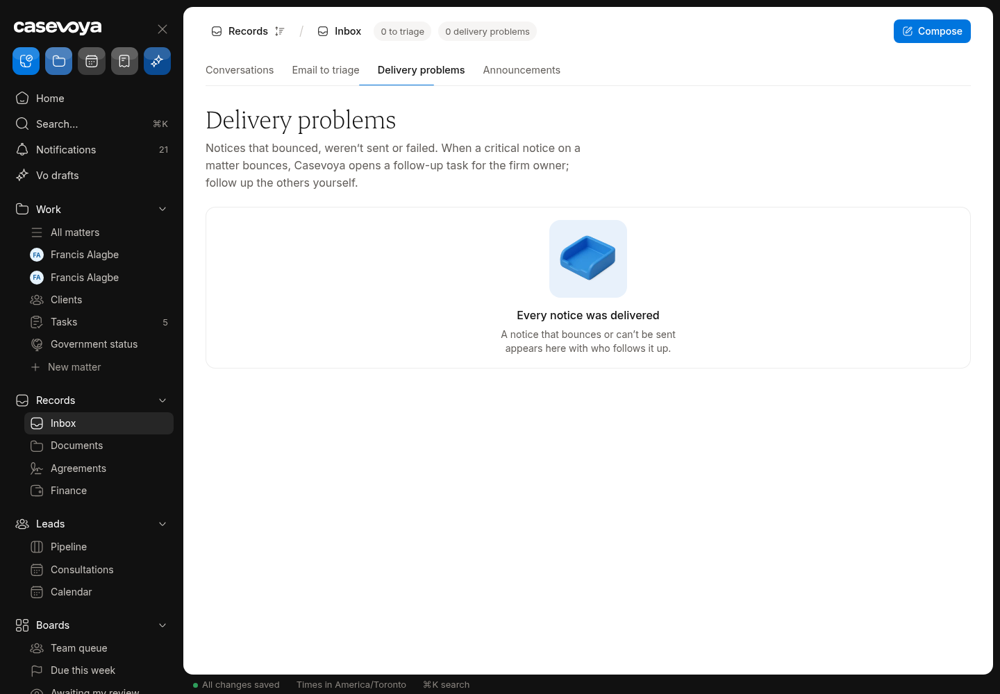

# OPS (Operations): partly built requirements

Requirements: OPS-01, OPS-04, OPS-06. Source: `docs/spec/PRD.md`, status from the PRD status review of main 6d5e54f (rechecked against aac7804, which adds only #173). UI checked on https://app.casevoya.ca on 2026-10-23.

Rules for whoever builds this: test mode only for Stripe (never live keys); new migrations go in `supabase/migrations/` and are applied by Francis, not by the builder; no invented immigration rules, fees or dates; wording follows `docs/spec/DECISIONS.md` and the design system.

## OPS-01: Tasks: watchers, dependencies, checklists

> **PRD OPS-01:** Tasks support owner, watcher, dependency, priority, due date, due timezone, checklist, estimated effort, status, blocker, and escalation. Separate client tasks from internal tasks. Reassignment preserves history and informs the new owner.

**UI check:** partly present (route: /sheet/tasks, /sheet/matters/<matter id>?tab=tasks)

- What's there: Tasks page lists tasks with owner, due, priority, status and a "Depends on" column; matter Tasks tab; create/complete tasks.
- What's missing on screen: The DB already has watchers, dependencies, checklist, estimated minutes and blocker note, but the UI only shows Depends on. No way to add watchers, set a dependency, tick checklist items, set an estimate or record a blocker; no recurring tasks.

**Built today**

- `task_watchers`, `tasks.depends_on_task_id`, `tasks.checklist`, `tasks.estimated_minutes`, `tasks.blocker_note` already in the database
- `src/modules/tasks/`, `src/modules/sheet/tasks-load.ts`

**Missing (acceptance criteria)**

- [ ] Task detail drawer: **Watchers** (add/remove staff), **Depends on** (pick another task in the same matter; blocked until it's done), **Checklist** (add/tick items), **Estimate** (minutes), **Blocker** (note + who/when).
- [ ] Watchers get the same in-app notifications as the owner on status changes.
- [ ] A task can't be completed while its dependency is open (server-side check, clear message).
- [ ] Recurring task option (weekly/monthly) creates the next occurrence on completion.
- [ ] Task list filters: Blocked, Watching.
- [ ] Due timezone shown and editable; escalation (overdue → notify owner's lead).
- [ ] Reassignment keeps history and notifies the new owner.

**Likely migration:** Probably none for watchers/deps/checklist (columns exist); yes for recurrence fields.

**UI test steps**

1. On ON-2026-0002 create two tasks; make B depend on A: completing B is refused until A done.
2. Add yourself as a watcher on A; change A's status: notification appears.
3. Add 3 checklist items, tick 2: progress shows 2/3.

**Open PRs:** Not covered by any open PR.

## OPS-04: Messaging: templates, delivery, announcements

> **PRD OPS-04:** Offer secure matter messaging, staff-only notes, announcements, and message templates. Every message shows audience before sending. Support attachments by permissioned link, translation drafts, unread status, and acknowledgements for critical instructions.

**UI check:** partly present (route: /sheet/matters/<matter id>?tab=messages, /sheet/messages, /sheet/templates (Messages tab), /sheet/clients (Announcements))

- What's there: Matter Messages tab with threads and audience; Messages inbox; Templates > Messages; Clients > Announcements tab, which says "Casevoya doesn't send announcements to clients yet".
- What's missing on screen: No sending of announcements; no external-participant messages (e.g. an employer contact) with their own audience; no per-message delivery/read status on staff screens; templates can't be inserted from the composer.

**Built today**

- `src/modules/messages/`, `src/modules/sheet/messages-load.ts`, `matter-messages-*`
- Templates Messages tab (`src/modules/sheet/templates-load.ts`)
- Email outbox (`src/modules/email/`)

**Missing (acceptance criteria)**

- [ ] Announcements: staff with permission write a short announcement (approved template), choose audience (all active clients / by program / by office), preview the recipient count, and send. Clients see it in the portal home; email uses minimal content; sending is audited and rate-limited.
- [ ] Composer has **Insert template** (firm message templates with merge fields).
- [ ] Each sent message shows delivered/read state (in-portal read receipts, email delivery from the outbox).
- [ ] External participants (employer, sponsor) can be added to a thread audience when they have portal access to that matter; private-note threads never leak.
- [ ] Translation drafts (staff-reviewed) and **acknowledgement** required for critical instructions.

**Likely migration:** Yes: `announcements` (+ deliveries) tables; read-receipt columns if absent.

**UI test steps**

1. Clients > Announcements: send a test announcement to "Test Firm clients": the client sees it on /portal; email logged.
2. Matter Messages: Insert template, send: shows Delivered, then Read after the client opens it.

**Open PRs:** #173 (merged to main as aac7804 on 2026-10-23) restyles the client-side portal Messages frame only. Staff templates, delivery state and announcements aren't covered.

## OPS-06: Inbound email capture

> **PRD OPS-06:** Connected email imports require user-selected scope and a matching preview. Unknown threads enter a triage queue. Forwarded email is not automatically proof that its sender may access the case. Record delivery failure and create a staff follow-up when a critical notice bounces.

**UI check:** partly present (route: /sheet/triage, /sheet/inbound/problems)

- What's there: Triage page and Delivery problems page (#102): inbound mail that couldn't be matched lands in Triage.
- What's missing on screen: Triage has no **file to matter** picker; no forward-to address shown per matter or firm; no attachment handling (save to the matter's documents after scan); no auto-reply.

**Built today**

- `src/modules/inbound/`, `src/app/api/inbound/`, `src/modules/sheet/triage-load.ts`
- #102 Delivery problems

**Missing (acceptance criteria)**

- [ ] Each matter (and the firm) shows a unique inbound address (copy button) to cc/forward mail into Casevoya.
- [ ] Triage item: **File to matter** (search matters; access checked), with option to save attachments into the matter's Documents (they go through the same type/scan checks) and mark as private or client-visible.
- [ ] Mail matched to a matter appears on the matter Messages/Timeline as an inbound email record.
- [ ] Unknown senders never get automatic replies with file details.
- [ ] Connected mailbox import requires user-selected scope (labels/folders) and a matching preview before import.
- [ ] Forwarded email never grants the sender access to the matter.
- [ ] A bounced critical notice records the failure and creates a staff follow-up task (extend Delivery problems).

**Likely migration:** Maybe: per-matter inbound alias column; filing state on inbound items.

**UI test steps**

1. Send a test email to the Test Firm inbound address (or seed one with the dev tool): it appears in Triage; File to matter ON-2026-0002 with its PDF attachment: the document appears under Documents, the email on the Timeline.

**Open PRs:** Not covered by any open PR.

