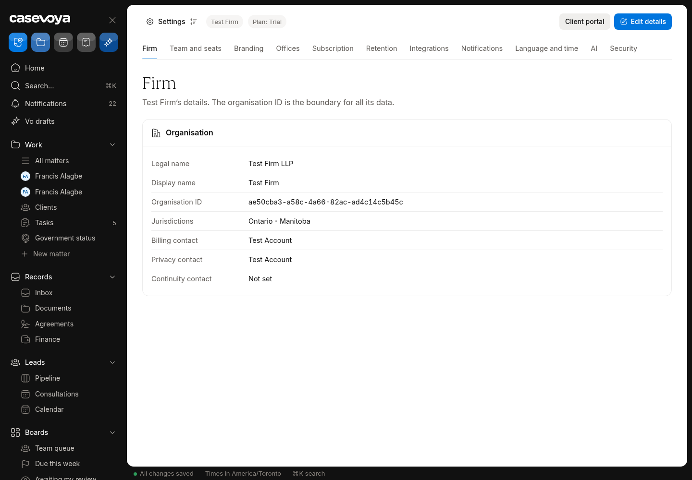
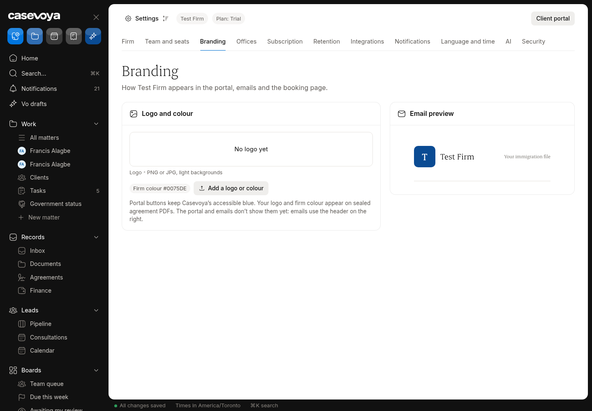
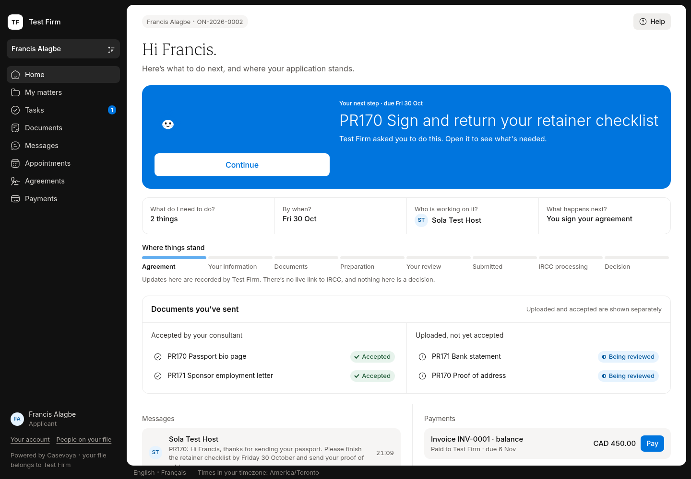
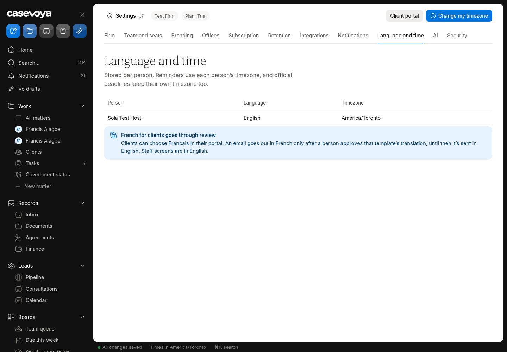
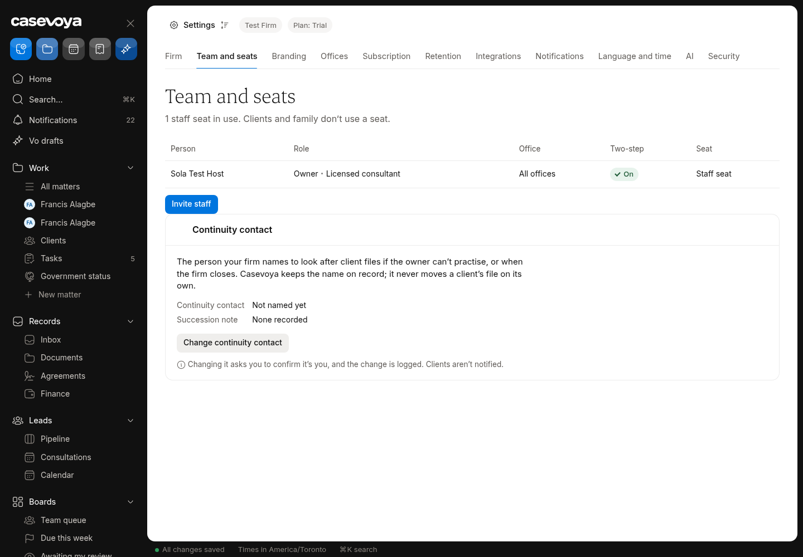

# ORG (Organization): partly built requirements

Requirements: ORG-01, ORG-06. Source: `docs/spec/PRD.md`, status from the PRD status review of main 6d5e54f (rechecked against aac7804, which adds only #173). UI checked on https://app.casevoya.ca on 2026-10-23.

Rules for whoever builds this: test mode only for Stripe (never live keys); new migrations go in `supabase/migrations/` and are applied by Francis, not by the builder; immigration content (rules, fees, forms, document lists, dates) is built from official IRCC / Government of Canada sources, with the source URL and retrieval date stored with each value (see **Official sources** below); wording follows `docs/spec/DECISIONS.md` and the design system.

## Official sources (applies to everything in this file)

Francis's direction: build the real content using accurate, current information from IRCC. Don't build placeholder, sample or example rules, fees, dates, forms or sources.

- Use only official IRCC / Government of Canada sources:
  - IRCC home: https://www.canada.ca/en/immigration-refugees-citizenship.html
  - Application forms and guides (form numbers and "date modified"): https://www.canada.ca/en/immigration-refugees-citizenship/services/application/application-forms-guides.html
  - IRCC fee list: https://ircc.canada.ca/english/information/fees/fees.asp
  - Processing times: https://www.canada.ca/en/immigration-refugees-citizenship/services/application/check-processing-times.html. IRCC says these times are "not a maximum or a guarantee", so show them as IRCC's estimate with the date checked.
  - Program pages and instruction guides on canada.ca for each program.
  - Where relevant, Justice Laws: IRPA https://laws-lois.justice.gc.ca/eng/acts/I-2.5/ and IRPR https://laws-lois.justice.gc.ca/eng/regulations/SOR-2002-227/. Record the "current to" date shown on the page.
- **Store the source with every value.** Every rule, fee, form, document list, deadline or date stores:
  - its official source URL, with the section or anchor;
  - the form number and the form's "date modified" where it applies;
  - the date it was retrieved, plus a snapshot hash;
  - the effective or "current to" date when the page states one.

  Store these with the rule or claim (SRC-01/02). Show them in the UI next to the value.
- **No invented values.** If something can't be found on an official page, leave it out, show it as Unknown where the UI needs a slot, and list it in your `## Handoff` comment. Don't guess.
- **Review before live.** Content goes live only through the licensed-reviewer approval (SRC-03). Matters pin the version they used (SRC-05). Vo cites these sources or abstains (SRC-09, AI-01).
- Spot check (retrieved 2026-10-23 from the fee list above):
  - "Study permit (including extensions) – per person" is $150.00.
  - "Right of permanent residence fee" is $600.00.

  Use the live page at build time, not these numbers.

## ORG-01: Organization profile, offices, branding

> **PRD ORG-01:** Create organizations with legal name, display name, office addresses, jurisdiction coverage, billing contact, privacy contact, locale, timezone, and custom branding. A unique organization ID is the tenant boundary.

**UI check:** partly present (route: /sheet/settings (Firm, Branding, Offices, Language and time); /portal)

- What's there: Settings > Firm shows legal name, display name, organisation ID, jurisdictions, billing / privacy / continuity contacts. Branding tab uploads a logo and sets a firm colour, with an email preview. Offices tab lists offices with address and timezone. Language and time lists each person's language and timezone.
- What's missing on screen: The portal sidebar shows initials ("TF"), not the firm logo; emails use a generic header and the tagline "Your immigration file"; Branding says "The portal and emails don't show them yet". No firm default-locale control. Offices don't scope staff (Staff column "—").

**Built today**

- `src/modules/firm-onboarding/firm-logo.ts`, `public-logo.ts`, `src/app/api/firm/logo/route.ts` (logo upload and public read)
- `src/modules/sheet/settings-firm-load.ts`, `settings-firm-present.ts`, `src/modules/settings/firm-actions.ts` (Firm, Offices, Branding tabs)
- `organizations.branding`, `organizations.default_locale` columns (`supabase/migrations/20261017040614_foundation_core.sql`)
- Logo and colour already used on sealed agreement PDFs (`src/modules/agreements/`)

**Missing (acceptance criteria)**

- [ ] The firm's logo (or its initials when there is no logo) and firm colour show in the client portal sidebar tile and mobile header, per the #167 design (`.firmlogo`). Portal buttons keep Casevoya's accessible blue.
- [ ] Transactional emails (`src/modules/email/designs/layout.ts`) show the firm logo/name in the header; the hard-coded preheader/tagline "Your immigration file" on every email is replaced by per-template text.
- [ ] Settings > Language and time gets a firm **default locale** (English / Français) saved to `organizations.default_locale`; new client invites default to it.
- [ ] Branding tab copy no longer says the portal and emails don't show the logo once they do.

**Likely migration:** Probably none (`branding` and `default_locale` exist). Only if a white/square logo variant is stored.

**UI test steps**

1. Settings > Branding: upload a PNG logo, set colour; reload: both persist.
2. Open /portal as the Test Firm client (falagbe@scootaround.com): sidebar tile shows the firm logo; colour doesn't replace primary buttons.
3. Trigger a document-request email in a test matter; email header shows the firm, preheader isn't "Your immigration file".
4. Settings > Language and time: set default locale to Français, invite a test client: invite is French-default.

**Open PRs:** #167 (spec) designs the portal firm-logo tile; #170 shipped the sidebar with an initials tile only. The logo itself is not in any open PR.

## ORG-06: Continuity contact, succession, offboarding

> **PRD ORG-06:** Maintain a named continuity contact and succession procedure for incapacity, closure, or staff departure. Revoke departing staff access, reassign open tasks and deadline ownership, and review client authority before moving matters. A receiving firm gets a permissioned export and separately verified onboarding; the platform does not transfer confidential records merely because another firm requests them.

**UI check:** partly present (route: /sheet/settings?tab=team)

- What's there: Team and seats lists staff with role, office, two-step and seat; offboard / role change / suspend controls (#105); Continuity contact and Succession note panel with "Change continuity contact" (step-up, logged).
- What's missing on screen: On offboarding, no step to move the person's open leads and booking-host duties; no client notice when a matter's consultant changes; no receiving-firm transfer flow (permissioned export + separately verified onboarding).

**Built today**

- `src/modules/settings/settings-staff-admin-actions.ts`, `src/modules/sheet/settings-staff-admin-present.ts`
- `supabase/migrations/20261019217000_settings_staff_admin.sql` (offboard, role change, suspend, continuity contact, succession note)
- Task and deadline reassignment on offboarding (#105)

**Missing (acceptance criteria)**

- [ ] Offboarding a staff member lists their open **leads** and **booking types / upcoming consultations they host**, and requires choosing a new owner/host for each before access is revoked (audited).
- [ ] When a matter's responsible consultant changes, the client (and other portal participants) gets an in-portal notice and an email using an approved minimal-content template; the staff screen shows the audience before sending.
- [ ] A **firm transfer** record: the owner (step-up) records a receiving firm and the matters in scope, then creates a permissioned client-file export per matter (reuse `src/modules/exports/`). Nothing is moved automatically; status is visible on Settings > Team (Continuity).
- [ ] Client authority review step before a matter is moved (checkbox + note, audited).

**Likely migration:** Yes: likely a `firm_transfers` table (+ items) and functions to reassign lead owner / booking host on offboard.

**UI test steps**

1. Invite a throwaway staff member in Test Firm, make them owner of one lead and host of one booking type, offboard them: the dialog forces reassignment of both; audit row written.
2. Change consultant on ON-2026-0002: the Test Firm client sees a notice in /portal; email logged in outbox.
3. Start a firm transfer for one matter: export is created, nothing deleted, status shown on Team tab.

**Open PRs:** Not covered by any open PR.

