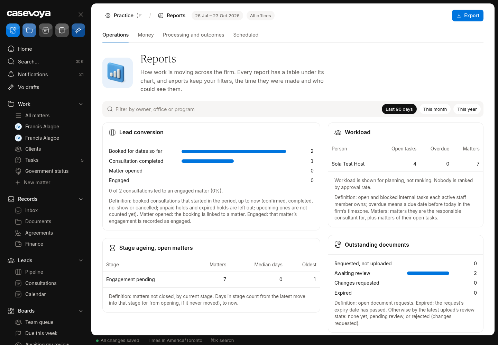
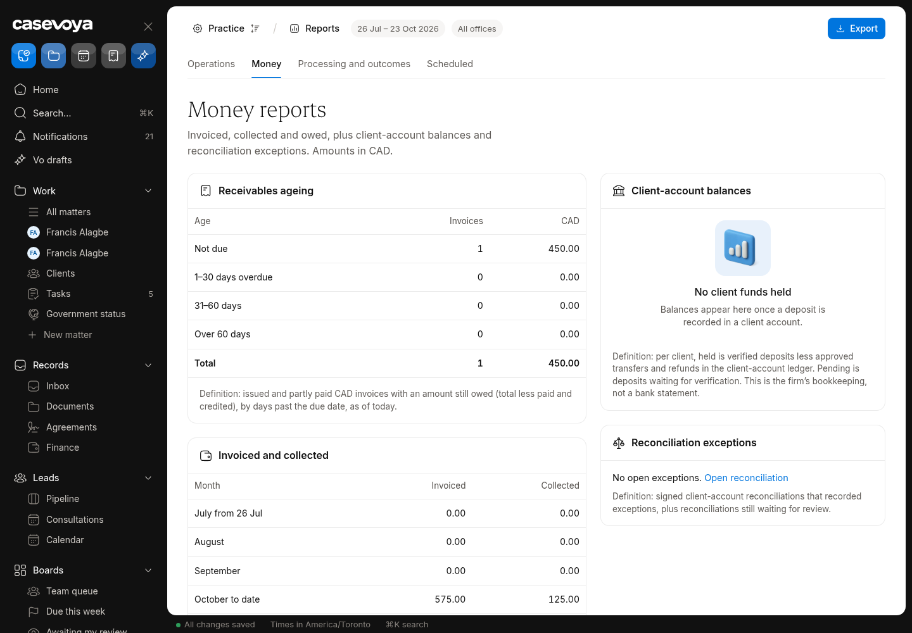
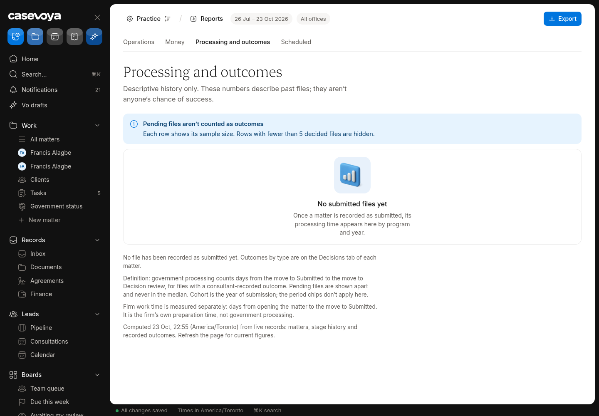
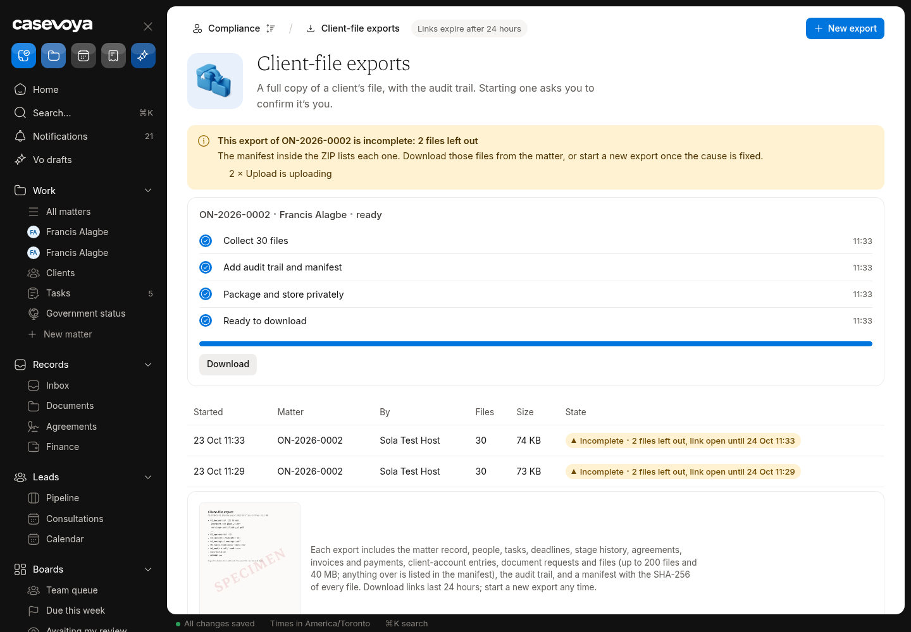
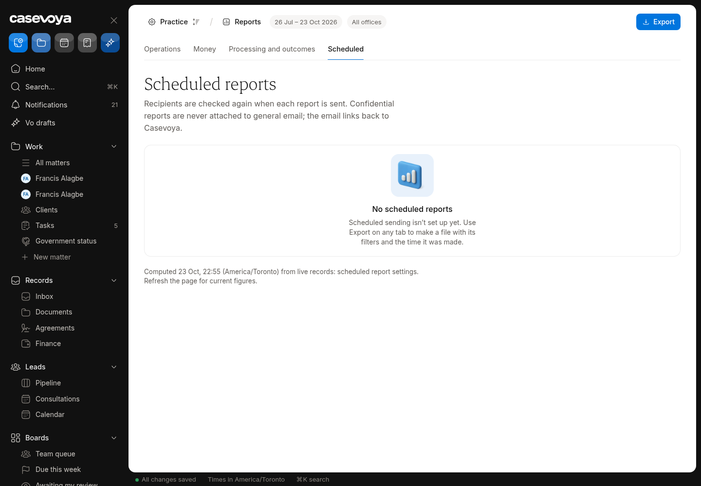

# REP (Reports): partly built requirements

Requirements: REP-01, REP-02, REP-03. Source: `docs/spec/PRD.md`, status from the PRD status review of main 6d5e54f (rechecked against aac7804, which adds only #173). UI checked on https://app.casevoya.ca on 2026-10-23.

Rules for whoever builds this: test mode only for Stripe (never live keys); new migrations go in `supabase/migrations/` and are applied by Francis, not by the builder; immigration content (rules, fees, forms, document lists, dates) is built from official IRCC / Government of Canada sources, with the source URL and retrieval date stored with each value (see **Official sources** below); wording follows `docs/spec/DECISIONS.md` and the design system.

## Official sources (applies to everything in this file)

Francis's direction: build the real content using accurate, current information from IRCC. Don't build placeholder, sample or example rules, fees, dates, forms or sources.

- Use only official IRCC / Government of Canada sources:
  - IRCC home: https://www.canada.ca/en/immigration-refugees-citizenship.html
  - Application forms and guides (form numbers and "date modified"): https://www.canada.ca/en/immigration-refugees-citizenship/services/application/application-forms-guides.html
  - IRCC fee list: https://ircc.canada.ca/english/information/fees/fees.asp
  - Processing times: https://www.canada.ca/en/immigration-refugees-citizenship/services/application/check-processing-times.html. IRCC says these times are "not a maximum or a guarantee", so show them as IRCC's estimate with the date checked.
  - Program pages and instruction guides on canada.ca for each program.
  - Where relevant, Justice Laws: IRPA https://laws-lois.justice.gc.ca/eng/acts/I-2.5/ and IRPR https://laws-lois.justice.gc.ca/eng/regulations/SOR-2002-227/. Record the "current to" date shown on the page.
- **Store the source with every value.** Every rule, fee, form, document list, deadline or date stores:
  - its official source URL, with the section or anchor;
  - the form number and the form's "date modified" where it applies;
  - the date it was retrieved, plus a snapshot hash;
  - the effective or "current to" date when the page states one.

  Store these with the rule or claim (SRC-01/02). Show them in the UI next to the value.
- **No invented values.** If something can't be found on an official page, leave it out, show it as Unknown where the UI needs a slot, and list it in your `## Handoff` comment. Don't guess.
- **Review before live.** Content goes live only through the licensed-reviewer approval (SRC-03). Matters pin the version they used (SRC-05). Vo cites these sources or abstains (SRC-09, AI-01).
- Spot check (retrieved 2026-10-23 from the fee list above):
  - "Study permit (including extensions) – per person" is $150.00.
  - "Right of permanent residence fee" is $600.00.

  Use the live page at build time, not these numbers.

## REP-01: Firm reports

> **PRD REP-01:** Firm reports include lead conversion, consultation attendance, intake completion, stage ageing, staff workload, outstanding documents, overdue tasks, time to internal readiness, invoiced and collected fees, receivables, client-account balances, reconciliation exceptions, and renewal workload.

**UI check:** partly present (route: /sheet/reports?tab=ops, ?tab=money)

- What's there: Reports Ops and Money tabs with several metrics (pipeline, matters by stage, invoiced/collected).
- What's missing on screen: Several metrics missing: consultation attendance, intake completion, stage ageing, staff workload, outstanding documents, overdue tasks, time to internal readiness, receivables ageing, client-account balances, reconciliation exceptions, renewal workload.

**Built today**

- `src/modules/reports/`, `src/modules/sheet/reports-*`

**Missing (acceptance criteria)**

- [ ] Add each missing metric listed above, from real data, with empty states when there's no data (never invented).
- [ ] Each card links to the filtered list behind it.

**Likely migration:** Maybe: report views/functions.

**UI test steps**

1. Reports > Ops on Test Firm: overdue tasks matches /sheet/tasks overdue filter; outstanding documents matches open requests.

**Open PRs:** Not covered by any open PR.

## REP-02: Outcome reports

> **PRD REP-02:** Government-processing duration and outcomes are descriptive reports segmented by program and cohort. Exclude pending cases from completed-outcome denominators and show sample size. Never present approval rates as an individual's chance of success or rank staff on raw approval rate without context.

**UI check:** present (route: /sheet/reports?tab=outcomes)

- What's there: Outcomes tab exists with sample-size rule and pending files excluded; empty for Test Firm because no files are decided.
- What's missing on screen: Nothing obvious missing in the UI; needs proof with data (segmentation by program and cohort, processing duration).

**Built today**

- `src/modules/reports/` outcomes

**Missing (acceptance criteria)**

- [ ] Verify segmentation by program **and cohort** and processing-duration view with seeded decided matters.
- [ ] Copy never presents rates as a chance of success; no staff ranking.
- [ ] If IRCC's published processing time is shown next to the firm's own durations, it comes from the official processing-times page with the date checked, clearly separate from the firm's data.

**Likely migration:** None expected.

**UI test steps**

1. Seed decided test matters (test firm only): Outcomes shows counts with n and durations; pending excluded.

**Open PRs:** Not covered by any open PR.

## REP-03: Exports and scheduled reports

> **PRD REP-03:** CSV and PDF exports preserve filters, generated time, currency, and authorization. Scheduled reports recheck recipients at send time. Do not put confidential report attachments into general email by default.

**UI check:** partly present (route: /sheet/reports?tab=scheduled)

- What's there: CSV export of report tables; Scheduled tab says scheduled reports aren't set up.
- What's missing on screen: No PDF export; exports don't stamp filters/generated time/currency; no scheduled reports.

**Built today**

- Report CSV export (`src/modules/reports/`)

**Missing (acceptance criteria)**

- [ ] CSV and PDF exports include filters, generated time, currency and who generated them.
- [ ] **Scheduled reports**: choose report, frequency and recipients (staff only); at send time recipients' access is rechecked; email contains a portal link, not the confidential attachment.

**Likely migration:** Yes: `scheduled_reports`.

**UI test steps**

1. Export Money as PDF: header shows filters and time. Schedule weekly to yourself; run it now (test): email has a link only.

**Open PRs:** Not covered by any open PR.

