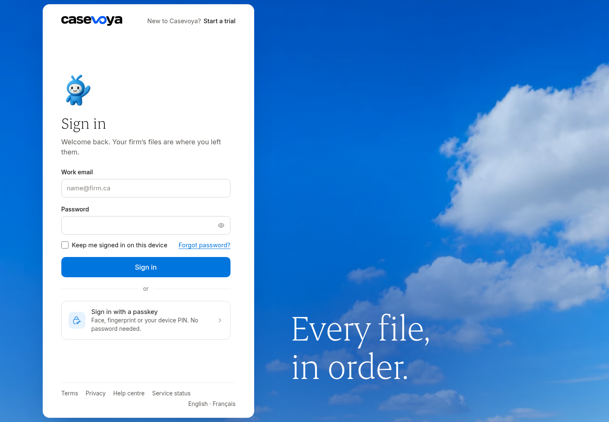
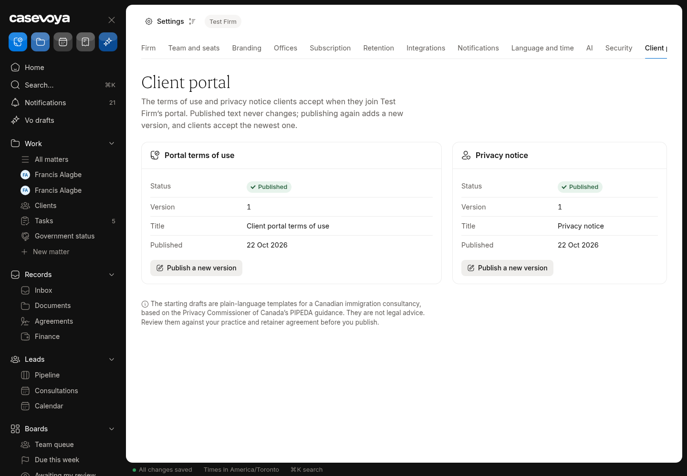
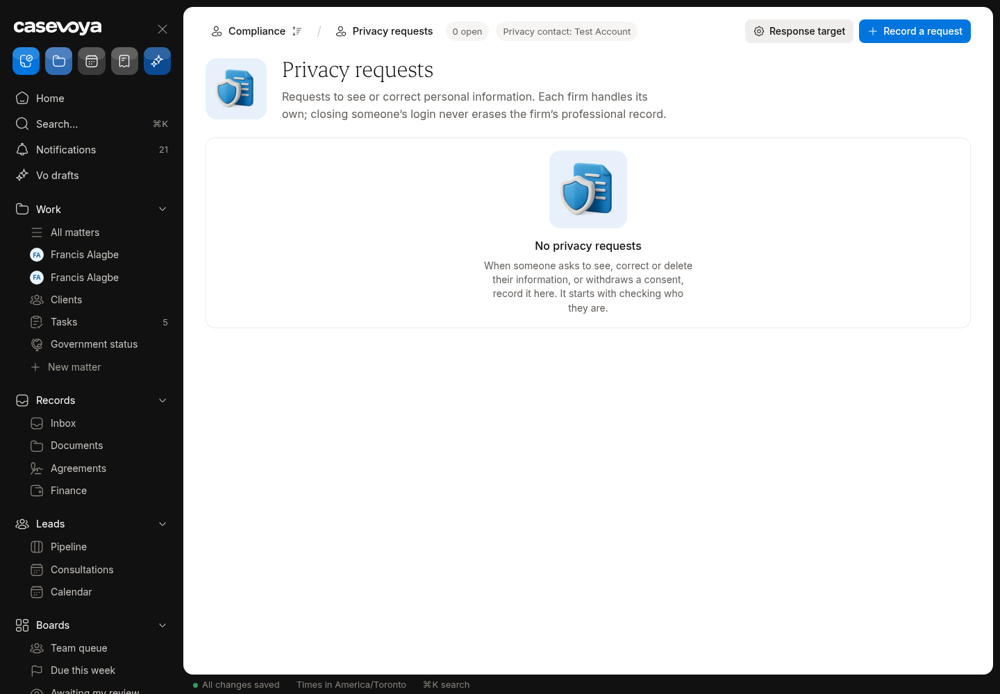
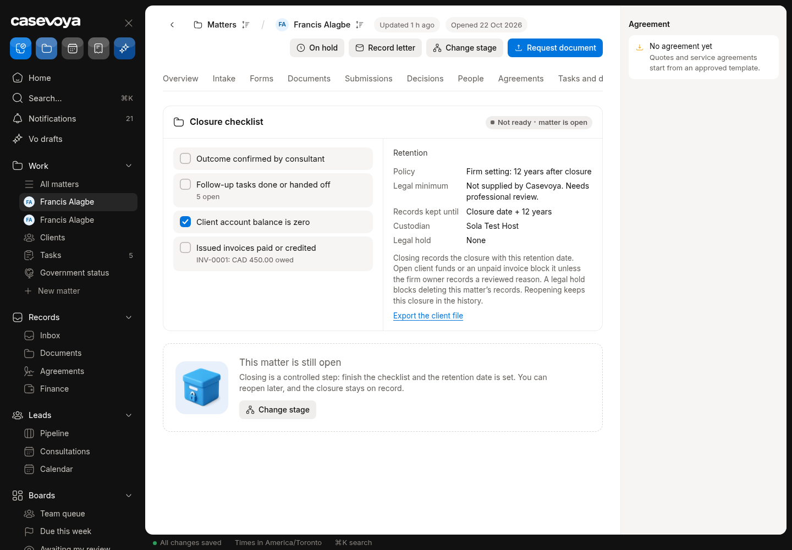
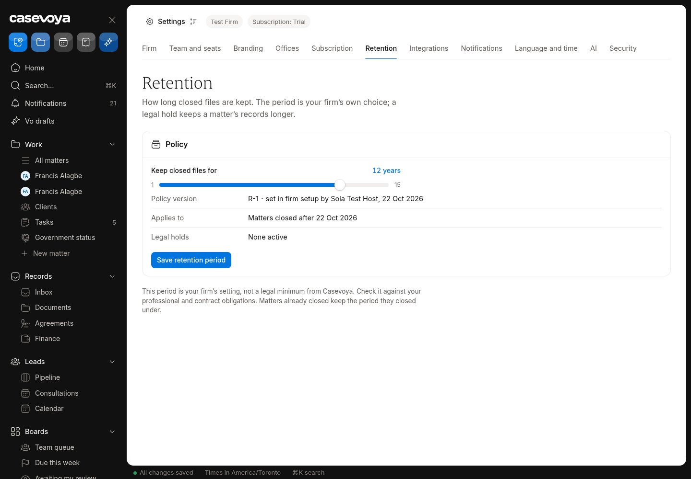
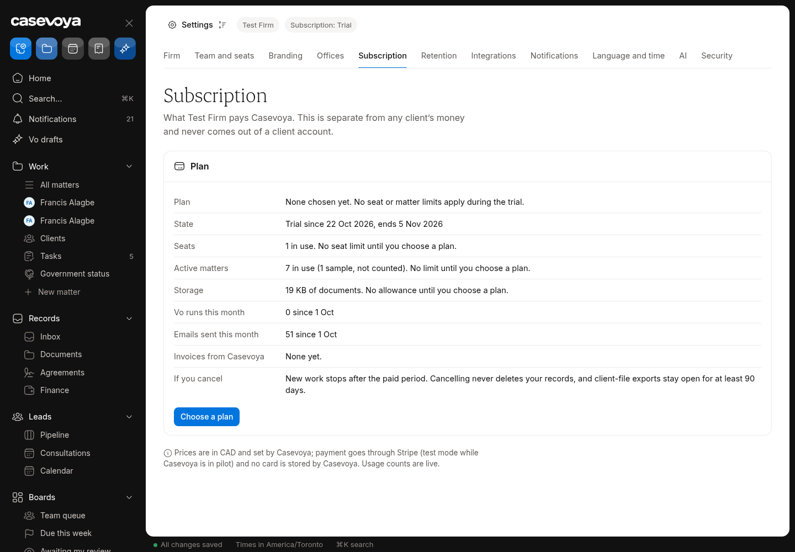

# SEC (Security and privacy): partly built requirements

Requirements: SEC-01, SEC-05, SEC-06, SEC-07, SEC-10. Source: `docs/spec/PRD.md`, status from the PRD status review of main 6d5e54f (rechecked against aac7804, which adds only #173). UI checked on https://app.casevoya.ca on 2026-10-23.

Rules for whoever builds this: test mode only for Stripe (never live keys); new migrations go in `supabase/migrations/` and are applied by Francis, not by the builder; immigration content (rules, fees, forms, document lists, dates) is built from official IRCC / Government of Canada sources, with the source URL and retrieval date stored with each value (see **Official sources** below); wording follows `docs/spec/DECISIONS.md` and the design system.

## Official sources (applies to everything in this file)

Francis's direction: build the real content using accurate, current information from IRCC. Don't build placeholder, sample or example rules, fees, dates, forms or sources.

- Use only official IRCC / Government of Canada sources:
  - IRCC home: https://www.canada.ca/en/immigration-refugees-citizenship.html
  - Application forms and guides (form numbers and "date modified"): https://www.canada.ca/en/immigration-refugees-citizenship/services/application/application-forms-guides.html
  - IRCC fee list: https://ircc.canada.ca/english/information/fees/fees.asp
  - Processing times: https://www.canada.ca/en/immigration-refugees-citizenship/services/application/check-processing-times.html. IRCC says these times are "not a maximum or a guarantee", so show them as IRCC's estimate with the date checked.
  - Program pages and instruction guides on canada.ca for each program.
  - Where relevant, Justice Laws: IRPA https://laws-lois.justice.gc.ca/eng/acts/I-2.5/ and IRPR https://laws-lois.justice.gc.ca/eng/regulations/SOR-2002-227/. Record the "current to" date shown on the page.
- **Store the source with every value.** Every rule, fee, form, document list, deadline or date stores:
  - its official source URL, with the section or anchor;
  - the form number and the form's "date modified" where it applies;
  - the date it was retrieved, plus a snapshot hash;
  - the effective or "current to" date when the page states one.

  Store these with the rule or claim (SRC-01/02). Show them in the UI next to the value.
- **No invented values.** If something can't be found on an official page, leave it out, show it as Unknown where the UI needs a slot, and list it in your `## Handoff` comment. Don't guess.
- **Review before live.** Content goes live only through the licensed-reviewer approval (SRC-03). Matters pin the version they used (SRC-05). Vo cites these sources or abstains (SRC-09, AI-01).
- Spot check (retrieved 2026-10-23 from the fee list above):
  - "Study permit (including extensions) – per person" is $150.00.
  - "Right of permanent residence fee" is $600.00.

  Use the live page at build time, not these numbers.

## SEC-01: Staff MFA, sessions, step-up

> **PRD SEC-01:** Enforce MFA for staff, secure session cookies, session inventory and revocation, login rate limits, credential-stuffing protections, and step-up authentication for exports, payment configuration, role changes, and sensitive downloads. Client MFA is available and required for high-risk actions; recovery must not rely on easily known biographical answers.

**UI check:** partly present (route: /sheet/settings?tab=security, /mfa)

- What's there: Staff MFA (TOTP) enforced via aal2; session list with revoke; step-up for exports, payment config, role changes; login rate limit. Security tab lists settings.
- What's missing on screen: Security tab shows "Session timeout: No idle timeout yet… Off" (no idle timeout); step-up dialog reason text is generic/wrong for some actions; client MFA isn't offered in the portal; recovery path not shown.

**Built today**

- `src/modules/auth/` (MFA, step-up), `src/app/mfa/`
- Settings Security tab (`src/modules/sheet/settings-security-*`)

**Missing (acceptance criteria)**

- [ ] **Idle timeout**: firm setting (e.g. 30 min default for staff) that signs out idle sessions with a warning 2 minutes before; Security tab shows the value and On.
- [ ] Step-up dialog states the exact action ("to export client files", "to change a role", …) from the calling action, not a generic text.
- [ ] **Client MFA** opt-in on /portal/account (TOTP), required for high-risk client actions (e.g. changing email, downloading full exports); recovery via verified firm process, not email alone.

**Likely migration:** Maybe: idle-timeout setting column.

**UI test steps**

1. Set idle timeout 5 min (test), stay idle: warning then sign-out.
2. Trigger a role change: step-up says "to change a role".
3. As the Test Firm client, enable MFA on Account; sign in again: code required.

**Open PRs:** Not covered by any open PR.

## SEC-05: Consent and withdrawal impact review

> **PRD SEC-05:** Use purpose-specific notices and consent or other documented authority as appropriate. Separate core processing, optional AI, optional channels, and marketing. Withdrawal starts an impact review; it does not automatically destroy records subject to retention or hold.

**UI check:** partly present (route: /sheet/settings (Portal / policies), /portal/account)

- What's there: Separate notices/consents for core processing, AI, channels and marketing; client-side consent switches (#173, now merged, display only).
- What's missing on screen: Withdrawing a consent doesn't start an **impact review**; staff can't see who withdrew what or act on it; withdrawal never deletes retained records (needs to be stated).

**Built today**

- Consent records (`src/modules/consent/` or policies)
- Portal policies page

**Missing (acceptance criteria)**

- [ ] Client withdraws a consent (e.g. AI, SMS, marketing) on /portal/account: saved immediately for that purpose; staff get an **impact review** task listing affected features (e.g. Vo off for this client's documents, SMS stopped).
- [ ] Staff review screen: consent history per person; mark the review done with a note.
- [ ] Withdrawal of core-processing consent explains retention/legal hold; nothing is auto-deleted.

**Likely migration:** Yes: `consent_impact_reviews` (or tasks with a kind) and consent history if absent.

**UI test steps**

1. As the client, turn off AI consent: staff see an impact review task; Vo is skipped for that client's documents.

**Open PRs:** #173 (merged to main as aac7804 on 2026-10-23) adds the portal Account consent switches (display only). The impact review is not covered.

## SEC-06: Privacy requests (access/correction)

> **PRD SEC-06:** Maintain subject-access and correction workflows with identity verification, scope search, redaction of third-party information, reviewer, applicable due date, export, and delivery proof. Requests across firms are handled independently. A closed user login does not erase the firm's professional record.

**UI check:** partly present (route: /sheet/settings (Privacy requests) or /sheet/privacy)

- What's there: Privacy requests list with identity verification, scope, reviewer and due date.
- What's missing on screen: No due-date **extension** (with reason/notice), no **export** package of the result with third-party redaction, no **delivery proof**.

**Built today**

- Privacy request tables and staff screens (`src/modules/privacy/`)

**Missing (acceptance criteria)**

- [ ] **Extend** due date with reason and a client notice (template).
- [ ] **Build response**: scope search across the person's records in this firm, redaction step for third-party info, export package (PDF/ZIP).
- [ ] **Deliver**: send through the portal with a download record; delivery proof stored; request closed.
- [ ] Requests across firms stay separate.
- [ ] Closing a user login never erases the firm's professional record.

**Likely migration:** Maybe: extension and delivery columns.

**UI test steps**

1. Create an access request for the Test Firm client; extend it; build an export; deliver via portal; client downloads; proof shown.

**Open PRs:** Not covered by any open PR.

## SEC-07: Retention, closure, deletion

> **PRD SEC-07:** At closure, set policy version, closure date, retention end, responsible custodian, and legal-hold status. Retained records are read-only except controlled annotations. Deletion requires eligibility checks and approval. Remove originals, derivatives, extracted text, embeddings, exports, and caches when appropriate; document backup expiry and reapply deletion tombstones after restore.

**UI check:** partly present (route: /sheet/settings?tab=retention, /sheet/matters/<matter id>?tab=closure)

- What's there: Retention tab: policy versions and legal hold; closure records policy, dates, custodian, legal hold; retained records read-only.
- What's missing on screen: No **deletion jobs** (eligibility check + approval) and no **tombstones** recording what was deleted.

**Built today**

- Retention policies, closure (`src/modules/retention/`, `src/modules/closure/`)

**Missing (acceptance criteria)**

- [ ] Settings > Retention: **Eligible for deletion** list (retention end passed, no hold); approver (step-up) creates a deletion job.
- [ ] Job deletes originals, derivatives, extracted text, embeddings, exports and caches; writes a **tombstone** (what, when, who approved, policy version) kept in place of the record.
- [ ] Legal hold blocks eligibility.

**Likely migration:** Yes: `deletion_jobs`, `deletion_tombstones`.

**UI test steps**

1. In a test matter with a back-dated retention end (test data only), approve deletion: files gone, tombstone shown; matter on hold is never listed.

**Open PRs:** Not covered by any open PR.

## SEC-10: Subscription cancellation and archive

> **PRD SEC-10:** On subscription cancellation, stop new work after the contracted period, retain necessary continuity access and export, and provide a defined custodial archive or verified transfer arrangement. Proposed export window is at least 90 days, subject to the retention contract. This window is not a permission to delete six-year records. No routine cancellation or nonpayment process may silently destroy client records.

**UI check:** partly present (route: /sheet/settings?tab=billing)

- What's there: Subscription status shown on Settings > Billing; exports available.
- What's missing on screen: No cancel subscription / custodial archive flow; no export window; nothing explains continuity access after cancellation.

**Built today**

- Subscription billing (`src/modules/subscription/`)
- Exports (`src/modules/exports/`)

**Missing (acceptance criteria)**

- [ ] Owner (step-up) **Cancel subscription**: shows end of contracted period; after it new work stops (no new matters/invites), read-only continuity access remains.
- [ ] **Export window** at least 90 days with a full firm export; then custodial archive or verified transfer (ORG-06); never deletion within retention.
- [ ] Banner across the app during the window.

**Likely migration:** Yes: cancellation state + archive fields on organizations/subscriptions.

**UI test steps**

1. Test-mode subscription: cancel; banner shows end date; after simulated end, creating a matter is refused; export still works.

**Open PRs:** Not covered by any open PR.

