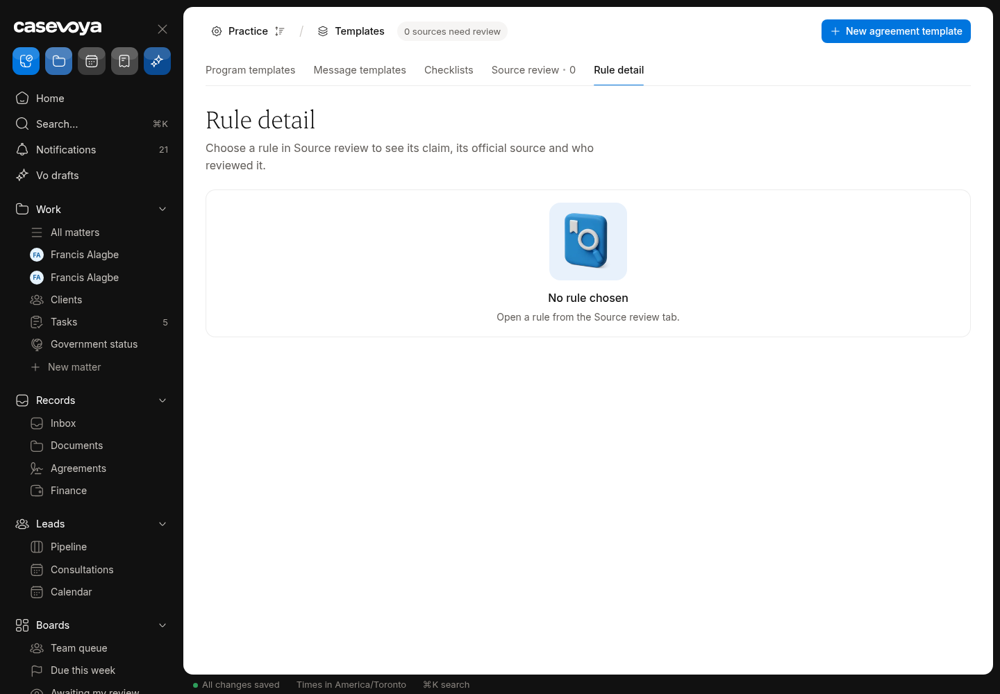
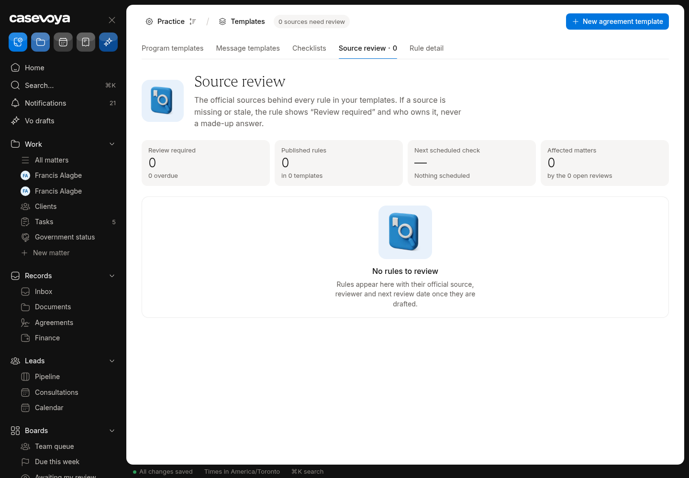
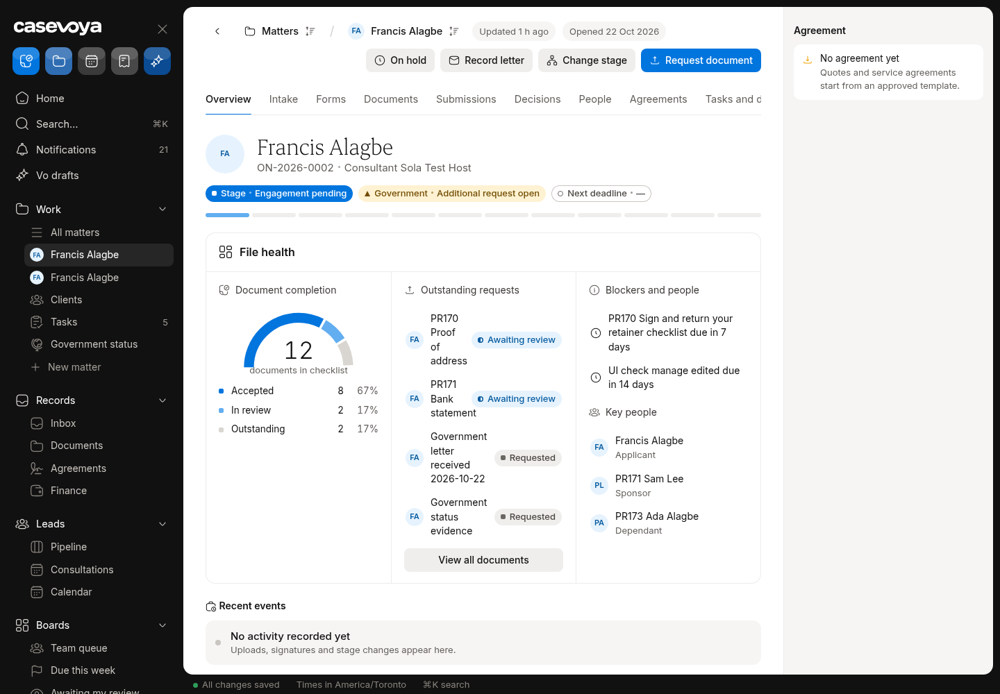
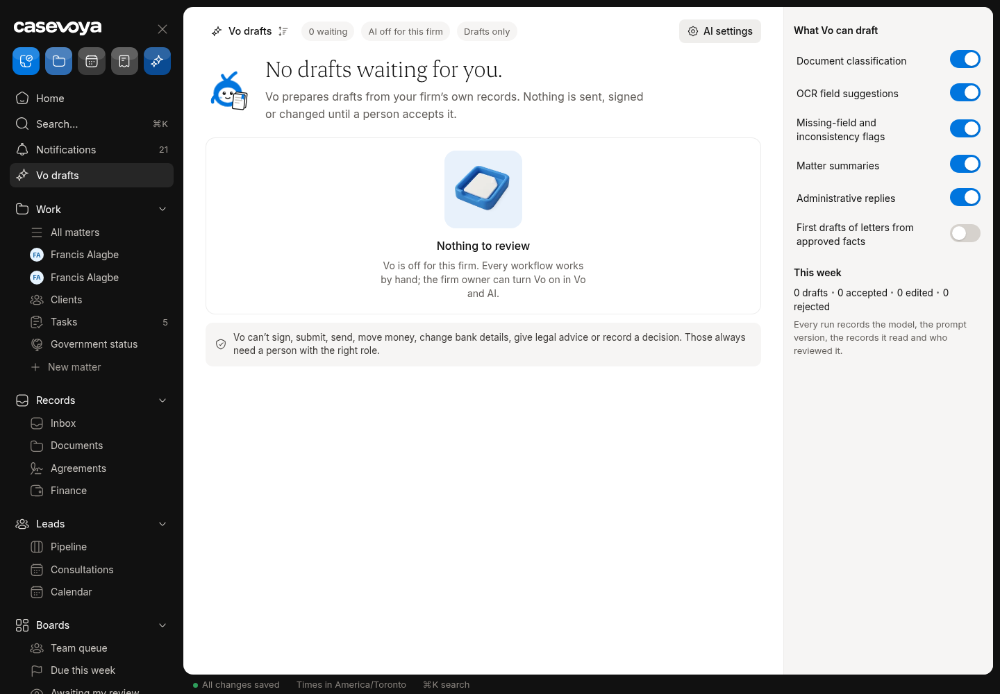
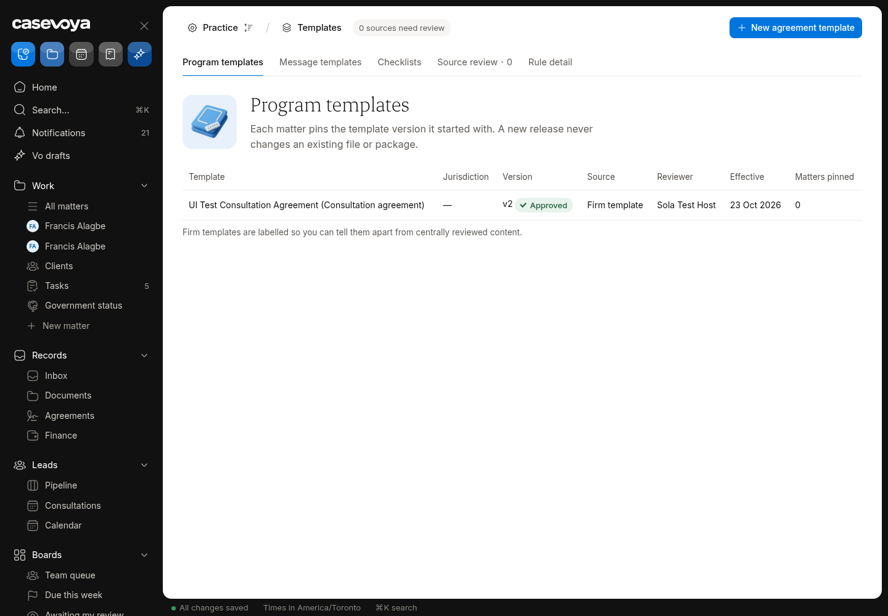

# SRC (Sources and rules): partly built requirements

Requirements: SRC-01, SRC-02, SRC-03, SRC-05, SRC-09, SRC-12. Source: `docs/spec/PRD.md`, status from the PRD status review of main 6d5e54f (rechecked against aac7804, which adds only #173). UI checked on https://app.casevoya.ca on 2026-10-23.

Rules for whoever builds this: test mode only for Stripe (never live keys); new migrations go in `supabase/migrations/` and are applied by Francis, not by the builder; no invented immigration rules, fees or dates; wording follows `docs/spec/DECISIONS.md` and the design system.

## SRC-01: Claim-level evidence

> **PRD SRC-01:** Store claim-level evidence. Each immigration claim resolves to jurisdiction, program/context, exact official URL and section, snapshot/hash, retrieval date, applicability, reviewer, and version. A homepage link alone fails.

**UI check:** partly present (route: /sheet/sources (Source review, Rule detail))

- What's there: Sources area with Source review and Rule detail tabs; tables for sources/claims exist; tabs are empty.
- What's missing on screen: No way to add a claim with exact official URL + section, snapshot/hash, retrieval date, applicability, reviewer and version.

**Built today**

- Source/claim tables and the Sources sheet

**Missing (acceptance criteria)**

- [ ] **Add claim**: jurisdiction, program, exact URL + section anchor, snapshot (stored + SHA-256), retrieval date, applicability note, version; a homepage URL is rejected.
- [ ] Rule detail lists its claims with evidence. Blocked in part on T001/T014 (first program and licensed reviewer): the *content* of an approved source pack is not something Claude should invent. Build the tooling with fictional sample rules marked as samples.

**Likely migration:** Maybe: snapshot storage columns.

**UI test steps**

1. Add a sample claim with a section URL: snapshot hash shown; a bare homepage URL is refused.

**Open PRs:** Not covered by any open PR.

## SRC-02: Authority vs observation dates

> **PRD SRC-02:** Separate authority from observation. Record published, modified, effective, consolidation-current-to, retrieved, and reviewed dates separately. Missing dates remain unknown; a reviewer must explicitly resolve applicability before publication. Never invent a date.

**UI check:** partly present (route: /sheet/sources)

- What's there: Date columns exist in the data model.
- What's missing on screen: No review screen showing published / modified / effective / consolidated-to / retrieved / reviewed dates separately with Unknown where missing; no explicit applicability resolution step.

**Built today**

- Source tables

**Missing (acceptance criteria)**

- [ ] Claim review shows each date separately; missing ones say Unknown (never filled in).
- [ ] Reviewer must resolve applicability (applies / doesn't / partly + note) before publication.

**Likely migration:** Maybe none.

**UI test steps**

1. Open a sample claim with no effective date: shows Unknown; Publish is blocked until applicability resolved.

**Open PRs:** Not covered by any open PR.

## SRC-03: Publication gate

> **PRD SRC-03:** Gate publication. Only a qualified authorized reviewer can approve the immutable rule version for its scope. Draft, unresolved, rejected, suspended, or expired review status cannot become live through an import, API, AI response, or background job.

**UI check:** partly present (route: /sheet/sources)

- What's there: DB status values and checks for rule versions.
- What's missing on screen: No review workbench where a qualified reviewer approves an immutable rule version; nothing on screen shows statuses (draft, unresolved, rejected, suspended, expired).

**Built today**

- Rule version tables/status

**Missing (acceptance criteria)**

- [ ] **Review workbench**: queue of rule versions awaiting review; approve (licensed reviewer role + step-up) makes it immutable and live for its scope; reject/suspend with reason.
- [ ] Server-side: imports, API, AI and jobs can't make a non-approved version live (test).

**Likely migration:** Maybe: reviewer-qualification column.

**UI test steps**

1. Try to publish a sample rule as a non-licensed user: refused. As licensed reviewer: approved, version locked.

**Open PRs:** Not covered by any open PR.

## SRC-05: Pin and migrate matter rule versions

> **PRD SRC-05:** Pin and migrate matter versions. A matter and each generated package record rule-pack and form versions. Upgrades require an impact preview and an audited decision; original evidence and exports remain reproducible.

**UI check:** not present (route: /sheet/matters/<matter id>?tab=overview)

- What's there: Nothing on the matter shows which rule-pack or form version it uses; `matter_rule_bindings` exists in the DB but isn't used in `src/modules`.
- What's missing on screen: Whole feature: no pinned version display, no upgrade with impact preview, no audited decision.

**Built today**

- `matter_rule_bindings` table only

**Missing (acceptance criteria)**

- [ ] Matter overview shows **Rule pack vX / Form vY** pinned at creation; packages record the versions used.
- [ ] When a newer approved version exists: **Review upgrade** shows an impact preview (changed checklist items, fields, deadlines); staff accept or decline (audited); old exports stay reproducible.

**Likely migration:** Probably none for bindings; maybe package version columns.

**UI test steps**

1. Create a matter: overview shows pinned sample versions; publish a new sample version: Review upgrade appears with diff; accept: binding updated, audit row.

**Open PRs:** Not covered by any open PR.

## SRC-09: Grounded AI outputs

> **PRD SRC-09:** Ground AI outputs. AI can draft from authorized matter evidence and approved source versions only. It cites supporting evidence or abstains. Human review is required for advice-like communications and submission material. Retrieved text cannot authorize tools or override project rules.

**UI check:** partly present (route: /sheet/matters/<matter id> (Vo panel))

- What's there: Vo drafts from matter evidence and abstains when unsure; human review for client communications.
- What's missing on screen: Vo outputs don't show citations to evidence/approved source versions on screen; no visible abstain state; retrieved-text tool-injection protection not tested.

**Built today**

- `src/modules/vo/`

**Missing (acceptance criteria)**

- [ ] Each Vo output lists citations (document/answer/source version) and links to them; if nothing supports it, Vo says it can't answer.
- [ ] Advice-like drafts and submission material require licensed review before sending.
- [ ] Tests: retrieved text containing instructions can't trigger tools.

**Likely migration:** None expected.

**UI test steps**

1. Ask Vo a question about a test matter: answer shows citations; ask about something not in the file: abstains.

**Open PRs:** Not covered by any open PR.

## SRC-12: Honest scope

> **PRD SRC-12:** Keep scope honest. Jurisdiction and program support are visible. Unsupported provinces, tribunals, countries, or case types cannot inherit another pack by default. No government integration, licence verification, approval, or processing guarantee may be claimed without corresponding evidence.

**UI check:** partly present (route: /sheet/support or Settings, public site)

- What's there: Jurisdictions on the firm profile; no claims of government integration.
- What's missing on screen: No **support catalogue** listing supported jurisdictions/programs; unsupported ones aren't clearly marked; no block on inheriting another pack.

**Built today**

- Firm jurisdictions

**Missing (acceptance criteria)**

- [ ] **What Casevoya supports** page (staff and public): jurisdictions, programs, case types with status (supported / not supported), from config.
- [ ] Creating a matter for an unsupported program shows a clear message and no checklist/rules are inherited.

**Likely migration:** Maybe a `supported_scopes` table.

**UI test steps**

1. Open the support catalogue; start a matter for an unsupported type: warning, no checklist.

**Open PRs:** Not covered by any open PR.

