# Consultation agreement states and the full signing flow

Docs only. Implementation to follow. Francis confirms merges.

This is the build spec for the consultation agreement on a booking: the staff record, the void dialog, and the public signing page. The visual reference is `design/consultations-pr161/`. Nothing in that folder is imported by the app.

The app already sends, voids, and signs these agreements (PRs #159–#161). This change fills the states the record hides today and replaces the single signing form with the flow in the design. Leave matter envelopes, their void copy, and their RPCs as they are.

## Ground rules

- **Fonts.** Keep the app’s split in `src/styles/kit/typography.css`: Inter (`--font-ui`) for interface text, including the six code boxes, and Erode for headings (`h1`, `.display`). The design folder sets Erode on `body` only because that folder ships Erode and no Inter. A typed signature may render in Erode italic; that is the mark, not body text.
- **Palette.** `#0075DE`, `#F6F5F4`, `#111`, already `--blue`, `--canvas`, and `--ink`. The void button stays `#a12c20`, the same red as `VoidEnvelopeDialog`.
- **Signing stays in-house.** The badge and the footer read **Signing secured by Casevoya**, as written in `design/consultations-pr161/app-v2/esign/index.html`. `design/consultations-pr161/app-v2/sheet/shell.js` still has a prototype matter-sidebar line that names a signing vendor. Do not copy that string into the app.
- **Icons.** The app keeps `/assets/icons-coreui/sprite.svg`. `shots-real-icons/` is the icon reference (1440×900). `app-v2/kit/icons-open.js` is a Lucide stand-in for the other prototype pages and must not be added to the app. Match size, placement, and meaning.
- **Demo chrome stays in the prototype.** The record’s “demo state” chips and the signing page’s state nav (`es-sw`, `?state=`) are not product UI.
- **Migrations stay additive.** New columns and functions only. Francis confirms the merge.

## What already exists

Use these; do not replace them with a second agreement system.

| Piece | Where | Behavior to keep |
|---|---|---|
| Table | `public.booking_agreements` | One live row per booking (`sent` or `signed`). A voided row stays. `voided_by`, `voided_at`, and `void_reason` (3–500 characters) are already columns. Staff who can read scheduling can `select` the table. |
| Send | `public.send_booking_agreement` / `app.issue_booking_agreement` | Locks an approved consultation template onto an upcoming booking and queues EM08 (`booking_agreement.sent`) with idempotency `booking-agreement-email:<id>`. |
| Void | `public.void_booking_agreement(booking, reason)` | Scheduling staff. Requires a reason of 3–500 characters. Sets `voided_by`, `voided_at`, `void_reason`. Audits `booking_agreement.voided`. |
| Read for signing | `public.booking_agreement_for_signing(ref)` | Stable. Returns `open`, `signed`, `closed` (booking cancelled or expired), or `unavailable`. A voided row is skipped, so the public page currently has nothing to say. |
| Sign | `public.sign_booking_agreement` | Typed name, the stored e-sign consent, the SHA-256 of the text shown, IP, and user agent. Once. |
| Staff record | `recordAgreement` in `src/modules/scheduling/sheet-present.ts`, loaded in `src/modules/scheduling/sheet-load.ts` | The loader selects only `sent` and `signed`, and only `booking_id, status, title, template_version, signed_name, signed_at`. A voided agreement is absent, so the panel falls back to **None sent**. |
| Void control | `runBookingAgreementVoid` in `src/components/sheet/booking-acts.ts` | A second click on the button. `voidBookingAgreement` then sends the fixed reason `Withdrawn from the consultation record`. |
| Matter dialog to copy | `VoidEnvelopeDialog` in `src/components/sheet/designer/agreements-live.tsx` | `dialog.dlg`, a reason box, **Keep it**, and a red primary button. The consultation dialog uses that structure and the consultation copy below. It calls `void_booking_agreement`, not the envelope RPC. |
| Public page | `/consultation/<booking ref>/agreement`, `src/components/sheet/agreement-sign.tsx` | One form: name, consent, **Sign the agreement**. `data-live="1"`. Errors sit in the form (`role="alert"`). |
| Mail | EM08, booking variant, in `docs/EMAIL-TEMPLATES.md` | The worker sends it only while the agreement is `sent`, the consultation is still ahead, and email notices are on. |

The record panel today is titled **Booking, agreement and fee**. Its heading becomes **Agreement and fee**. When, with, where, lead, notes, outcome, history, and the fee line stay on the record. The prototype’s right-hand card omits those facts because it is only the agreement block. The prototype fee `INV-0211` and quote `Q-0044` are demo data. The live fee line stays **No fee** until a real fee exists.

Names in the prototype (Tomás Duarte, Northline Immigration, Dana Okonkwo-Hale) are fictional. The live page uses the booking’s firm, attendee, and locked agreement text.

## 1. Staff record — sent, not signed

Reference (real icons, 1440):

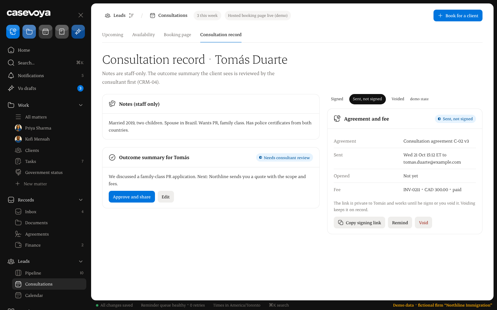

Phone layout (390, earlier icon set): [consultations-record-sent-390.png](../../design/consultations-pr161/shots/consultations-record-sent-390.png).

Open the prototype at `design/consultations-pr161/app-v2/sheet/consultations.html?tab=record&ag=sent`.

The panel heading is **Agreement and fee**, with a status chip **Sent, not signed** (existing chip tone `rev`).

Rows:

| Row | Content |
|---|---|
| Agreement | `{title} v{version}` from the locked row. |
| Sent | The sent time in the staff member’s zone, the same format as other consultation times, then `to {email}` of the primary attendee. The loader needs that email; it currently selects only the attendee’s name and zone. |
| Opened | **Not yet**, or the first-open time in that same zone. |
| Fee | The fee line the record already shows. |

Note, with the client’s first name (the first word of the attendee’s display name; the whole name when it is one word):

> The link is private to {client} and works until they sign or you void it. Voiding keeps it on record.

Buttons, in this order:

1. **Copy signing link** — the control that already copies `{origin}/consultation/{public_ref}/agreement`.
2. **Remind** — calls the reminder RPC below. Success toast: **Reminder sent**.
3. **Void** — opens the dialog. It does not void on the first click, and it does not arm a second click.

The upcoming list’s Agreement column shows **Sent, not signed** as it does now. A voided agreement shows **Voided** there, rather than an em dash. The list loader has the same `sent`/`signed` filter as the record and needs the same read.

A signed agreement keeps a **Signed** chip (tone `ok`), the title and version, who signed and when, and **Open the signed agreement**. Copy, Remind, and Void are absent. Older shots: [consultations-tab-record-ag-signed.png](../../design/consultations-pr161/shots/consultations-tab-record-ag-signed.png), [consultations-record-signed-390.png](../../design/consultations-pr161/shots/consultations-record-signed-390.png). The newer icon set has no signed-record shot.

## 2. Void dialog

Reference (real icons, 1440):

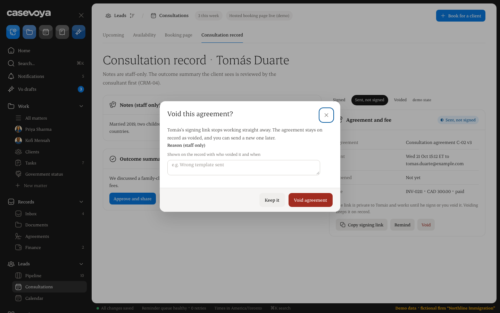

Earlier shot, before the reason box: [dialog-void-agreement.png](../../design/consultations-pr161/shots/dialog-void-agreement.png). The reason box in `consultations.html` is the one to build.

Reuse the matter dialog’s structure (`dialog.dlg`, close control, **Keep it**, red primary). Consultation copy:

- Title: **Void this agreement?**
- Body: **The signing link stops working straight away. The agreement stays on record as voided, and you can send a new one later.** The prototype inserts the client’s first name (“Tomás’s signing link…”). Use that first name the same way.
- Field label: **Reason (staff only)**
- Placeholder: `e.g. Wrong template sent`
- Hint: **Shown on the record with who voided it and when.**
- Buttons: **Keep it** (closes the dialog) and **Void agreement** (`#a12c20`).

The reason is required. The existing function rejects anything outside 3–500 characters. The textarea `maxlength` is 500 so it matches that function. The prototype’s 300 is only the static cap. An empty or too-short reason stays in the dialog with an inline error, the same pattern as the envelope void (“Say why this agreement is voided. It stays on the record.”). **Keep it** writes nothing.

Pass the typed reason to `void_booking_agreement`. Remove the hardcoded reason and the second-click arm.

## 3. Voided state

Reference (real icons, 1440):

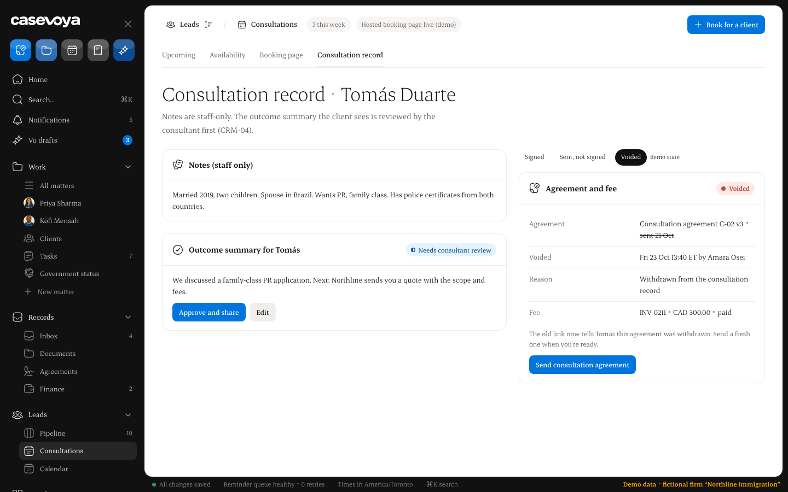

Phone: [consultations-record-voided-390.png](../../design/consultations-pr161/shots/consultations-record-voided-390.png).

Prototype: `?tab=record&ag=voided`.

Today the panel falls back to **None sent** because the loader never reads a voided row. The voided panel shows:

- Chip **Voided** (tone `bad`).
- Agreement line: `{title} v{version}`, then the sent date struck through (`sent {date}`).
- **Voided** row: when, and who. Who is the staff display name for `voided_by`, resolved the same way the record’s history resolves a staff user id. When `voided_by` is null, the row says **A staff member**.
- **Reason** row: `void_reason`, the staff-only text.
- Fee row, unchanged.
- Note: **The old link now tells {client} this agreement was withdrawn. Send a fresh one when you’re ready.**
- **Send consultation agreement** — the send action the record already uses when nothing is live. A voided row is not live, so `send_booking_agreement` already allows a new one. When the viewer has no approved consultation template, the button is absent and the note remains, as today’s empty send does.

The public page must not receive `void_reason` or `voided_by`.

A client decline (section 4) must not fall through to **None sent** either. Use this same card: chip **Declined**, the client’s reason, when they declined, the note that the link no longer accepts a signature, and **Send consultation agreement**. There is no staff screenshot for declined; the voided card is the layout.

## 4. Public signing page

The page stays `/consultation/<booking ref>/agreement`. The layout, steps, and end states are `design/consultations-pr161/app-v2/esign/index.html`. The prototype’s `?state=` values are how to open each card in a browser. The live page chooses the card from the agreement. It does not ship the state switcher.

The prototype document is an employer letter with page images and a second signer. A consultation agreement is the locked `body` and its SHA-256, signed by the booker alone. There is no countersignature and no completion-certificate download in this change. The receipt card says the firm has the signed agreement.

Header: the firm’s logo when the firm has one on file, otherwise the firm name. Beside it, a lock icon and **Signing secured by Casevoya**. Under 640px the words hide and the lock remains, as the prototype CSS does.

Footer: the Casevoya wordmark, **Signing secured by Casevoya**, **Every step is recorded with the time and the document’s fingerprint.**, and the existing Privacy and Help targets if the app already has those pages. Omit a link that has nowhere to go.

Every form that submits keeps `data-live="1"`. Validation and server errors render inline (`role="alert"`) next to the control. A toast may repeat a success; it is not the only place an error appears. The sample-mode banner on the current page stays.

Fingerprint: at 1440 show the full SHA-256. At the phone layout (390, the prototype’s 640px breakpoint) show `SHA-256` plus the first 4 and last 4 hex characters with an ellipsis, the prototype’s `9f3b…41aa` shape.

### Landing — `?state=landing`

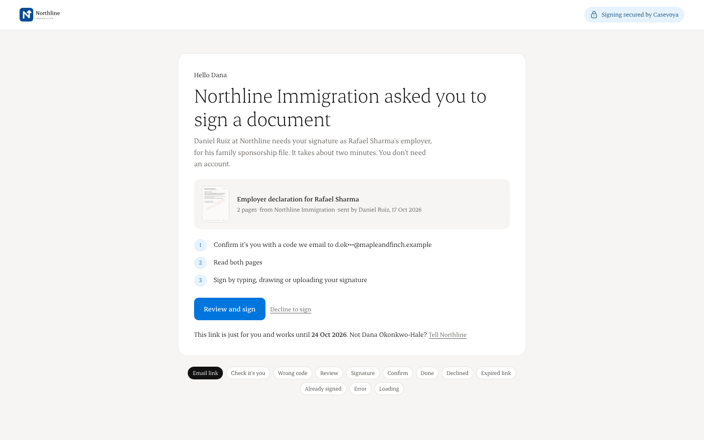

- Eyebrow: **Hello {first name}**
- Heading: **{Firm} asked you to sign your consultation agreement**
- Lead: the meeting title, the firm, and the time in the attendee’s zone, plus that it takes about two minutes and no account is needed.
- Document row: the agreement title, and “from {firm}”.
- Steps: (1) confirm it’s you with a code emailed to the masked address, (2) read the agreement, (3) sign by typing, drawing, or uploading.
- **Review and sign** starts the code check. **Decline to sign** opens the decline dialog.
- Note: the link is private and works until they sign or the firm voids it. **Not {name}?** records an audit `booking_agreement.wrong_recipient` and confirms inline that the firm was told. It does not reveal any address beyond the mask already on the page.

Mask the address the way the prototype does (`d.ok•••@mapleandfinch.example`): keep a short prefix, hide the rest of the local part, keep the domain.

### Email code — `?state=verify` and wrong code

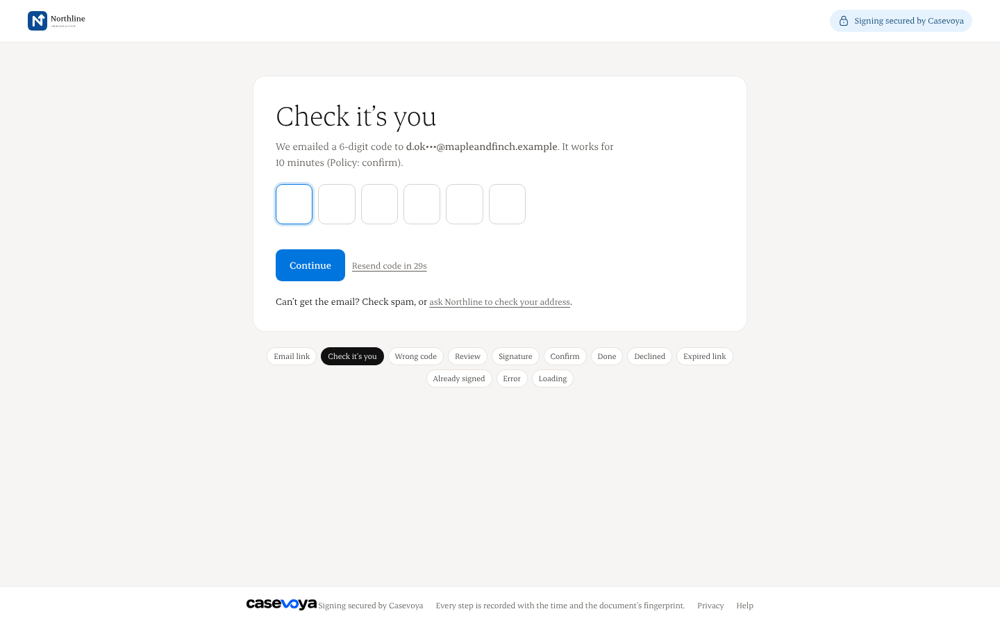

Wrong code (1440, earlier icons; the newer set has no wrong-code shot): [index-state-verify-error.png](../../design/consultations-pr161/shots/index-state-verify-error.png). Prototype: `?state=verify-error`.

- Heading: **Check it’s you**
- The code goes to the primary attendee’s email. Six digits. It works for 10 minutes. Those 10 minutes, and three attempts, are the numbers in the design (“2 tries left” after one failure). They are pending Francis’s confirmation; build them as stated.
- Six boxes, numeric, one character, paste fills them. The first box uses `autocomplete="one-time-code"`.
- **Continue** checks the code. A short code is an inline error: **Enter all 6 digits.** A wrong code is inline: **That code doesn’t match. Check the latest email; {n} tries left.** The boxes take the prototype’s bad style.
- **Resend** waits 30 seconds, then sends a new code. The previous code stops working. Inline confirmation: **New code sent.**
- After three failures the code is dead. The inline error tells them to resend. Nothing is signed.
- Store only a SHA-256 of the code. The audit records that a code was sent, not the code.
- **Can’t get the email?** The help line asks the firm to check the address (audit `booking_agreement.code_help`), with an inline confirmation.

Send the code through the outbox to the primary attendee. Add a row to `docs/EMAIL-TEMPLATES.md`, pending Francis: a short mail whose subject is **Your signing code from {firm}**, body containing the firm name and the code, and no second copy of the agreement. Honour **Email notices** the same way EM08 does. When notices are off, the page says the firm has email notices turned off for this person and does not invent another channel.

### Review — `?state=review`

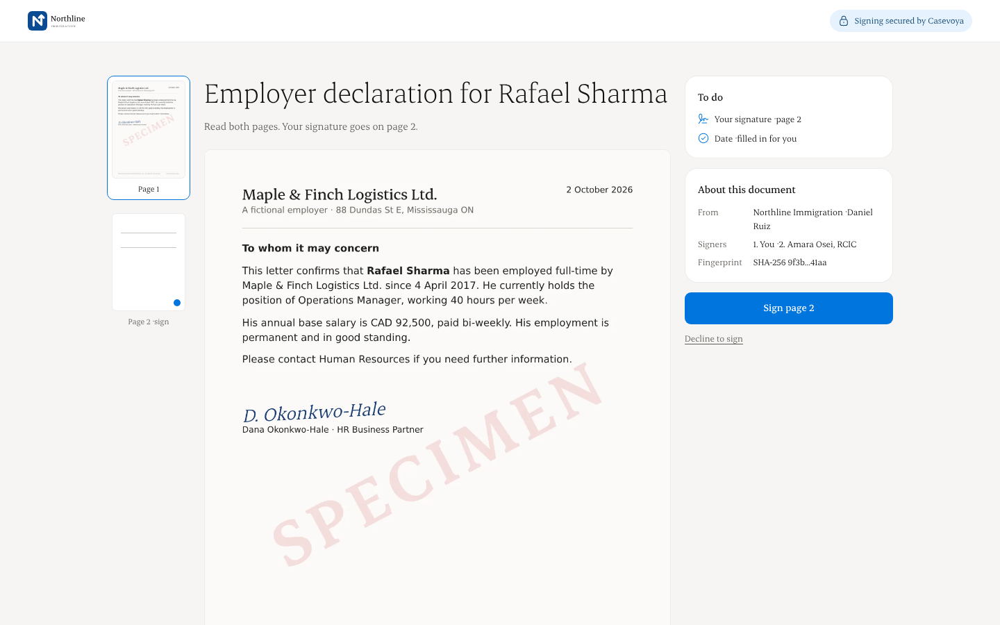

One document: the locked agreement text, scrollable, with the version and the fingerprint. The signature control reads **Sign here · required** and continues to the signature step. **Decline to sign** stays available. On a phone, the bottom bar shows what’s left and **Sign**.

The prototype’s two-page employment-letter images and thumbnail rail are that demo document. A consultation agreement is this one text. Do not render those specimen images.

### Signature — `?state=sign`

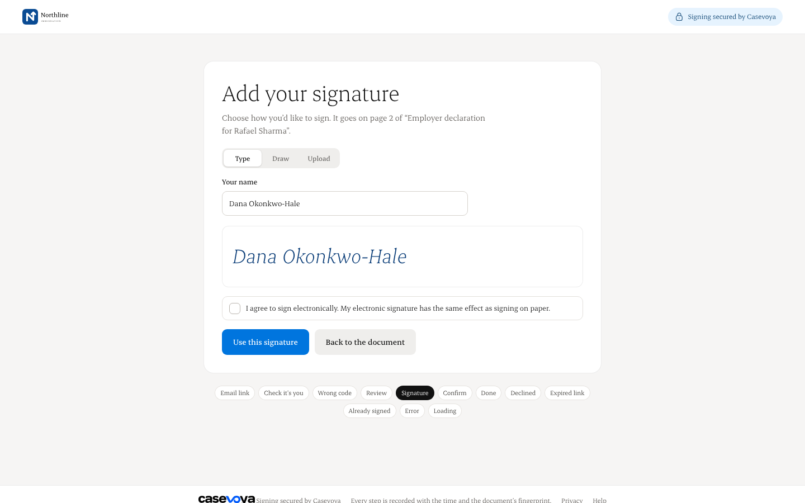

Heading: **Add your signature.** Three modes, in a segmented control: **Type**, **Draw**, **Upload**.

- **Type:** the name field, prefilled with the attendee’s name. The preview is that name in Erode italic.
- **Draw:** a canvas with a pointer, finger, or stylus, and **Clear**. An empty canvas is an inline error: **Draw your signature first.**
- **Upload:** PNG or JPEG. Reject anything else, and reject a file over 1.5 MB (engineering default, pending Francis). Inline error on rejection.

Consent, required before **Use this signature**, using the consent text and version already returned by `app.esign_consent()` (the product setting the current page shows). The prototype’s shorter sentence is not a new consent version. Unticked: inline **Tick the box to agree to sign electronically.**

**Back to the document** returns to review without storing a signature.

**Use this signature** continues to confirm. Typed stores the name as `signed_name` and `signature_kind = typed`. Drawn and uploaded store the same signer name plus the image (`signature_kind` `drawn` or `uploaded`) and show that image on the confirm card. The image is on the agreement row, readable by scheduling staff, and is not a public URL.

### Confirm — `?state=confirm`

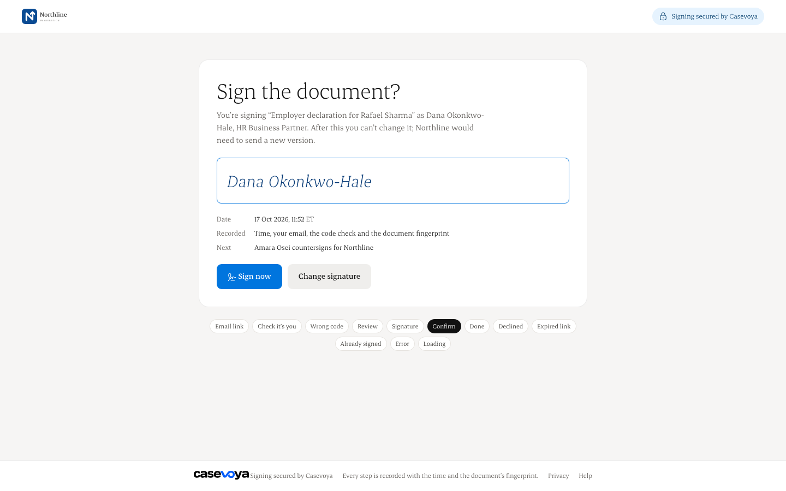

Heading: **Sign the document?** Lead: they are signing `{title}` as `{name}`. After this they can’t change it; the firm would send a new agreement. Show the mark, the time in the attendee’s zone, and that the record includes the time, the email, the code check, and the document fingerprint. **Sign now** calls `sign_booking_agreement` (extended for the signature kind and image). The hash must still be the one shown. **Change signature** returns to the signature step.

### Done — `?state=done`

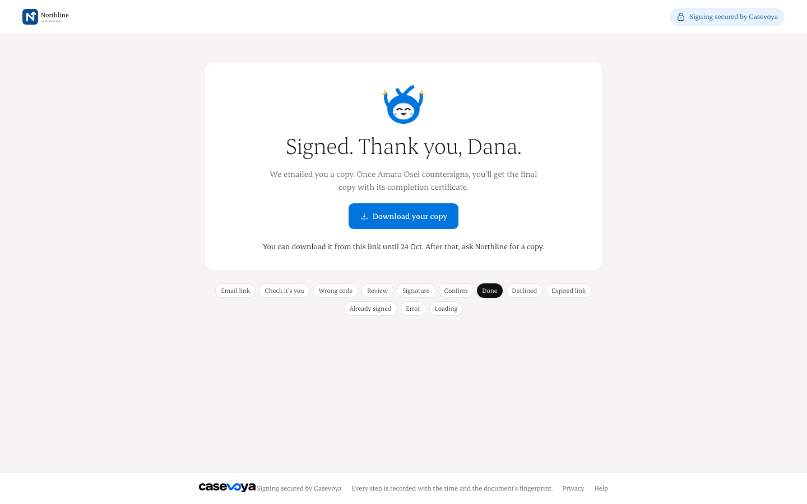

Receipt card, centered: **Signed. Thank you, {first name}.** Who signed, when, the firm, and the fingerprint. **{Firm} has the signed agreement. You can close this page.** No download button and no line about a second person countersigning. The prototype’s certificate button belongs to the employer-letter demo.

### Decline and declined — dialog, then `?state=declined`

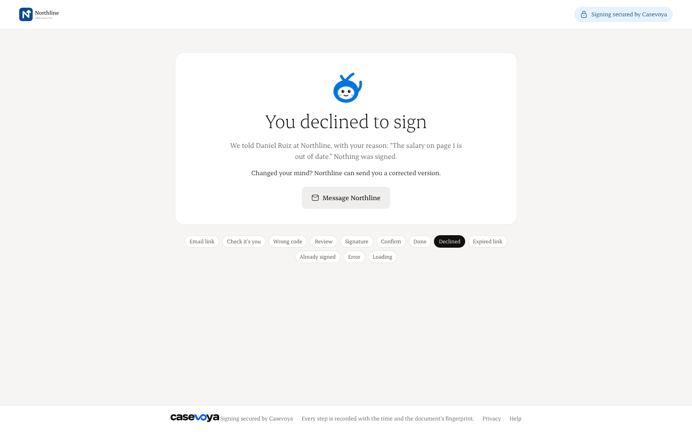

Dialog title: **Decline to sign?** Body: **{Firm} will be told you declined, with your reason. The agreement won’t be signed.** Label: **Reason ({firm} sees this).** Buttons: **Keep reviewing** and **Decline**.

The reason is required (1–500 characters) and stored. Status becomes `declined`, with `declined_at`. The live unique index stays on `sent` and `signed`, so a later send still works. Audit `booking_agreement.declined`. The public card: **You declined to sign**, the reason they typed, **Nothing was signed**, and that the firm can send a corrected version. **Message {firm}** records an audit the staff record can show; it does not open a new mailbox.

### Expired — `?state=expired`

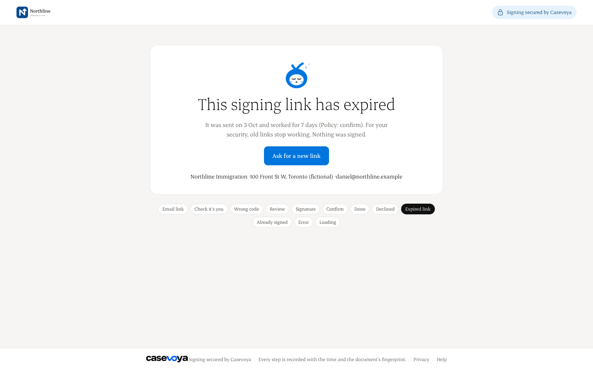

This screen is the current `closed` result: the consultation was cancelled or the booking expired. Heading: **This signing link no longer works.** Body: the consultation was cancelled or has ended, nothing was signed, and they should contact the firm. **Ask for a new link** records an audit `booking_agreement.link_requested` and confirms inline. Do not add a 7-day life. The staff note says the link works until they sign or the firm voids it. The prototype’s “worked for 7 days (Policy: confirm)” is not a product rule. Do not print a staff person’s email address on this page.

### Withdrawn

The prototype has no `?state=` for this and no screenshot. When the latest agreement is `voided` and none is `sent` or `signed`, the public read returns `withdrawn`. Same card family as expired: heading **This agreement was withdrawn.** Body: **{Firm} withdrew this agreement. Nothing was signed.** The link does not show the text, the hash, the staff reason, or who voided it. `sign_booking_agreement` keeps refusing it.

### Already signed — `?state=signed`

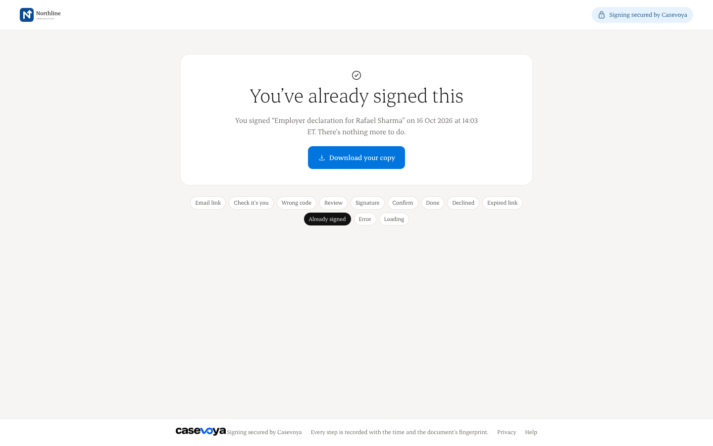

Receipt card: **You’ve already signed this.** The title, the signed time in the attendee’s zone, the fingerprint, and that there is nothing more to do. Show the typed name, or the drawn or uploaded mark, from the stored signature. No download control.

### Error and loading

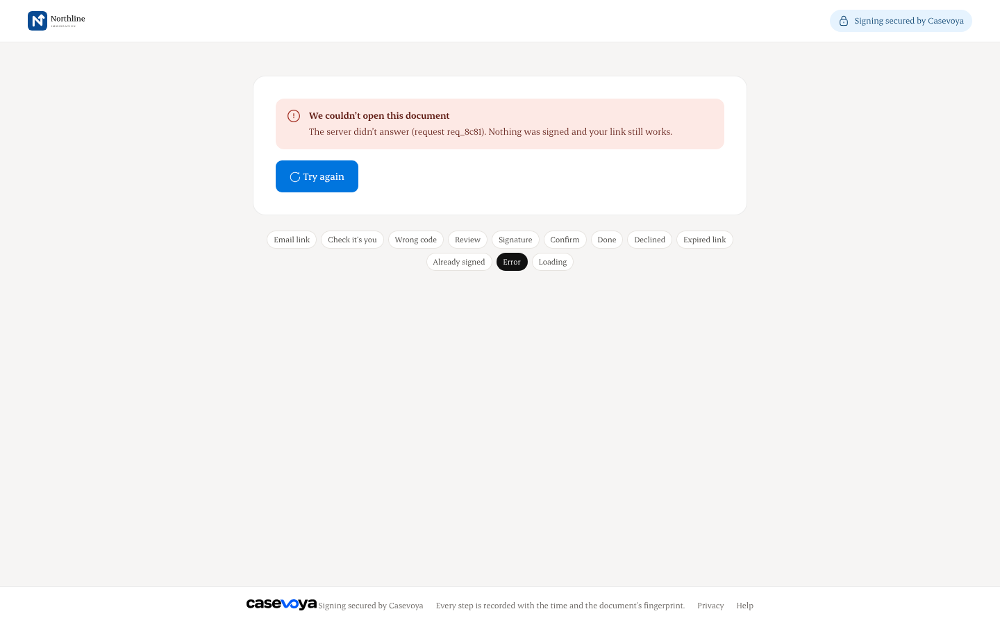

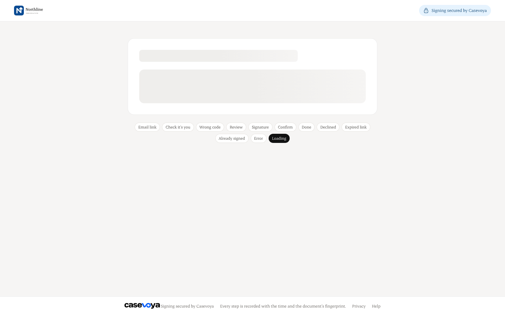

**Error:** an alert, **We couldn’t open this document**, that nothing was signed and the link still works, and **Try again**. The prototype’s request id is optional; omit it when the server has no id to show.

**Loading:** the skeleton, `role="status"`, `aria-busy="true"`, and the screen-reader text **Opening the document…**

## 5. Database

Additive migration. Staff who can already `select` `booking_agreements` can read the new columns. Anonymous roles still cannot `select` the table. Public reads and writes stay on security-definer functions with `search_path` pinned.

**First opened.** `booking_agreements.opened_at timestamptz`, null until the first successful view of a `sent` agreement through the private link. A definer `note_booking_agreement_opened(ref)` sets it only where it is null and the status is `sent`. The stable read function stays a read. Later opens do not move the timestamp. Staff views of the record do not call it. The record shows **Not yet** or that time.

**Reminder.** `remind_booking_agreement(booking_id)` for the same scheduling staff as void, and only while the agreement is `sent` and the consultation is still upcoming (the same status check as send). It queues another EM08 (`booking_agreement.sent`) to the primary attendee. The original idempotency key is one per agreement, so the reminder uses its own key, `booking-agreement-remind:<agreement_id>:<utc timestamp>`. It does not insert a second agreement row. Audit `booking_agreement.reminded`. The worker’s existing rules still apply: unsigned, consultation ahead, email notices on. When notices are off, the action returns a sentence the button can show (**Email notices are off for this client**) and does not claim the message was sent.

**Void reason and who voided.** Already stored, and already readable by scheduling staff. The work is the loader and the panel in section 3, plus passing the dialog’s reason into the existing function. Do not add a second reason column. The public read continues to omit them.

**Decline.** Extend the status check with `declined`. Add `declined_at` and `decline_reason`. A `declined` row requires both. `sign_booking_agreement` refuses it.

**Code.** A child table `booking_agreement_codes`: agreement id, organization id, `code_sha256`, `expires_at`, `attempts`, `created_at`. Forced RLS, no policies for `anon` or `authenticated` select, foreign keys indexed. A new code row is the one that verifies; older rows for that agreement no longer match. Attempts increment on a wrong guess.

**Signature.** `signature_kind text` constrained to `typed`, `drawn`, `uploaded`, null until signed. `signature_image bytea` null for `typed`, required for the other two, `octet_length` at most 1.5 MB, and a PNG or JPEG header. Extend `sign_booking_agreement` so the hash and consent checks stay, and so a drawn or uploaded signature stores the image in the same update as `signed_name`.

`booking_agreement_for_signing` gains `withdrawn` and `declined` (the public declined card). `unavailable` remains the answer for a bad ref or a booking with no agreement. The withdrawn and declined payloads include the firm name and the sentence in section 4, and omit the body and the hash.

## 6. Acceptance

Desktop 1440 and 390px screenshots of every live state, in the implementation PR:

- Record: sent (opened “Not yet”, and opened with a time), void dialog (empty reason refused, reason kept), voided, declined, signed.
- Signing: landing, verify, wrong code, review, sign (type, draw, upload, consent unticked), confirm, done, decline dialog, declined, expired, withdrawn, already signed, error, loading.

Tests, beside the booking-agreement tests that already exist (`tests/booking-agreements.test.tsx`, `tests/booking-agreements.rls.test.ts`, and the present-function tests for `recordAgreement`):

- Sent panel: chip, sent row with email, opened **Not yet** and with a time, the private-link note, Copy, Remind, Void.
- Void dialog: short reason stays inline; a valid reason is what the RPC receives. The second-click arm is gone.
- Voided panel: not **None sent**; struck-through sent date; who; when; reason; send button. Upcoming column reads **Voided**.
- `opened_at` set once on the public view of a `sent` agreement, unchanged on a second view, unset when staff only open the record. Staff can select it. `anon` cannot select the table.
- Reminder: one new outbox row, no second agreement, refused when the agreement is signed, voided, or declined. Idempotency key differs from `booking-agreement-email:<id>`.
- Each public state renders its heading. Withdrawn and declined responses omit the body, the hash, and the staff void reason. Wrong-code and unticked-consent errors are inline. Signing forms carry `data-live="1"`. Sign still requires consent and the displayed hash.
- A declined row stays readable by staff and is not a live agreement, so send works again.

## Screenshot index

Real icons, 1440×900, in `design/consultations-pr161/shots-real-icons/`:

| File | State |
|---|---|
| `cshot2-record-sent.png` | Record, sent |
| `cshot2-voiddlg.png` | Void dialog |
| `cshot2-record-voided.png` | Record, voided |
| `esign-landing.png` | Landing |
| `esign-verify.png` | Email code |
| `esign-review.png` | Review |
| `esign-sign.png` | Signature |
| `esign-confirm.png` | Confirm |
| `esign-done.png` | Done |
| `esign-declined.png` | Declined |
| `esign-expired.png` | Expired |
| `esign-signed.png` | Already signed |
| `esign-error.png` | Error |
| `esign-loading.png` | Loading |

`cshot2-consultations.png` and `cshot2-agreements.png` are the consultations list and the agreements page with the same icons. They are context. This spec does not change those pages except the Agreement column on the consultations list.

Earlier set, `design/consultations-pr161/shots/`: the 390px record shots (`consultations-record-sent-390.png`, `consultations-record-voided-390.png`, `consultations-record-signed-390.png`), the signed record at 1440 (`consultations-tab-record-ag-signed.png`), and the wrong-code shot (`index-state-verify-error.png`). The signing page has no 390px shot in the pack. Build that width from the breakpoints in `app-v2/esign/index.html` (`max-width: 1000px` and `640px`). Withdrawn has no shot; section 4 is the copy.
